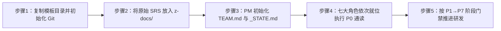

# 00 团队项目模板使用与全员就位指南（开发工具无关版）

> **多人协作前置规则（复制提示词时一并加载）**：先按 AGENTS.md 声明 user_id、actor_id、role_id、task_id、lane_id；同角色多人各用独立分支/worktree，先领取不相交的文件与资源。自己的文档和代码在自检提交后分别冻结；任何冻结修改（含兼容变化、格式化）先有明确接口/功能干涉依据及真人批准，批准可指定其他用户/角色接手，无需原角色回来。冻结单据的回复另建记录。所有新文档放 z-readme/ 并使用目录序号或唯一任务/人员标识；固定示例名是内容类型，不是免除命名要求。运行锁以共享协调中心为准，Markdown 摘要不作为锁。具体命令见 `z-readme/08_冻结并行开发与Git合并操作手册.md`。

> **模板目标**：每次启动一个新的大型软件研发项目时，直接将本模板文件夹 `_templete_project_team` 完整复制为新项目目录，放入唯一输入——原始《需求规格说明书（SRS）》，即可让 **PM、PO、AR、BE、FE、QA、OPS（及可选 AI）** 七大技术岗位角色（真人、AI 代理或混合团队）立即按标准化目录、标准化文档链、标准化协作单据就位并协同开发，直至系统上线交付。

---

## 1. 适用工具与三种团队组织模式

本模板**完全解耦特定 AI 编程工具与大模型**，通过根级 `AGENTS.md` + `.agents/roles/<ROLE>.md` + `.agents/workflows/<ACTION>.md` + `z-readme/collab/` 协作单据实现跨工具统一治理。

### 1.1 主流 AI 开发工具就位方式对照表

| 工具名称                        | 根宪法 `AGENTS.md` 生效方式        | 岗位角色卡 `.agents/roles/<ROLE>.md` 加载方式                                        | 标准动作 `.agents/workflows/` 触发方式                |
| ------------------------------- | ---------------------------------- | ------------------------------------------------------------------------------------ | ----------------------------------------------------- |
| **Cursor**                      | 自动识别或通过 `.cursorrules` 引用 | 在 Composer / Agent 对话首句输入 `@.agents/roles/BE.md 我是本项目 BE`                | 输入 `@.agents/workflows/inbox.md` 或配置为 Rule      |
| **Codex CLI / Claude Code**     | 启动时自动读取根目录 `AGENTS.md`   | 会话首句：`请读取并严格扮演 .agents/roles/AR.md 中的角色`                            | 会话中输入 `按 .agents/workflows/handoff.md 执行`     |
| **Antigravity**                 | 自动作为 Workspace Rule 加载       | 会话首句声明：`我是本项目 PO，先读 .agents/roles/PO.md 并按 workflows/inbox.md 开场` | 直接引用 `.agents/workflows/<动作>.md`                |
| **Qoder / Windsurf / Cline**    | 自动或通过 Workspace Rules 绑定    | 将对应岗位 `.agents/roles/<ROLE>.md` 设为当前会话 Role / Custom Instruction          | 将 `.agents/workflows/` 注册为自定义 Workflow / 命令  |
| **OpenCode / Aider 等终端工具** | 自动读取 `AGENTS.md`               | 将 `.agents/roles/*.md` 映射为各 agent 配置文件或开场直接读取                        | 将 `.agents/workflows/*.md` 映射为 `/inbox` 等命令    |
| **网页端对话大模型（通用）**    | 作为首个附件上传                   | 上传对应岗位 `.agents/roles/<ROLE>.md` 与当前任务输入文档                            | 复制 `z-readme/05_分阶段分角色提示词总手册.md` 提示词 |

### 1.2 三种团队组织模式

| 组织模式           | 运作方式                                                                                                                      | 适用场景                    |
| ------------------ | ----------------------------------------------------------------------------------------------------------------------------- | --------------------------- |
| **真人多角色团队** | 每位工程师负责 1 个角色，在各自电脑/分支/worktree 启动自己的 AI 编程工具并加载对应角色卡，通过 Git 与 `z-readme/collab/` 协作 | 3–10 人正式研发团队（推荐） |
| **一人多角色轮转** | 1 名工程师按阶段与任务流转顺序依次切换角色；**每次切换角色必须新开独立会话**，严禁单会话串角                                  | 独立承接大项目、原型攻关    |
| **人机混合编组**   | 真人担任 PM、PO、AR 把握方向与审批，BE、FE、QA、OPS 由独立 AI 会话并行执行，真人负责代码点检、环境操作与签字                  | 2–3 人精干敏捷小组          |

---

## 2. 新项目复制后的“五步点火流程”



### 步骤 1：复制模板并初始化仓库

1. 将 `_templete_project_team` 复制为新项目目录（例如 `D:\Projects‚6_ProjectName`）。
2. 初始化 Git 主干与集成分支（由 AR 或 PM 真人执行）：
   ```powershell
   git init
   git symbolic-ref HEAD refs/heads/main
   git add -- AGENTS.md _STATE.md _TASKLISTS.md _STATE_HISTORY.md _CHECKLISTS.md .agents .gitignore readme.md z-readme z-scripts server web mobile ai tests deploy .ci z-docs z-resource z-prototype z-temps z-logs
   git commit -m "[AR][T000][admin] chore: 初始化团队项目模板基线"
   git checkout -b develop
   ```

### 步骤 2：放入唯一输入——原始需求文档

1. 将客户/业务方提供的原始《需求规格说明书（SRS）》、外部接口文档、业务表单样本放入 `z-docs/` 目录（如 `z-docs/SRS_原始需求规格说明书.md`）。
2. 若需要将原始需求同步拷贝一份作为 `z-readme/SRS.md` 供索引引用，由 PO 在 P0/P1 阶段按 `z-readme/05_分阶段分角色提示词总手册.md` 中的基线提示词生成或复制；**`z-docs/` 下的原始文件永久保持只读**。

### 步骤 3：PM 就位并登记团队章程（P0 第一棒）

1. 打开你的 AI 开发工具，启动一个**PM 会话**，发送以下通用就位指令：
   ```text
   我是本项目的项目经理（PM）。请先阅读：AGENTS.md、.agents/roles/PM.md、z-readme/00_团队项目模板使用与全员就位指南.md、
   以及 z-docs/ 下的原始需求文档前两章。然后按 z-readme/05_分阶段分角色提示词总手册.md 中的【PM-01】与【PM-02】，
   初始化 z-readme/collab/00_团队成员与职责.md、z-readme/collab/02_协作看板模板.md、z-readme/collab/03_风险登记模板.md、z-readme/11_开发计划模板.md（阶段里程碑）并更新 _STATE.md。
   ```

### 步骤 4：AR、PO、BE、FE、QA、OPS 依次就位（P0 其余各棒）

每个角色各自开启**独立会话**，使用统一开场白后执行对应 P0 提示词：

| 就位顺序 | 角色  | 首句加载角色卡         | 执行提示词       | P0 阶段核心产出文件                                                                  |
| -------- | ----- | ---------------------- | ---------------- | ------------------------------------------------------------------------------------ |
| 1        | `PM`  | `.agents/roles/PM.md`  | `PM-01`、`PM-02` | `z-readme/collab/00_团队成员与职责.md`、`BOARD.md`、`RISKS.md`、`meetings/启动会.md` |
| 2        | `AR`  | `.agents/roles/AR.md`  | `AR-01`、`AR-02` | `AGENTS.md`（项目化微调）、`z-readme/collab/01_文件归属与评审矩阵.md` 初版           |
| 3        | `PO`  | `.agents/roles/PO.md`  | `PO-01`          | `z-readme/analysis/00-PO需求通读笔记.md`                                             |
| 4        | `BE`  | `.agents/roles/BE.md`  | `BE-01`          | `z-readme/collab/notes/BE-需求通读笔记.md`                                           |
| 5        | `FE`  | `.agents/roles/FE.md`  | `FE-01`          | `z-readme/collab/notes/FE-需求通读笔记.md`                                           |
| 6        | `QA`  | `.agents/roles/QA.md`  | `QA-01`          | `z-readme/collab/notes/QA-需求通读笔记.md`                                           |
| 7        | `OPS` | `.agents/roles/OPS.md` | `OPS-01`         | `z-readme/collab/notes/OPS-需求通读笔记.md`                                          |

### 步骤 5：运行项目规范自检脚本

任何阶段结束或会话收尾前，均可运行内置脚本一键对齐全部 Markdown 表格并校验目录、单据与编号规范：

```powershell
py -3.11 z-scripts/validate_project.py --align --files <本泳道已领取的文件>
```

---

## 3. 本模板内置的六大核心规范文档导航

| 编号 | 文档路径                                            | 面向对象 | 核心解决的问题                                                                    |
| ---- | --------------------------------------------------- | -------- | --------------------------------------------------------------------------------- |
| `00` | `z-readme/00_团队项目模板使用与全员就位指南.md`     | 全体     | 复制模板后如何 5 步点火、不同 AI 工具如何加载角色卡、每日如何开工收尾             |
| `01` | `z-readme/01_大项目全技术规范与架构文档内容规范.md` | 全体     | 从 SRS 到交付全链路 25+ 份技术文档的**标准章节结构、必填表头、ID 追溯与合格标准** |
| `02` | `z-readme/02_各岗位角色项目文件夹与工作空间规范.md` | 全体     | PM/PO/AR/BE/FE/QA/OPS/AI 每个岗位的专属目录树、读写边界、分支与泳道规范           |
| `03` | `z-readme/03_项目沟通任务流转与接口对接规范.md`     | 全体     | 四类协作单据、八阶段门禁、契约先行与变更分级、测试准入与缺陷闭环、运维部署闭环    |
| `04` | `z-readme/04_跨AI开发工具通用适配指南.md`           | 全体     | Cursor / Codex / Qoder / Antigravity / Windsurf / Cline / OpenCode 具体配置映射   |
| `05` | `z-readme/05_分阶段分角色提示词总手册.md`           | 全体     | 工具无关的 P0–P7 全阶段 × 八角色全部专用提示词（含基线生成与 40+ 任务卡模板）     |
| `06` | `z-readme/06_各岗位角色提示词实操演练全流程手册.md` | 全体     | 以真实业务闭环为例，手把手演示 8 大角色 18 个接力会话的开场、提示词、产出与收尾   |

---

## 4. 每次会话的标准开场与收尾模板（直接复制使用）

### 4.1 通用会话开场提示词（对应 `.agents/workflows/inbox.md`）

```text
我是本项目的 {角色名称，如：后端开发工程师 BE}。
请先依次阅读：
1. AGENTS.md（项目最高宪法）
2. .agents/roles/{角色编码，如 BE}.md（本岗位专属准则与可写路径）
3. _STATE.md、_TASKLISTS.md、z-readme/12_进度看板模板.md、z-readme/collab/02_协作看板模板.md 中与 {角色编码} 相关的条目
4. z-readme/lanes/ 下当前活跃泳道

请先不要修改任何文件，向我汇报：
① 指派给我的待处理阻塞项、缺陷单/问题单（IS）、评审单（RV）、交接单（HO）、变更单（CR）；
② 我当前进行中或下一项前置条件已满足的任务；
③ 本次会话建议优先处理的事项及拟写入的文件路径（核对均在我角色 OWNERS 范围内且不与活跃泳道冲突）。
```

### 4.2 通用会话收尾提示词（对应 `.agents/workflows/wrapup.md`）

```text
请执行本次 {角色编码} 会话收尾：
1. 防串角核查：列出本次会话新增或修改的全部文件路径，逐一核对是否属于 z-readme/collab/01_文件归属与评审矩阵.md 中 {角色编码} 拥有的范围；
2. 需要移交下游角色的工作，按模板在 z-readme/collab/handoff/ 创建交接单 HO-xxx；
3. 发现他人工件的问题或歧义，按模板在 z-readme/collab/issues/ 创建问题单 IS-xxx（绝不直接改他人文件）；
4. 更新 z-readme/collab/02_协作看板模板.md 中我负责条目的状态与 z-readme/lanes/ 下我的泳道状态，释放我持有的租约；
5. 给出显式路径的 git add 命令与符合 `[<ROLE>][<TASK>][<USER>] <type>: <中文说明>` 规范的提交信息（不自动执行提交）。
```
