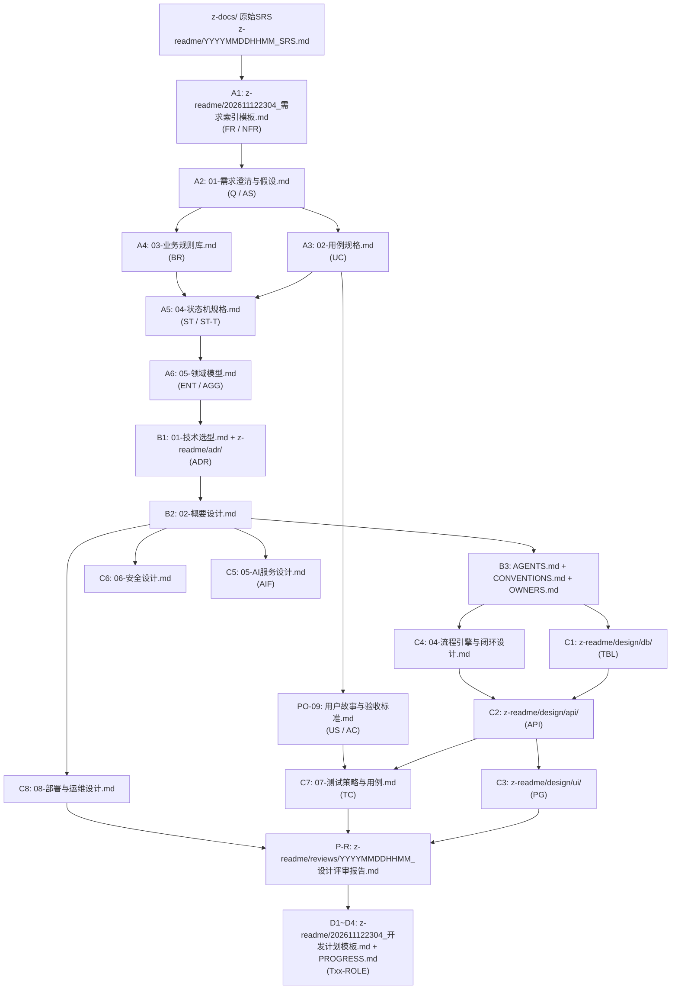

# 01 大项目全技术规范与架构文档内容规范

> **多人协作前置规则（复制提示词时一并加载）**：先按 AGENTS.md 声明 user_id、actor_id、role_id、task_id、lane_id；同角色多人各用独立分支/worktree，先领取不相交的文件与资源。自己的文档和代码在自检提交后分别冻结；任何冻结修改（含兼容变化、格式化）先有明确接口/功能干涉依据及真人批准，批准可指定其他用户/角色接手，无需原角色回来。冻结单据的回复另建记录。所有新文档放 z-readme/ 并使用时间戳与人员标识；固定示例名是内容类型，不是免除命名要求。运行锁以共享协调中心为准，Markdown 摘要不作为锁。具体命令见 `z-readme/202611122304_冻结并行开发与Git合并操作手册.md`。

> **定位**：本文档规定大型软件项目从《原始需求规格说明书（SRS）》出发，到最终系统上线交付全过程必须产出的 **7 大阶段、26 类核心技术与管理文档** 的**存放路径、唯一责任角色、必需评审角色、强制章节结构、必填表格字段、全局编号体系与质量合格标准（DoD）**。
> 任何角色代理生成或修订技术文档时，必须以本文档定义的目录与章节骨架为刚性标准，严禁遗漏关键章节或用空洞套话替代实质设计。

---

## 1. 全局文档演进链路与唯一编号体系

### 1.1 文档演进依赖总图

### 1.2 全局唯一编号与双向追溯规范

所有文档与源码注释必须使用下表规定的标准前缀，保证**向上可溯源至原始需求，向下可追踪至代码、测试与部署**：

| 编号前缀   | 含义                 | 格式示例       | 定义所在权威文档                                         | 下游必须引用该编号的工件                          |
| ---------- | -------------------- | -------------- | -------------------------------------------------------- | ------------------------------------------------- |
| `FR-`      | 功能性原始需求条款   | `FR-WO-001`    | `z-readme/202611122304_需求索引模板.md`                  | `UC`、`BR`、`US`、`PLAN` 需求覆盖矩阵、`测试报告` |
| `NFR-`     | 非功能性需求条款     | `NFR-PERF-001` | `z-readme/202611122304_需求索引模板.md`                  | `02-概要设计`、`06-安全`、`07-测试`、`08-部署`    |
| `Q-`       | 需求待澄清问题       | `Q-001`        | `z-readme/analysis/YYYYMMDDHHMM_01-需求澄清与假设.md`    | `UC`、`BR`、`ST`（引用已确认决议）                |
| `AS-`      | 工程与业务假设       | `AS-001`       | `z-readme/analysis/YYYYMMDDHHMM_01-需求澄清与假设.md`    | `02-概要设计`、`RISKS.md`                         |
| `UC-`      | 业务用例             | `UC-WO-001`    | `z-readme/analysis/YYYYMMDDHHMM_02-用例规格.md`          | `API`、`PG`、`US`、`TC`                           |
| `BR-`      | 业务规则             | `BR-RET-001`   | `z-readme/analysis/YYYYMMDDHHMM_03-业务规则库.md`        | `API`、`PG`、后端 Service 注释、`TC`              |
| `ST-`      | 状态机与转换编号     | `ST-WO-T05`    | `z-readme/analysis/YYYYMMDDHHMM_04-状态机规格.md`        | `04-闭环设计`、状态机实现类注释、`TC`             |
| `ENT-`     | 领域实体 / 聚合根    | `ENT-WO-001`   | `z-readme/analysis/YYYYMMDDHHMM_05-领域模型.md`          | `TBL`、后端领域实体类                             |
| `ADR-`     | 架构决策记录         | `ADR-001`      | `z-readme/adr/YYYYMMDDHHMM_ADR-001-*.md`                 | `02-概要设计`、`CONVENTIONS.md`、`08-部署`        |
| `TBL-`     | 数据库表             | `TBL-WO-MAIN`  | `z-readme/design/db/YYYYMMDDHHMM_<模块>.md`              | Flyway 迁移脚本、`API`、Mapper/Entity             |
| `API-`     | 接口契约条目         | `API-WO-003`   | `z-readme/design/api/YYYYMMDDHHMM_<模块>.md`             | Controller 注释、前端 `src/api/`、Mock、`TC`      |
| `PG-`      | 前端页面 / 弹窗规格  | `PG-WO-002`    | `z-readme/design/ui/YYYYMMDDHHMM_<模块>.md`              | 前端路由与视图组件、E2E 页面对象、`US`            |
| `AIF-`     | AI 辅助业务功能点    | `AIF-001`      | `z-readme/design/YYYYMMDDHHMM_05-AI服务设计.md`          | `ai/` 服务路由与提示词模板、`API`、`TC`           |
| `US-`      | 用户故事             | `US-WO-001`    | `z-readme/acceptance/YYYYMMDDHHMM_用户故事与验收标准.md` | `PLAN.md` 任务卡、`验收记录.md`                   |
| `AC-`      | 验收标准条目         | `AC-WO-001-01` | `z-readme/acceptance/YYYYMMDDHHMM_用户故事与验收标准.md` | `TC`、`验收记录.md`                               |
| `TC-`      | 测试用例             | `TC-WO-001`    | `z-readme/design/YYYYMMDDHHMM_07-测试策略与用例.md`      | `tests/`、`web/e2e/`、迭代执行记录                |
| `Txx-ROLE` | 迭代任务卡与角色子卡 | `T21-BE`       | `z-readme/202611122304_开发计划模板.md`                  | Git 分支名、提交信息、泳道文件、`PROGRESS.md`     |

---

## 2. 全套技术与管理文档总览表

| 阶段 | 文档编号 | 标准存放路径                                                                                                  | 拥有角色 | 必需评审角色            | 冻结门禁          |
| ---- | -------- | ------------------------------------------------------------------------------------------------------------- | -------- | ----------------------- | ----------------- |
| 基线 | `DOC-00` | `z-docs/SRS_*.md`（及 `z-readme/YYYYMMDDHHMM_SRS.md`）                                                        | PO       | PM、AR                  | P0 启动前         |
| P1   | `DOC-01` | `z-readme/202611122304_需求索引模板.md`                                                                       | PO       | AR、QA                  | P1 需求基线关卡   |
| P1   | `DOC-02` | `z-readme/analysis/YYYYMMDDHHMM_01-需求澄清与假设.md`                                                         | PO       | AR、BE、FE、QA、OPS     | P1 需求基线关卡   |
| P1   | `DOC-03` | `z-readme/analysis/YYYYMMDDHHMM_02-用例规格.md`                                                               | PO       | FE、BE、QA              | P1 需求基线关卡   |
| P1   | `DOC-04` | `z-readme/analysis/YYYYMMDDHHMM_03-业务规则库.md`                                                             | PO       | BE、QA                  | P1 需求基线关卡   |
| P1   | `DOC-05` | `z-readme/analysis/YYYYMMDDHHMM_04-状态机规格.md`                                                             | PO       | AR、BE、QA              | P1 需求基线关卡   |
| P1   | `DOC-06` | `z-readme/analysis/YYYYMMDDHHMM_05-领域模型.md`                                                               | AR       | PO、BE                  | P1 需求基线关卡   |
| P2   | `DOC-07` | `z-readme/architecture/YYYYMMDDHHMM_01-技术选型.md` + `adr/`                                                  | AR       | BE、FE、QA、OPS、AI     | P2 架构基线关卡   |
| P2   | `DOC-08` | `z-readme/architecture/YYYYMMDDHHMM_02-概要设计.md`                                                           | AR       | PO、BE、FE、OPS         | P2 架构基线关卡   |
| P2   | `DOC-09` | `z-readme/architecture/YYYYMMDDHHMM_CONVENTIONS.md`                                                           | AR       | BE、FE、QA、OPS         | P2 架构基线关卡   |
| P2   | `DOC-10` | `z-readme/collab/202611122304_文件归属与评审矩阵.md`                                                          | AR       | PM、全体确认            | P2 架构基线关卡   |
| P3   | `DOC-11` | `z-readme/design/db/YYYYMMDDHHMM_00-数据库总体设计.md` 等                                                     | BE       | AR、OPS                 | P3 设计基线关卡   |
| P3   | `DOC-12` | `z-readme/design/api/YYYYMMDDHHMM_00-接口规范.md` 及各模块                                                    | BE       | FE、AR、QA              | P3 契约冻结门禁   |
| P3   | `DOC-13` | `z-readme/design/ui/YYYYMMDDHHMM_00-信息架构.md` 及各模块                                                     | FE       | PO（签字）、AR、QA      | P3 设计基线关卡   |
| P3   | `DOC-14` | `z-readme/design/YYYYMMDDHHMM_04-流程引擎与闭环设计.md`                                                       | AR       | PO、BE、QA              | P3 设计基线关卡   |
| P3   | `DOC-15` | `z-readme/design/YYYYMMDDHHMM_05-AI服务设计.md`                                                               | AI / AR  | PO、BE、FE、QA、OPS     | P3 设计基线关卡   |
| P3   | `DOC-16` | `z-readme/design/YYYYMMDDHHMM_06-安全设计.md`                                                                 | AR       | BE、FE、QA、OPS         | P3 设计基线关卡   |
| P3   | `DOC-17` | `z-readme/acceptance/YYYYMMDDHHMM_用户故事与验收标准.md`                                                      | PO       | QA、FE、BE              | P3 设计基线关卡   |
| P3   | `DOC-18` | `z-readme/design/YYYYMMDDHHMM_07-测试策略与用例.md`                                                           | QA       | PO、AR、BE、FE          | P3 设计基线关卡   |
| P3   | `DOC-19` | `z-readme/test/YYYYMMDDHHMM_测试数据与环境需求.md`                                                            | QA       | OPS、BE                 | P3 设计基线关卡   |
| P3   | `DOC-20` | `z-readme/design/YYYYMMDDHHMM_08-部署与运维设计.md`                                                           | OPS      | AR、QA、BE、FE          | P3 设计基线关卡   |
| P3   | `DOC-21` | `z-readme/reviews/YYYYMMDDHHMM_设计评审报告.md`                                                               | AR       | PM、全体                | P3 出口门禁       |
| P4   | `DOC-22` | `z-readme/202611122304_开发计划模板.md` & `z-readme/202611122304_进度看板模板.md`                             | PM       | PO、AR、BE、FE、QA、OPS | P4 计划基线关卡   |
| P4   | `DOC-23` | `z-readme/test/YYYYMMDDHHMM_测试计划.md`                                                                      | QA       | PM、PO、OPS             | P4 计划基线关卡   |
| P4   | `DOC-24` | `z-readme/ops/YYYYMMDDHHMM_环境与流水线计划.md`                                                               | OPS      | PM、AR、QA              | P4 计划基线关卡   |
| P6/7 | `DOC-25` | `z-readme/test/YYYYMMDDHHMM_系统测试与准出报告*.md`、`z-readme/delivery/YYYYMMDDHHMM_测试报告.md`             | QA       | PM、PO、AR              | P6 发布 / P7 交付 |
| P6/7 | `DOC-26` | `z-readme/ops/YYYYMMDDHHMM_预发布与演练报告*.md`、`z-readme/delivery/YYYYMMDDHHMM_部署手册.md`、`运维手册.md` | OPS      | AR、PM                  | P6 发布 / P7 交付 |

---

## 3. 各阶段核心文档内容规范详解

### 3.1 需求基线与需求分析包（`DOC-00` ~ `DOC-06`）

#### (1) `z-readme/YYYYMMDDHHMM_SRS.md`（若需从粗粒度需求生成完整 SRS 时遵守）
- **章节骨架（12 章完整标准）**：1 引言（目的/范围/术语）→ 2 总体描述（业务背景/核心闭环/技术约束/假设）→ 3 组织、部门、角色与权限体系（组织树/角色清单/功能权限矩阵/数据权限）→ 4 核心业务流转与闭环模型（主状态机/提交—评审—退回补充—通过闭环/SLA 时效）→ 5 功能需求规格（按业务模块逐条 `FR-模块-xxx` 给出：角色、前置条件、输入字段表、处理规则、输出、异常）→ 6 AI 业务分析与智能辅助需求（`AIF-xxx`：触发方式、输入上下文、输出结构、采纳交互、降级策略、安全边界）→ 7 概念数据模型与数据字典 → 8 外部接口与系统集成需求 → 9 非功能需求（`NFR-xxx`：性能/可靠/安全等保/信创/易用/可观测）→ 10 界面与交互规范 → 11 验收标准总则 → 12 附录。

#### (2) `z-readme/202611122304_需求索引模板.md`（需求索引表，PO 拥有）
- **强制表头**：
  - 功能需求索引：`需求编号 FR-xxx | 所属模块 | 需求名称 | 涉及角色 | 优先级(P0/P1/P2) | SRS 章节与行号 | 状态(首期实现/Mock/后置)`
  - 非功能需求索引：`编号 NFR-xxx | 类别(性能/可用/安全/兼容/可观测) | 量化指标描述 | 验证方式(压测/安全扫描/演练/审查) | SRS 章节`
  - 字典与枚举索引：`字典编码 | 字典名称 | 枚举值清单 | 引用模块`
- **合格标准**：SRS 中每一条可独立验收的需求均已分配唯一编号，无遗漏、无重号。

#### (3) `z-readme/analysis/YYYYMMDDHHMM_01-需求澄清与假设.md`（PO 拥有）
- **强制章节**：1 范围界定表（首期实现 / 接口 Mock / 二期后置）→ 2 合并澄清问题总表（汇总 PO/BE/FE/QA/OPS 通读笔记）→ 3 工程与业务假设清单（`AS-xxx`）→ 4 非功能需求量化补充表 → 5 澄清会决议回填区。
- **澄清问题表头**：`问题编号 Q-xxx | 提出角色 | 关联 FR/NFR | 问题描述与歧义点 | 备选方案 A/B | 建议方案 | 决策归属(业务方/PO/AR) | 最终决议 | 决策人与日期`

#### (4) `z-readme/analysis/YYYYMMDDHHMM_02-用例规格.md`（PO 拥有）
- **每个用例 `UC-模块-xxx` 必填结构**：
  - 基本信息表：`用例编号 | 用例名称 | 关联 FR | 主执行者 | 参与角色 | 触发条件 | 前置条件 | 成功保证（后置条件） | 优先级`
  - 主成功场景（编号步骤 1..N，每步写明“用户动作”或“系统响应与校验”）
  - 扩展/异常流程（如 `3a. 字段校验不通过`、`4a. 并发已被他人处理`、`5a. 退回次数已达上限`）
  - 业务规则引用（`BR-xxx`）与界面要求提示。

#### (5) `z-readme/analysis/YYYYMMDDHHMM_03-业务规则库.md`（PO 拥有）
- **强制表头**：`规则编号 BR-模块-xxx | 规则名称 | 规则类别(校验/计算/流转/权限/时效/通知/AI) | 触发时机 | 精确规则表达式（IF 条件 THEN 动作 ELSE 错误码与提示语） | 可配置参数与默认值 | 关联 FR/UC | 可测试断言说明`
- **禁令**：严禁出现“视情况而定”“适当提示”等不可写成代码 `if/else` 与测试 `assert` 的描述。

#### (6) `z-readme/analysis/YYYYMMDDHHMM_04-状态机规格.md`（PO 拥有）
- **强制内容**：
  1. 主对象与子对象状态清单表：`状态编码 | 状态中文名 | 是否初态/终态 | 进入该状态的业务含义 | 允许停留时限(SLA) | 页面可见操作按钮`
  2. Mermaid `stateDiagram-v2` 状态流转图
  3. 状态转换明细表：`转换编号 ST-Txx | 源状态 | 触发事件 | 操作角色 | 守卫条件(引用 BR-xxx) | 目标状态 | 转换副作用(写历史/发通知/启停计时器/释放锁)`
  4. **状态 × 事件全矩阵**（行=全部状态，列=全部事件；合法单元格填 `ST-Txx`，非法单元格填 `拒绝: 错误码`——**严禁留空单元格**）。

#### (7) `z-readme/analysis/YYYYMMDDHHMM_05-领域模型.md`（AR 拥有）
- **强制内容**：1 限界上下文划分图 → 2 聚合根、实体与值对象清单（`ENT-xxx`）→ 3 Mermaid `classDiagram` / `erDiagram` 领域关系图 → 4 领域事件清单（事件名、触发转换 `ST-Txx`、载荷字段、订阅模块）→ 5 建议的后端工程模块划分草案。

---

### 3.2 架构设计与项目宪法包（`DOC-07` ~ `DOC-10`）

#### (1) `z-readme/architecture/YYYYMMDDHHMM_01-技术选型.md` 与 `z-readme/adr/YYYYMMDDHHMM_ADR-xxx.md`（AR 拥有）
- **选型维度**：后端语言与框架、ORM 与迁移、工作流/状态机引擎、安全与鉴权、缓存、数据库（含信创适配）、对象存储、前端框架与 UI 组件库、移动端方案、图表与设计器库、AI 服务框架与向量库、接口/E2E/性能测试工具、容器与 CI/CD、监控与日志。
- **每篇 ADR 强制结构**：`标题 | 状态(提议/已接受/已废弃) | 决策日期 | 背景与问题 | 候选方案对比表(成熟度/信创兼容/AI代码生成友好度/运维成本) | 决策结论 | 正向收益与负面代价/规避措施`。

#### (2) `z-readme/architecture/YYYYMMDDHHMM_02-概要设计.md`（AR 拥有）
- **强制章节**：1 系统上下文图（与外部系统边界）→ 2 容器与分层架构图 → 3 模块划分与岗位归属表（模块名 | 职责 | 拥有角色 | 依赖模块）→ 4 核心跨切面机制（认证鉴权、数据权限、统一异常与错误码、分布式锁与幂等、审计日志、异步事件、时间服务注入）→ 5 外部系统适配与 Mock 切换机制 → 6 部署拓扑概要视图（对齐 OPS）→ 7 NFR 架构保障映射表。

#### (3) `z-readme/architecture/YYYYMMDDHHMM_CONVENTIONS.md`（编码与工程规范，AR 拥有）
- **强制包含**：
  - 后端：包结构（`controller / service / domain / mapper / dto / config`）、类与方法命名、统一响应体 `Result<T>{code, message, data, traceId}`、全局错误码分段表、权限注解与数据权限注解规范、Flyway 脚本命名规范（`V1_0_xx__Txx_description.sql`）、禁止写法清单；
  - 前端：目录结构、组件与路由命名、`request.ts` 统一拦截、Pinia 状态约定、`v-perm` 按钮权限指令、表单校验规范、**`data-testid="<page>-<element>-<action>"` 强制命名约定**（供 QA E2E 使用）；
  - AI 服务：目录结构、提示词模板版本管理、Pydantic Schema 校验、脱敏拦截器、假模型桩切换开关；
  - Git 与测试：分支命名、提交信息格式、单元测试命名与最低覆盖率指标。

---

### 3.3 详细设计包（`DOC-11` ~ `DOC-21`）

#### (1) 数据库详细设计 `z-readme/design/db/`（BE 拥有）
- `00-数据库总体设计.md`：数据库选型与字符集、命名规范、通用审计字段（`id, created_by, created_at, updated_by, updated_at, deleted, version`）、主键与乐观锁策略、软删除策略、索引设计原则、分表/归档策略、全量表总览清单（`TBL-xxx`）。
- `<模块>.md`（每张表必填）：
  - 表头信息：`表编号 TBL-xxx | 表名 | 中文名 | 对应领域实体 ENT-xxx | 预估年数据量 | 数据权限过滤字段`
  - 字段表：`序号 | 字段名 | 类型与长度 | 必填 | 默认值 | 主外键/字典编码 | 脱敏/加密要求 | 业务说明`
  - 索引表：`索引名 | 索引字段 | 唯一性 | 支撑的高频查询场景/API编号`
  - 完整可执行的建表 DDL 与初始种子数据 SQL。

#### (2) 接口契约设计 `z-readme/design/api/`（BE 拥有，FE/AR/QA 必审）
- `00-接口规范.md`：通信协议、路径前缀与版本、认证头、签名机制、统一分页请求/响应结构、统一排序与筛选约定、统一响应结构、全局错误码总表、幂等头约定。
- `<模块>.md`（每个接口 `API-模块-xxx` 必填）：
  - 接口元信息表：`接口编号 API-xxx | 接口名称 | HTTP 方法与路径 | 关联 UC/BR/ST | 权限标识 | 数据权限范围 | 幂等要求 | 状态(草案/已冻结 vX.Y)`
  - 请求参数表（Path / Query / Header / Body）：`字段名 | 类型 | 必填 | 校验规则(长度/正则/范围/枚举) | 说明与示例`
  - 响应字段表：`字段名 | 类型 | 必返 | 字典/枚举 | 说明`
  - 请求与响应完整 JSON 示例（含成功示例与典型失败示例）
  - 业务处理伪代码步骤（注明调用的状态转换 `ST-Txx`、校验的 `BR-xxx`、写入的 `TBL-xxx`）
  - 错误码表：`错误码 | HTTP 状态码 | 触发条件(引用 BR/ST) | 前端可直接展示的提示语`
  - **前端与测试关注点**：默认排序、详情返回的当前用户可执行操作列表 `actions[]` 计算规则、QA 接口测试关键边界点。

#### (3) 前端信息架构与页面规格 `z-readme/design/ui/`（FE 拥有，PO 业务签字）
- `00-信息架构.md`：导航与布局结构、全量路由与菜单总表（`PG-xxx | 页面名称 | 路由路径 | 所属模块 | 角色可见性矩阵`）、全局通用组件设计（如动态表单渲染器、流程可视化组件、状态标签、问题字段批注组件、变更对比组件、AI 助手抽屉）。
- `<模块>.md`（每个页面 `PG-模块-xxx` 必填）：
  - 页面元信息：`页面编号 PG-xxx | 页面名称 | 路由 | 关联 UC/US/AC | 调用的 API-xxx 清单 | PO 业务签字状态`
  - 页面分区线框描述（筛选区、工具栏、列表/表单主区、侧边栏/抽屉、弹窗）
  - 字段与交互元素明细表：`元素名称 | data-testid | 绑定字段 | 控件类型 | 必填/只读条件 | 前端校验规则 | 触发动作与调用 API | 显示条件(角色/工单状态)`
  - 页面四态说明（加载骨架、空数据文案与引导、错误重试、无权限提示）。

#### (4) 流程引擎与闭环专项设计 `z-readme/design/YYYYMMDDHHMM_04-流程引擎与闭环设计.md`（AR 拥有）
- **强制章节**：1 状态机与工作流引擎双层协作架构 → 2 核心闭环（如“提交—评审—退回补充—再提交—通过/驳回/撤回”）完整时序图 → 3 多级串行评审、会签（一票否决/按比例通过）、转办、加签、委派机制 → 4 退回策略（退回提交人/退回上一节点/退回任意历史节点、问题字段定向批注、新旧版本快照与字段级 Diff 算法、最大退回次数控制）→ 5 SLA 计时器模型（工作日历、进入“待补充”自动暂停计时、再提交恢复计时、预警/催办/超时升级调度）→ 6 并发控制与幂等设计。

#### (5) AI 服务详细设计 `z-readme/design/YYYYMMDDHHMM_05-AI服务设计.md`（AI / AR 拥有）
- **强制章节**：1 AI 总体架构与调用链路（Java 后端 ↔ AI 服务 ↔ 模型网关/向量库）→ 2 统一治理机制（敏感信息正则+NER 脱敏、提示词注入检测、输出 JSON Schema 校验、超时熔断与无感降级、审计与用户采纳反馈闭环）→ 3 每个 AI 功能点 `AIF-xxx` 详细规格（场景、输入 Schema、System/User Prompt 模板、输出 JSON Schema、置信度阈值、前端交互要求、降级兜底规则）→ 4 离线评估集构建与评估指标（准确率/召回率/格式合规率/拒答率/P95 耗时）→ 5 假模型桩（Fake LLM）设计。

#### (6) 安全详细设计 `z-readme/design/YYYYMMDDHHMM_06-安全设计.md`（AR 拥有）
- **强制章节**：1 认证与会话安全（登录锁定、Token 签发与刷新、黑名单登出、SSO 集成）→ 2 功能权限点总表（与 `API-xxx` 和前端 `v-perm` 一一对应）→ 3 数据权限隔离设计（本人的/本部门/本部门及下级/跨部门协办/全部，SQL 拦截器实现机制）→ 4 密码学与敏感数据保护（口令哈希、传输加密、落库加密、展示脱敏、日志脱敏）→ 5 接口安全（开放 API 签名与防重放、XSS/CSRF/SQL 注入防护、文件上传白名单与鉴权下载）→ 6 安全审计日志规范。

#### (7) 测试策略与用例 `z-readme/design/YYYYMMDDHHMM_07-测试策略与用例.md`（QA 拥有）
- **强制章节**：1 测试分层策略（单元/接口/E2E/性能/安全/兼容/AI 评估）与各层工具链 → 2 测试准入与准出硬性标准 → 3 按模块测试用例表（`TC-模块-xxx | 标题 | 类型 | 优先级 | 关联 US/AC/BR/ST/API/PG | 前置条件与测试账号 | 测试数据 | 操作步骤 | 期望结果 | 是否自动化`）→ 4 状态机转换全覆盖矩阵（合法+非法）→ 5 角色×接口越权测试矩阵 → 6 性能压测场景与安全测试清单 → 7 需求到测试用例追踪矩阵（`FR → US → AC → TC`）。

#### (8) 部署与运维设计 `z-readme/design/YYYYMMDDHHMM_08-部署与运维设计.md`（OPS 拥有）
- **强制章节**：1 四级环境（`dev/test/staging/prod`）拓扑图、节点规格与网络端口矩阵 → 2 容器化规范（各服务 Dockerfile 多阶段构建、非 root、健康检查、资源配额）→ 3 配置与密钥外置管理（全量环境变量表 `服务 | 变量名 | 含义 | 示例值 | 是否敏感`）→ 4 数据库 Flyway 迁移与向后兼容规范 → 5 备份恢复策略与 RTO/RPO 指标 → 6 发布、升级与一键回滚方案 → 7 安全基线与信创适配方案 → 8 可观测性设计（统一 JSON 日志与 `traceId`、Prometheus 基础设施/应用/业务指标、Grafana 仪表盘、告警规则与 Runbook 映射表）。

---

### 3.4 开发计划、测试计划与环境计划（`DOC-22` ~ `DOC-24`）

- `z-readme/202611122304_开发计划模板.md`（PM 拥有）：
  1. 阶段里程碑表（P0–P7）与迭代划分表（`I0 工程基建 → I1 系统管理 → I2 配置中心 → I3 核心业务闭环 → I4 AI 智能能力 → I5 统计报表与移动端 → I6 加固与收尾`）；
  2. 任务卡总表：`任务号 Txx | 任务名称 | 所属迭代 | 前置依赖 | 关联 US/FR | 涉及 TBL | 涉及 API | 涉及 PG | 包含子任务(Txx-BE/FE/QA/OPS/AI)`；
  3. 角色子任务明细表：`子任务号 | 责任角色 | 交付物路径清单 | 前置交接单 | 自检/验收命令 | 估算会话数`；
  4. 每张任务卡正文（只写设计文档章节索引与交付要求，不重复粘贴设计全文）；
  5. 需求覆盖校验矩阵（确保首期 P0/P1 的每条 `FR`、`TBL`、`API`、`PG`、`AIF` 均落入具体任务卡，缺口为 0）。
- `z-readme/202611122304_进度看板模板.md`（PM 拥有）：按迭代与角色子任务的实时状态表、回归检查点记录、设计文档回写记录、风险与阻塞汇总。
