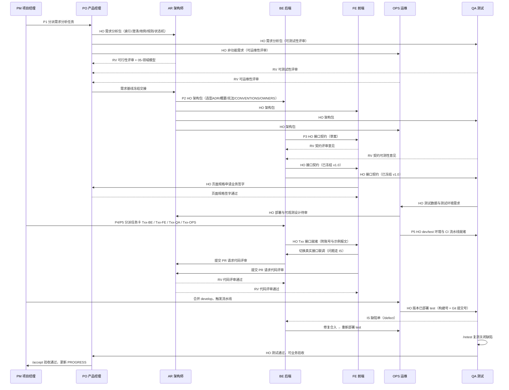
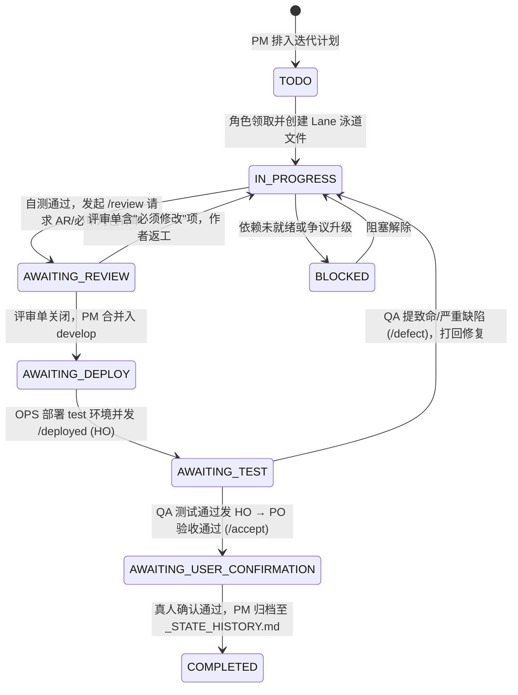

# 03 项目沟通、任务流转与接口对接详细规范

> **多人协作前置规则（复制提示词时一并加载）**：先按 AGENTS.md 声明 user_id、actor_id、role_id、task_id、lane_id；同角色多人各用独立分支/worktree，先领取不相交的文件与资源。自己的文档和代码在自检提交后分别冻结；任何冻结修改（含兼容变化、格式化）先有明确接口/功能干涉依据及真人批准，批准可指定其他用户/角色接手，无需原角色回来。冻结单据的回复另建记录。所有新文档放 z-readme/ 并使用目录序号或唯一任务/人员标识；固定示例名是内容类型，不是免除命名要求。运行锁以共享协调中心为准，Markdown 摘要不作为锁。具体命令见 `z-readme/08_冻结并行开发与Git合并操作手册.md`。

> **定位**：本文档定义团队项目在研发全生命周期中的**沟通载体、单据状态机、任务拆解与泳道流转、前后端契约对接与联调协议、测试准入与缺陷闭环协议、运维环境与发布演练协议、Git 分支合并与冲突升级裁决机制**。
> 核心铁律：**角色之间不凭记忆沟通、不口头约定、不越权代改；一切跨角色交互必须落地为 `z-readme/collab/` 下的标准化单据。**

---

## 1. 四类跨角色沟通工件与流转规则

所有跨角色协作统一通过 `z-readme/collab/` 下的四类单据进行，并由 PM 或单据发起/处理方同步登记到 `z-readme/collab/02_协作看板模板.md`：

| 单据名称        | 存放路径与命名                           | 发起角色     | 接收/处理角色         | 触发场景                                                              | 关闭条件                                         |
| --------------- | ---------------------------------------- | ------------ | --------------------- | --------------------------------------------------------------------- | ------------------------------------------------ |
| **交接单**      | `z-readme/collab/handoff/HO-xxx-简述.md` | 上游产出角色 | 下游消费角色          | 文档完成请求评审/签字、契约冻结、接口就绪、版本已部署、测试通过可验收 | 接收角色核对证据齐全并将状态改为 `已接收`        |
| **问题/缺陷单** | `z-readme/collab/issues/IS-xxx-简述.md`  | 任何角色     | 被问询角色 / 责任开发 | 需求疑问、技术争议、联调不一致、QA 发现缺陷、环境故障、任务阻塞       | 疑问已答复并确认；**缺陷类必须由 QA 复测关闭**   |
| **评审单**      | `z-readme/collab/reviews/RV-xxx-对象.md` | 必审角色     | 工件作者角色          | 需求可行性/可测性评审、架构评审、契约评审、代码 PR 评审、安全性能评审 | 所有 `必须修改（严重）` 项已修复并经评审人复核   |
| **变更单**      | `z-readme/collab/changes/CR-xxx-简述.md` | 任何角色     | PM 召集五方评估       | 对已冻结的 SRS/用例/规则/ADR/表结构/接口契约/页面规格/计划提出修改    | PO+AR+QA+OPS+PM 评估完成、批准且关联工件全部更新 |

### 1.1 全角色协作总时序图



---

## 2. 任务生命周期与多环境并行泳道流转

### 2.1 单张任务卡 `Txx` 的拆解与流转规则

1. **纵向业务切片**：PM 在 `z-readme/11_开发计划模板.md` 中将每张业务任务卡 `Txx` 拆分为角色子任务：
   - `Txx-BE`：Flyway 迁移脚本 + 实体/Mapper + Service（含单测）+ Controller（含接口测试）+ 接口就绪交接单；
   - `Txx-FE`：契约类型与 Mock + 页面与组件（含 `data-testid` 与组件单测）+ 真实接口联调；
   - `Txx-QA`：用例细化与测试数据 + 接口自动化（`tests/api/`）+ E2E 自动化（`web/e2e/`）+ 独立测试执行与复测；
   - `Txx-OPS`（按需）：新增服务/端口/环境变量/定时任务/中间件的容器编排与流水线更新 + 测试环境部署记录；
   - `Txx-AI`（按需）：AI 路由、提示词模板、Schema 校验、假模型桩与离线评估脚本。
2. **子任务状态流转机**：



3. **并行泳道（Lane）与文件锁纪律**：
   - 每个正在执行的会话必须在 `z-readme/lanes/<TASK>-<ROLE>-<USER>-<SESSION>.md` 登记自己的 `actor_id`、`role_id`、`branch`、`starting_head`、`owned_paths`；
   - 两个并行泳道的 `owned_paths` **严禁存在任何文件或目录包含关系重叠**；由于 `OWNERS.md` 已按角色物理隔离了 `server/`、`web/`、`tests/`、`deploy/`，同一任务卡的 `Txx-BE`、`Txx-FE`、`Txx-QA`、`Txx-OPS` 可以在不同 worktree 下，经共享协调中心确认文件及资源不重叠后并行。

---

## 3. 前后端与 AI 接口对接规范（契约先行协议）

### 3.1 接口对接六步闭环

| 步骤 | 责任角色  | 动作与产出                                                                                                  | 门禁 / 产出单据                        |
| ---- | --------- | ----------------------------------------------------------------------------------------------------------- | -------------------------------------- |
| 1    | `BE`      | 依据用例 `UC`、规则 `BR`、状态机 `ST` 与表 `TBL` 起草 `z-readme/design/api/<模块>.md`（分配唯一 `API-xxx`） | 发起 `HO` 请 FE、QA、AR 评审           |
| 2    | `FE`/`QA` | FE 审查字段能否支撑界面展示/提交、`actions[]` 权限列表、筛选排序、错误提示；QA 审查边界值与异常码可测性     | 出具评审单 `RV-xxx`                    |
| 3    | `BE`      | 逐条回复并修订契约，所有评审单关闭后在文档头标注 `状态：已冻结 v1.0（日期）`                                | 发起 `HO` 宣告契约冻结                 |
| 4    | `BE`∥`FE` | **并行开发**：BE 按契约实现后端并写接口测试；FE 按冻结契约编写 TypeScript 类型与带 `API-xxx` 注释的 Mock    | 各自单元测试通过                       |
| 5    | `BE`      | 后端自测（正常+异常 curl/测试类）逐字段比对契约一致，经 AR 代码评审后，发出**“接口就绪交接单”**             | `HO-xxx`（含账号、种子数据、示例报文） |
| 6    | `FE`      | 一键切换环境变量关闭本模块 Mock，连接真实后端逐路径联调（含正常、空、校验失败、越权、并发冲突路径）         | 联调通过后通知 OPS 部署、交 QA 测试    |

### 3.2 统一接口契约技术约定（默认标准，可由 AR 在 `00-接口规范.md` 微调）

1. **统一响应信封**：
   ```json
   {
     "code": "00000",
     "message": "操作成功",
     "data": {},
     "traceId": "c0a80101-1731234567890-1001"
   }
   ```
2. **统一分页请求与响应**：
   - 请求参数：`pageNo`（从 1 开始，默认 1）、`pageSize`（默认 20，最大 100）、`sortField`、`sortOrder`（`asc | desc`）；
   - 响应 `data`：`{ "list": [...], "total": 128, "pageNo": 1, "pageSize": 20 }`。
3. **统一错误码分段**：
   - `00000`：成功；
   - `A0400`~`A0499`：客户端参数、登录认证、功能权限与数据权限错误；
   - `B0100`~`B0999`：业务规则校验失败（如 `B0301` 非法状态转换、`B0302` 退回次数超上限、`B0303` 并发版本冲突）；
   - `C0100`~`C0999`：第三方外部系统、数据库、缓存或 AI 服务调用异常。
4. **可执行操作集合 `actions[]`**：详情与列表接口必须根据当前登录用户角色、部门数据权限与工单当前状态，由后端计算并返回允许前端展示的动作编码数组（如 `["SUBMIT", "WITHDRAW"]` 或 `["APPROVE", "RETURN_SUPPLEMENT", "REJECT"]`），**严禁前端自行用硬编码状态判断权限**。
5. **幂等与并发控制**：
   - 创建/提交类写接口支持请求头 `X-Idempotency-Key`；
   - 状态流转与表单修改接口必须在请求体携带乐观锁版本号 `version`，版本不匹配返回 `B0303`（“当前记录已被他人处理，请刷新后重试”）。

### 3.3 契约变更分级控制

| 变更级别        | 判定标准                                                                | 强制执行流程                                                                                               |
| --------------- | ----------------------------------------------------------------------- | ---------------------------------------------------------------------------------------------------------- |
| **L1 兼容变更** | 新增可选请求参数、响应体新增字段、新增独立接口、补充错误码枚举说明      | 先 CR + 真人解冻，再由指定接手者修改契约文档（按项目版本规则更新）→ 发 `HO` 通知 FE 与 QA → 更新实现与测试 |
| **L2 破坏变更** | 删除/重命名字段、修改字段类型或必填性、修改 URL/HTTP 方法、改变状态语义 | **严禁直接修改！** 必须先发起 `/cr` 变更单 → FE/QA/AR 评估影响 → 真人明确批准 → 同步更新契约/前端/测试     |

---

## 4. 测试准入、缺陷流转与运维部署对接规范

### 4.1 开发 ↔ 运维 ↔ 测试 ↔ 产品 四方交接链

1. **构建与部署参数交接（BE/FE/AI → OPS）**：
   - 当任务新增或修改了环境变量、监听端口、外部依赖地址、定时任务、存储挂载路径或构建命令时，开发角色必须在 PR 合入前向 OPS 发出 `HO`（或在任务卡 `Txx-OPS` 中声明），OPS 核对符合部署规范后更新 `deploy/.env.example` 与 `compose/K8s` 清单。
2. **版本部署交接（OPS → QA）**：
   - 代码合入 `develop`（迭代期）或 `release/vX.Y.Z`（系统测试期）后，由 OPS 流水线统一构建镜像并部署到 `test` / `staging` 环境；
   - OPS 确认容器 `healthy`、Flyway 迁移无报错后，执行 `/deployed` 生成 `z-readme/ops/部署记录-<环境>-<版本>.md`，并向 QA 发出 `版本已部署 HO`（必含：**环境地址、版本号、镜像标签、Git 提交 SHA、本次包含的任务卡与待复测缺陷列表**）。
3. **测试准入与缺陷闭环（QA ↔ BE/FE ↔ OPS）**：
   - QA 收到 `版本已部署 HO` 后先跑冒烟套件；冒烟失败直接 `/defect` 提阻塞缺陷打回；
   - 冒烟通过后执行功能、接口自动化与 E2E 测试；发现任何问题统一通过 `/defect` 创建缺陷单 `IS-xxx`；
   - 开发修复缺陷必须：① 先写一个能复现该缺陷的单元/集成测试 → ② 最小化修改代码使测试通过 → ③ 在缺陷单填写根因、修改文件、单测证据与提交号 → ④ 将状态改为 `待部署`（**严禁开发将缺陷直接改为 `已关闭`**）；
   - OPS 将包含该修复的新版本部署到测试环境后，缺陷状态变为 `待复测`，由 QA 执行 `/retest` 验证通过后方可改为 `已关闭`。
4. **测试放行与业务验收交接（QA → PO → PM）**：
   - 当某张任务卡（或整个版本）关联的全部 `TC-xxx` 100% 执行通过且致命/严重缺陷为 0 时，QA 向 PO 发出 `测试通过可验收 HO`；
   - PO 收到 QA 放行单后方可执行 `/accept` 对照 `AC-xxx` 验收签字，并通知 PM 将任务卡更新为 `已验收`。

---

## 5. Git 分支模型、提交规范与冲突升级裁决

### 5.1 分支与合并权限表

| 分支模式                              | 用途                         | 创建角色     | 合并执行人 | 合并硬性前置条件                                                              |
| ------------------------------------- | ---------------------------- | ------------ | ---------- | ----------------------------------------------------------------------------- |
| `main`                                | 稳定发布基线（只读保护）     | AR           | PM（真人） | P6 四方准出（QA 准出 + AR 安全性能 + OPS 回滚演练 + PO 系统验收）+ 真人批准   |
| `develop`                             | 日常集成分支                 | AR           | PM         | AR 代码评审单 `RV` 已关闭、无越权修改、队列候选版本构建与回归通过、目标未前进 |
| `docs/<TASK>-<ROLE>-<USER>-<SESSION>` | P0–P4 文档阶段分支           | 各角色       | PM         | 下游交接单已接收、必需评审单已关闭、`validate_project.py` 校验通过            |
| `feature/Txx-be-<USER>-<SESSION>`     | 任务卡后端实现分支           | BE           | PM         | AR 评审通过、后端验收命令通过、与冻结契约一致；候选合并后重新验证             |
| `feature/Txx-fe-<USER>-<SESSION>`     | 任务卡前端实现分支           | FE           | PM         | AR 评审通过、前端 lint/typecheck/build/unit 通过、已完成真实接口联调          |
| `test/Txx-qa-<USER>-<SESSION>`        | 任务卡自动化测试脚本分支     | QA           | PM         | 脚本在 `test` 环境运行通过、AR 抽查评审通过                                   |
| `ops/<TASK>-<USER>-<SESSION>`         | 环境、容器、流水线与监控分支 | OPS          | PM         | AR 评审通过、在 `dev/test` 环境实际拉起验证通过                               |
| `fix/IS-xxx-<角色>`                   | 缺陷修复分支                 | BE / FE / AI | PM         | 附带防回归单测、AR 评审通过；合入后经 OPS 部署并由 QA `/retest` 关闭          |
| `release/vX.Y.Z`                      | P6 预发布与系统测试分支      | PM + OPS     | PM         | 仅允许合入经批准的缺陷修复 `fix/*`                                            |

### 5.2 提交信息格式

统一遵循：`[<ROLE>][<TASK>][<USER>] <type>: <中文说明>`
- `type` 取值：`docs` / `feat` / `fix` / `refactor` / `test` / `ci` / `build` / `perf` / `chore`
- 示例：`[PO][T001][po01] docs: 完成业务规则库`、`[BE][T021][be01] feat: 实现工单退回补充状态流转与接口`、`[QA][T021][qa01] test: 新增退回补充接口与E2E自动化用例`、`[OPS][T000][ops01] ci: 搭建测试环境与冒烟门禁`。

### 5.3 争议裁决与超时升级机制

| 争议领域                                         | 一级裁决角色 | 裁决依据文档                      | 升级路径（1 个会话未决或仍有异议） |
| ------------------------------------------------ | ------------ | --------------------------------- | ---------------------------------- |
| 需求范围、业务流程、业务规则、验收标准含义       | `PO`         | `SRS`、`01-澄清结论`、`03-规则库` | 真人业务负责人                     |
| 技术选型、模块边界、接口契约规范、代码质量与安全 | `AR`         | `AGENTS.md`、`ADR`、`CONVENTIONS` | 真人技术负责人                     |
| 缺陷是否成立、缺陷严重级别、测试准入与准出判定   | `QA`         | `07-测试策略与用例`、`测试计划`   | AR（技术类）/ PO（业务类）→ 真人   |
| 容器规范、环境配置、密钥安全、上线与回滚就绪判定 | `OPS`        | `08-部署与运维设计`、部署规范     | AR → 真人运维/项目负责人           |
| 迭代排期、任务拆分、资源冲突、一般缺陷延期决议   | `PM`         | `PLAN.md`、`TEAM.md`、`RISKS.md`  | 真人项目负责人                     |
