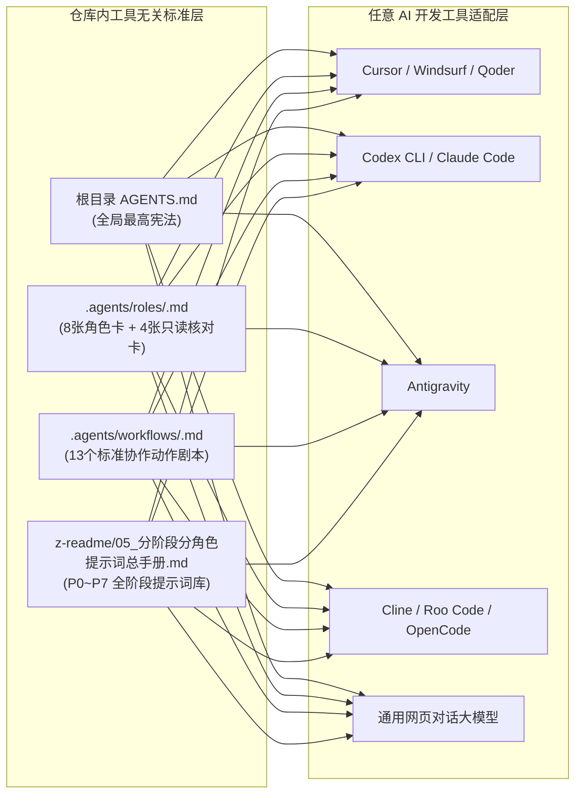

# 04 跨 AI 开发工具通用适配指南（去特定工具绑定）

> **设计原则**：本团队项目模板不绑定任何单一 AI IDE、CLI 或底层大模型（无论是 Cursor、Codex、Qoder、Antigravity、Windsurf、Cline、Claude Code、OpenCode、GitHub Copilot，还是 DeepSeek、Claude、GPT、Gemini、Qwen 等模型）。
> 所有角色定义、工作流剧本、目录权限与提示词均以**标准 Markdown 与 YAML 纯文本文件**存储在仓库内，任何工具只需按本文指南完成“三件套映射”（根宪法 + 角色准则卡 + 工作流剧本），即可获得完全一致的团队协同开发能力。

---

## 1. 跨工具核心三件套映射原理



---

## 2. 各主流 AI 开发工具具体配置与使用方法

### 2.1 Cursor

1. **全局规则生效**：Cursor 原生支持读取根目录 `AGENTS.md`。
2. **按角色切换会话**：
   - 每次切换角色时点击 `New Chat / Composer` 开启新会话；
   - 在首句使用 `@` 引用对应角色卡与开场剧本，例如：
     ```text
     @.agents/roles/BE.md @.agents/workflows/inbox.md 我是本项目后端开发工程师（BE），请按开场剧本巡检待办。
     ```
3. **可选进阶**：如需在 Cursor Rules 面板固定下拉选择角色，可将 `.agents/roles/*.md` 软链接或复制到 `.cursor/rules/` 下并改后缀为 `.mdc`（`alwaysApply: false`，按需手动 `@` 调用）。

### 2.2 Codex CLI / Claude Code

1. **全局规则生效**：Codex CLI 与 Claude Code 启动时自动加载工作区根目录的 `AGENTS.md`（Claude Code 亦可在根下创建一行 `@AGENTS.md` 的 `CLAUDE.md` 引用文件）。
2. **以指定角色启动会话**：
   - 启动新会话（或执行 `/clear`）后输入：
     ```text
     请先阅读 .agents/roles/QA.md 与 .agents/workflows/inbox.md，本会话你将严格且唯一扮演测试工程师（QA）。
     ```
3. **自定义斜杠命令映射（可选）**：可将 `.agents/workflows/*.md` 复制到 `.claude/commands/` 下，即可直接使用 `/project:inbox`、`/project:handoff`、`/project:defect` 等命令。

### 2.3 Antigravity

1. **全局规则生效**：Antigravity 自动识别工作区根目录的 `AGENTS.md` 作为最高优先级项目规则。
2. **角色与工作流使用**：
   - `.agents/workflows/*.md` 可直接作为工作流剧本引用；
   - 每个独立任务开启新对话，首句声明：`我是本项目系统架构师（AR），请先读取 .agents/roles/AR.md 与 .agents/workflows/inbox.md 并汇报待办`。

### 2.4 Qoder / Windsurf / Cline / Roo Code

1. **全局规则生效**：在工具的 Workspace Rules 设置中指向根目录 `AGENTS.md`（Cline/Roo Code 可将 `.agents/roles/<ROLE>.md` 配置为自定义 Mode，如 `PM Mode`、`PO Mode`、`AR Mode`、`BE Mode`、`FE Mode`、`QA Mode`、`OPS Mode`）。
2. **工作流调用**：将 `.agents/workflows/` 绑定为工具的 Workflows 目录，或在对话中直接引用 `@.agents/workflows/review.md`。

### 2.5 OpenCode / Aider 等终端 Agent 工具

1. 若使用支持多 Agent 配置文件的工具，只需用脚本或软链接将 `.agents/roles/<ROLE>.md` 头部加上对应工具所需的 YAML frontmatter（如读写与命令权限），映射至该工具的配置目录；
2. 模型配置在工具自身的配置文件中自由指定（可为 `PM/PO/AR` 指定深度推理模型，为 `BE/FE/QA/OPS` 指定高吞吐高性价比代码模型；提示词正文不绑定任何模型名称）。

### 2.6 通用网页端大模型（无本地文件读写能力的环境）

1. 新建对话窗口（一个窗口固定扮演一个角色）；
2. 上传 `AGENTS.md` + `.agents/roles/<ROLE>.md` + 当前阶段提示词要求的输入文档（按 `z-readme/05_分阶段分角色提示词总手册.md` 中每条提示词的 `【输入】` 清单精确上传，避免无关文件挤占上下文）；
3. 将模型输出的 Markdown 文档或代码保存到提示词指定的 `【输出】` 路径，并在本地运行 `py -3.11 z-scripts/validate_project.py --align` 校验。

---

## 3. 屏蔽底层模型差异的“五条防幻觉工程设计”

由于不同团队可能选用不同参数规模或厂商的大模型，本模板在提示词与流程设计上内置了五项与模型无关的工程防护：

1. **上下文精确喂入（Context Bounding）**：`z-readme/05_分阶段分角色提示词总手册.md` 中的每一条提示词都明确列出了 `【必读输入文件与章节】`，禁止让模型“自己全仓漫游猜测”，既节省 Token 又防止小上下文模型遗忘。
2. **分块生成长文档（Chunked Generation）**：对于超过 400 行的长文档（如 SRS、用例规格、数据库设计、接口契约、测试用例），提示词统一采用“先生成总纲与目录索引，再按模块分会话追加生成”的策略，避免单次输出截断。
3. **结构化模板先行（Skeleton-First）**：所有单据（`HO/IS/RV/CR`）与所有技术文档均提供固定的章节标题与表头，模型只需按表头填空并标注上游编号（`FR/BR/ST/API/TC`）。
4. **作者与核对员分离（Maker-Checker Separation）**：每个角色完成产出后，通过加载独立的只读核对卡（`REVIEWER-ARCH`、`ACCEPTOR-BIZ`、`CHECKER-QA`、`CHECKER-OPS`）在独立会话中进行反向挑刺。
5. **确定性脚本兜底（Deterministic Script Gate）**：由 `z-scripts/validate_project.py` 对目录完整性、表格对齐、单据必填字段、OWNERS 越界进行机械化检查，弥补概率模型的疏漏。
