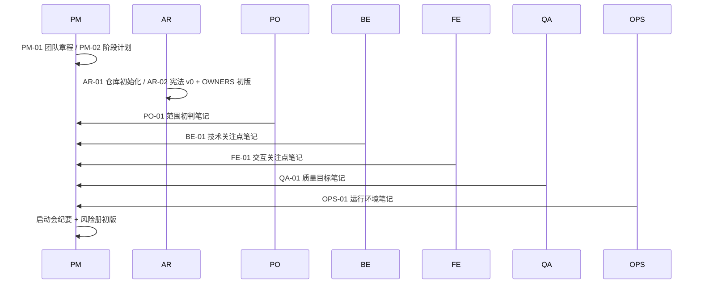
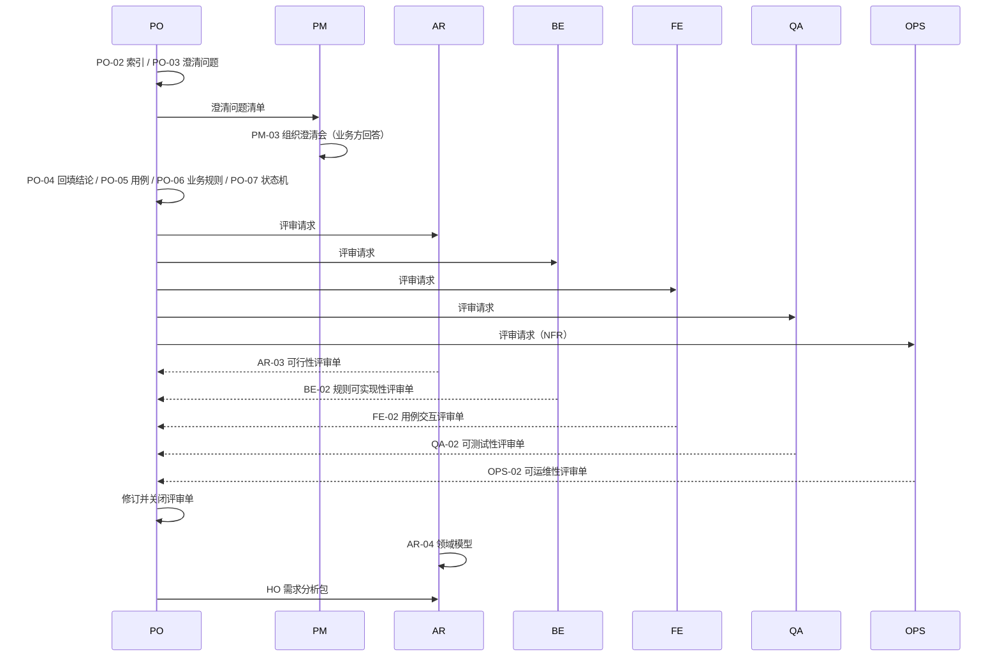
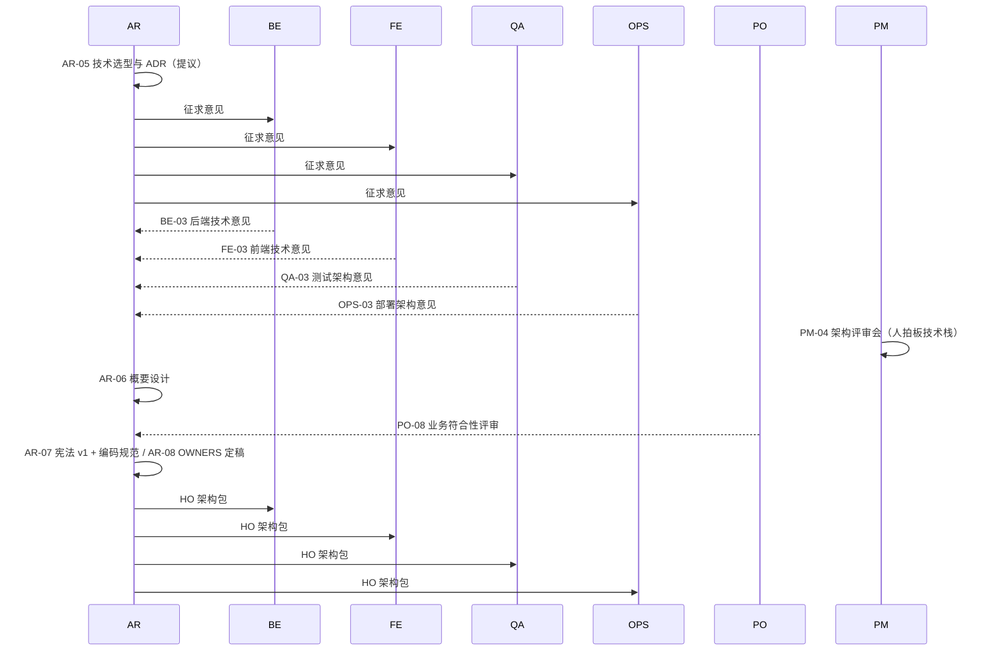
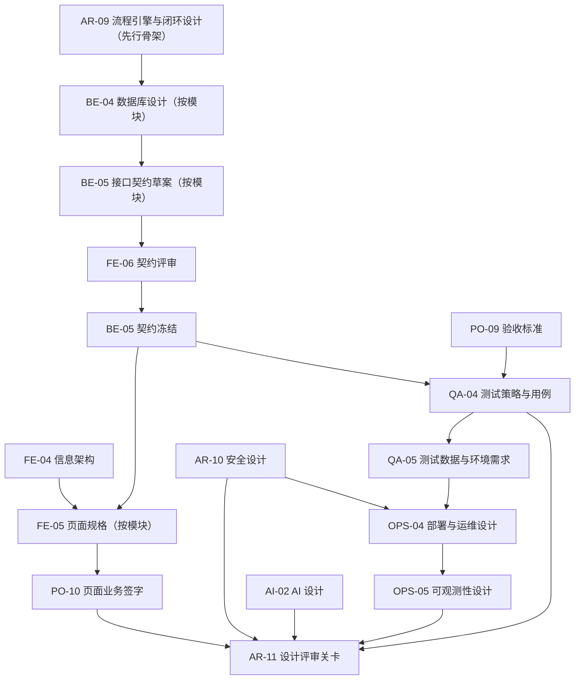
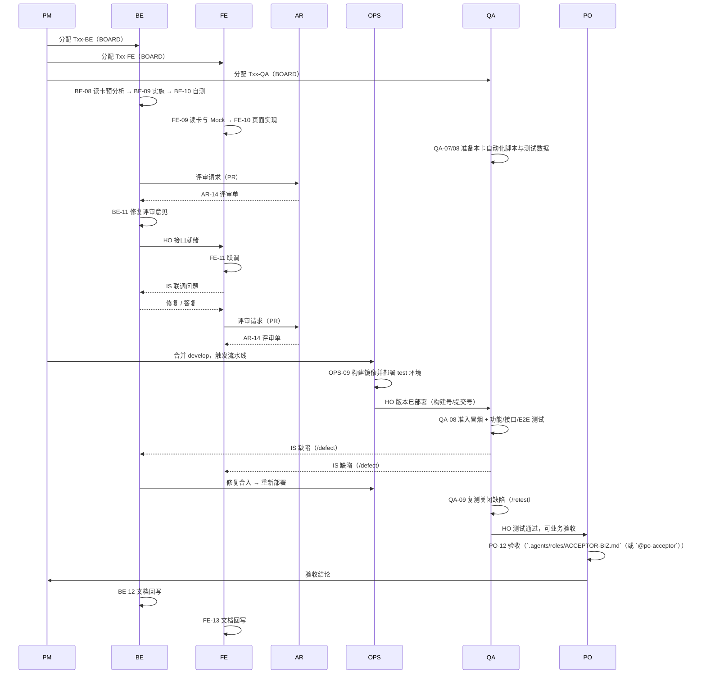
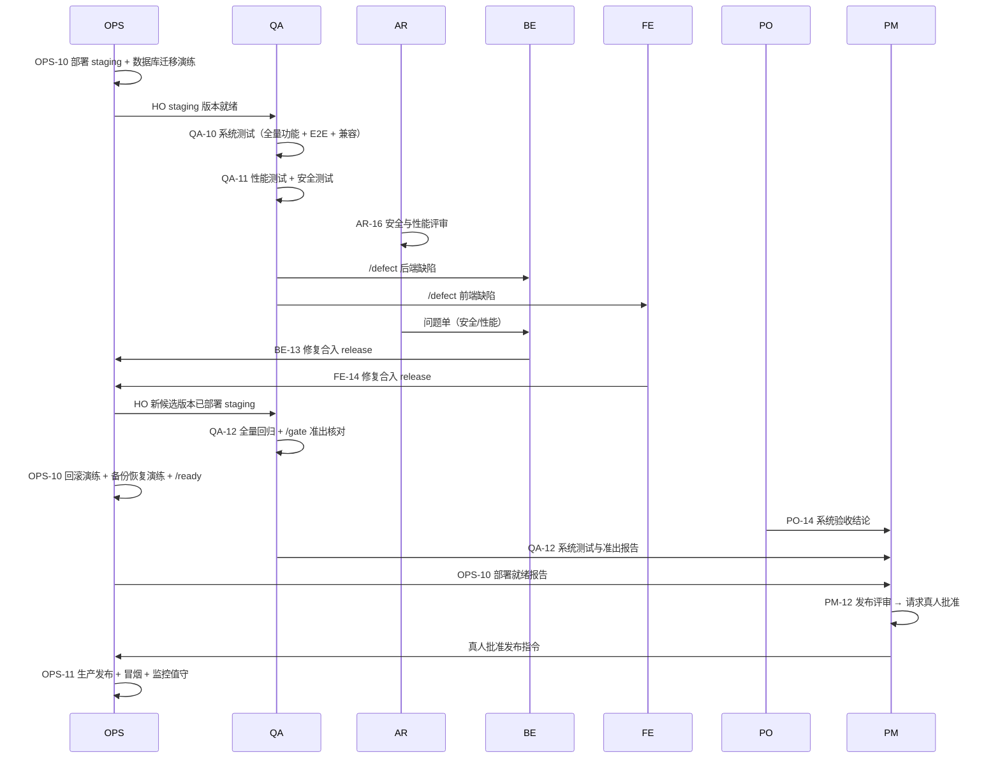
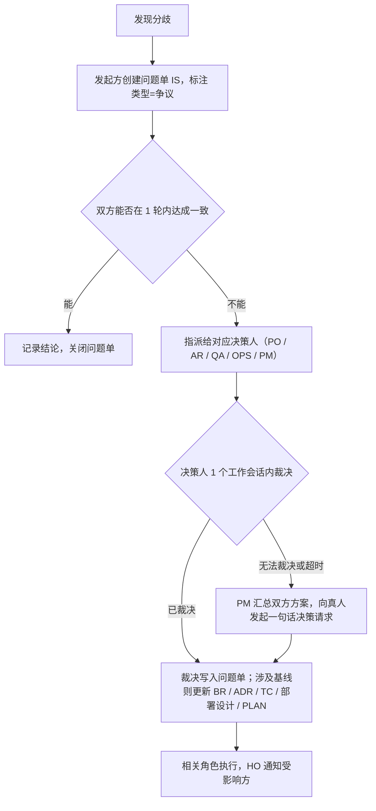

# 05 分阶段分角色提示词总手册（P0–P7 全生命周期 · 工具无关版）

> 工单平台、特定行业、技术栈、模块编号与任务数量均为演练示例，不自动成为新项目需求或架构决策；复制模板后按实际 SRS 取舍。

> **多人协作前置规则（复制提示词时一并加载）**：先按 AGENTS.md 声明 user_id、actor_id、role_id、task_id、lane_id；同角色多人各用独立分支/worktree，先领取不相交的文件与资源。自己的文档和代码在自检提交后分别冻结；任何冻结修改（含兼容变化、格式化）先有明确接口/功能干涉依据及真人批准，批准可指定其他用户/角色接手，无需原角色回来。冻结单据的回复另建记录。所有新文档放 z-readme/ 并使用时间戳与人员标识；固定示例名是内容类型，不是免除命名要求。运行锁以共享协调中心为准，Markdown 摘要不作为锁。具体命令见 `z-readme/202611122304_冻结并行开发与Git合并操作手册.md`。

> **用途**：本手册整合了《从需求规格说明书到完整系统的逐步提示词链》《全功能开发提示词手册（基线文档与任务卡生成）》与《多角色 AI 协同开发完全工作指引（含 PM/PO/AR/BE/FE/QA/OPS/AI）》，已去除特定开发工具与特定大模型绑定，适用于 Cursor、Codex、Qoder、Antigravity、Windsurf、Cline、Claude Code、OpenCode 及各类通用对话大模型。
> **使用方法**：
> 1. 每次开启一个新会话，先发送 `z-readme/00_团队项目模板使用与全员就位指南.md` 第 4.1 节的**通用会话开场提示词**（或执行 `.agents/workflows/inbox.md`），声明当前会话扮演的唯一角色；
> 2. 在第 3 章《阶段 × 角色 工作总矩阵》查出当前阶段与角色对应的提示词编号（如 `PO-03`、`AR-05`、`BE-09`、`QA-08`、`OPS-09`）；
> 3. 复制对应编号的提示词发送给 AI 代理（把 `{模块}`、`{任务号 Txx}`、`{版本号}` 替换为实际值）；
> 4. 会话结束前发送**通用会话收尾提示词**（或执行 `.agents/workflows/wrapup.md`），生成交接单/问题单并运行 `py -3.11 z-scripts/validate_project.py --align --files <本泳道已领取的文件>`。

---

## 1 提示词设计规范与通用约束（八要素骨架）

### 1.0 说明

统一提示词结构（所有步骤都按这个骨架写）

大模型对结构化、边界清楚的提示词执行最稳定。本文每段提示词都遵循以下 8 段式：

```text
【角色】你是……（给出与本步匹配的专业身份）
【本步目标】一句话说明要产出什么文档、解决什么问题
【输入】只允许阅读的文件清单（含章节或行号范围）；禁止读取清单外文件
【输出】文件路径；文档章节结构（固定标题）
【内容要求】逐条列出必须包含的内容、编号规则、引用规则
【分段规则】超过多少行需分段；每段写什么
【自检清单】完成后逐条自查并在回复中给出"通过/不通过+原因"
【完成后输出】统计数字、待人工确认事项、下一步建议
```

**通用约束（每段提示词末尾都追加这一段，下文以【通用约束】代称）**：

```text
【通用约束】
- 先声明五项身份并取得路径/资源写锁；同角色用户使用独立 worktree。
- 自己的文档与代码提交后分别冻结；改冻结范围须真实人工批准，可指定其他角色接手。
- 每个新文档用时间戳及人员标识；冻结单据的回复另存并引用原编号。
- 不确定或 SRS 未定义的内容，不得编造；写入 z-readme/analysis/YYYYMMDDHHMM_01-需求澄清与假设.md 的"新增问题"区，并在本文中标注"待确认 Q-xxx"。
- 所有条目编号唯一、连续；引用上游条目必须写编号（如 FR-REV-003、BR-012、TBL-wo_order）。
- 所有 Markdown 表格列对齐；图使用 mermaid，节点文字含括号时加引号。
- 只创建/修改【输出】列出的文件。
- 文档使用中文；代码标识（表名、类名、路径）使用英文。
```

---

---

## 2 基线文档构建提示词（当需要从粗粒度输入生成 SRS / PLAN / PROGRESS 时使用）

### 2.0 适用场景

> 若 `z-docs/` 中已有完整的 `SRS.md`，可直接跳过 2.1 节进入第 3 章 P0 阶段；若仅有粗粒度需求纪要，可由 PO 执行 `P-SRS-*` 生成标准 12 章 SRS。

基线文档生成与启动提示词

### 2.1 三份基线文档与生成路线

| 文件                                    | 作用                                               | 路线 A（推荐，已有成果时）                      | 路线 B（从零由模型生成）                                                          |
| --------------------------------------- | -------------------------------------------------- | ----------------------------------------------- | --------------------------------------------------------------------------------- |
| `z-readme/YYYYMMDDHHMM_SRS.md`          | 需求基线，所有任务卡按章节号与需求编号引用         | 复制已有 SRS → 执行 P-SRS-A 校验并生成需求索引  | P-SRS-B0 骨架 → P-SRS-B1~B10 分段生成 → P-SRS-B11 一致性校验                      |
| `z-readme/202611122304_需求索引模板.md` | 需求编号索引，供 大模型按需定位、减少整篇阅读      | P-SRS-A 自动生成                                | P-SRS-B11 自动生成                                                                |
| `z-readme/202611122304_开发计划模板.md` | 开发计划：阶段、任务总表、任务卡正文、需求覆盖矩阵 | 复制本手册 5.3–5.9 → 执行 P-PLAN-A 校验与补矩阵 | P-PLAN-B1 任务总表 → P-PLAN-B2 逐阶段任务卡 → P-PLAN-B3 覆盖校验 → P-PLAN-B4 冻结 |
| `z-readme/202611122304_进度看板模板.md` | 进度看板、交接摘要、会话交接、技术债               | P-PROG-1 初始化                                 | P-PROG-1 初始化                                                                   |

> [!IMPORTANT]
> 生成顺序固定为 **SRS → SRS-INDEX → PLAN → PROGRESS**，每份文档生成后人工审阅、`git commit`，再进入下一份。每段提示词使用新会话（`/new`），避免长文档撑爆上下文。
> 大模型单次输出长度有限，**禁止让模型一次性生成整篇 SRS 或整篇 PLAN**，必须按本节分段提示词执行。

### 2.2 生成 `z-readme/YYYYMMDDHHMM_SRS.md` 的提示词

#### 2.2.1 路线 A：导入已有 SRS 并校验 —— P-SRS-A

前置：已执行 `cp <路径>/202611101622_国家电网工单管理系统需求规格说明书.md z-readme/YYYYMMDDHHMM_SRS.md`。

```text
任务：校验需求基线 z-readme/YYYYMMDDHHMM_SRS.md 并生成需求索引。不要修改 SRS 的业务含义，不写任何代码。
步骤：
1. 分段阅读 z-readme/YYYYMMDDHHMM_SRS.md（每次不超过 400 行），不要一次读全文。
2. 校验以下内容，把问题列成清单（位置/问题/建议），只修正"格式类"问题（编号重复、编号跳号、表格列不齐、
   标题层级错误），涉及业务内容的问题只报告不修改：
   a) 功能需求编号 FR-模块-序号 全局唯一，模块编码与 5.0 模块总览一致；
   b) 4.2 状态枚举与 4.3 状态转换表中出现的状态完全一致；6.2.1 wo_order.status 说明引用 4.2；
   c) 4.4 退回原因编码、退回策略编码在第 5、6、7 章引用一致；
   d) 7.2 接口清单中每个接口都能对应到至少一个 FR；
   e) 7.4 错误码在正文中的引用均已定义。
3. 生成 z-readme/202611122304_需求索引模板.md，包含：
   - 「章节索引」表：章节号 | 标题 | 起始行号 | 结束行号
   - 「需求索引」表：需求编号 | 名称 | 优先级 | 所在章节 | 起始行号 | 关联任务（先留空，PLAN 阶段回填）
     需覆盖全部 FR-*、NFR-*、INT-*；
   - 「关键枚举索引」：工单状态、状态转换编号 T01-T18、退回原因 R01-R99、退回策略、系统角色、流程角色、数据范围、错误码，
     每项给出所在章节与行号。
4. 输出：需求总数（FR/NFR/INT 分别统计）、P0/P1/P2 数量、问题清单。
约束：SRS-INDEX 的表格列必须对齐；行号以修正后的 SRS 为准。
```

#### 2.2.2 路线 B：从零分段生成 SRS

**P-SRS-B0 骨架与编写规则**

```text
任务：为"国家电网全业务工单管理系统（智慧工单平台 SGCC-WOP）"创建需求规格说明书骨架 z-readme/YYYYMMDDHHMM_SRS.md。只写骨架，不写正文。
业务背景（作为全部章节的输入基线）：
- 面向国家电网总部、省公司、地市公司、县公司、供电所/班组五级组织的统一工单平台；
- 覆盖营销、运检、调度、基建、物资、信通、安监、财务、人资、综合办公、科技数字化、新能源 12 个专业的审批类工单；
- 核心闭环："提交—评审—退回补充—通过"，支持多级评审、会签、或签、转办、加签、委托、催办、督办、执行反馈、归档；
- 需要用户、角色、部门、权限、表单与流程配置、SLA 时限、消息通知、附件、统计驾驶舱、知识库、移动端、外部集成；
- 需要 AI 业务分析：智能填单、提交前预审、分类派单、评审辅助、退回意见与原因分析、补充建议、风险预警、相似工单、
  超时预测、趋势洞察、自然语言查数（ChatBI）、知识问答、报告生成、AI 模型与提示词管理、效果评估；
- 约束：信息内网部署、等保三级、国密 SM2/SM3/SM4、信创兼容、大模型私有化部署、AI 只建议不决策。
骨架要求：
1. 文档头：文档信息表（名称、版本 V1.0、日期、状态、适用对象）、修订记录表。
2. 章节固定为：1 引言（1.1 编写目的 1.2 项目范围 1.3 术语与缩略语 1.4 参考资料 1.5 文档约定）；
   2 总体描述（2.1 建设背景 2.2 建设目标 2.3 业务范围 2.4 用户特征 2.5 运行环境 2.6 推荐技术架构 2.7 约束 2.8 假设与依赖）；
   3 组织、用户与角色（3.1 组织模型 3.2 部门设置 3.3 用户模型 3.4 角色定义 3.5 权限模型）；
   4 业务流转（4.1 闭环概述 4.2 状态定义 4.3 状态转换规则 4.4 退回补充策略 4.5 评审节点模式 4.6 典型流程 4.7 SLA 规则）；
   5 功能需求（5.0 模块总览，5.1–5.23 依次为 AUTH ORG USER ROLE CAT FORM FLOW WO REV RET CLS TODO QRY SLA MSG FILE AI STAT KB EVAL SYS INT MOB）；
   6 数据需求；7 接口需求；8 非功能需求；9 部署与运行；10 验收标准；11 实施建议与里程碑；12 附录。
3. 每个小节下只写一行"（待生成：P-SRS-Bn）"占位，n 按下方分段表对应。
4. 在 1.5 文档约定中写明编号规则：FR-模块编码-三位序号；NFR-类别-两位序号；INT-两位序号；优先级 P0/P1/P2；
   "应/宜/可"含义；功能点描述格式"参与者/描述/前置条件/输入/处理逻辑/输出/业务规则/异常处理"。
5. 所有 Markdown 表格列对齐。完成后输出骨架的标题树。
```

**P-SRS-Bn 分段生成通用模板**（把 `{段号}`、`{章节范围}`、`{必须覆盖要点}` 按下表替换）

```text
任务：生成 z-readme/YYYYMMDDHHMM_SRS.md 的 {章节范围}，替换对应"（待生成：P-SRS-{段号}）"占位。只修改这些章节，其他章节保持不变。
步骤：
1. 阅读 z-readme/YYYYMMDDHHMM_SRS.md 的 1.5 文档约定，以及已生成章节中与本段相关的部分（通过标题定位，按需阅读，不要读全文）。
2. 按"必须覆盖要点"编写正文：{必须覆盖要点}
3. 写作规则：
   - 功能需求逐条编号，每条按"参与者/描述/前置条件/输入/处理逻辑（编号步骤）/输出/业务规则/异常处理"书写，
     简单功能可合并为表格，但必须保留编号、优先级与可验证的规则；
   - 业务规则必须可测试：写具体阈值、次数、时限、角色，避免"及时""合理""友好"等不可验证表述；
   - 引用其他章节时写章节号与编号（如"见 4.4、FR-REV-003"），不得引用尚不存在的编号；
   - 状态、角色、错误码、退回原因等枚举只能使用已在第 3、4、7 章定义的编码；本段若需新增枚举，写在本段并在末尾列出；
   - 表格列对齐；流程用 mermaid（flowchart/stateDiagram-v2/sequenceDiagram/erDiagram），节点文字含括号时加引号。
4. 本段输出长度控制在 250–450 行；超出时先完成前半部分，在末尾写"（续：P-SRS-{段号}-2）"，等待我发送"继续"。
5. 完成后输出：本段新增的需求编号清单、新增枚举清单、需要后续章节呼应的事项。
```

| 段号 | 章节范围   | 必须覆盖要点                                                                                                                                                                                                                                                                                                                                                            |
| ---- | ---------- | ----------------------------------------------------------------------------------------------------------------------------------------------------------------------------------------------------------------------------------------------------------------------------------------------------------------------------------------------------------------------- |
| B1   | 第 1、2 章 | 术语表（工单、退回补充、会签、或签、SLA、ISC、i国网、PMS、ERP、LLM、RAG、等保三级、国密、信创）；量化建设目标 6 项；12 专业工单目录表（每专业 4–5 个典型工单）；用户特征与规模；运行环境（信创软硬件、浏览器、移动端、AI 资源）；推荐技术架构与架构图；约束与假设                                                                                                       |
| B2   | 第 3 章    | 组织节点类型 7 种与字段；地市公司 12 个部门表；用户字段表（含兼职、资质、加密手机号）；14 个系统角色与三员分立；10 种流程角色解析规则；功能权限矩阵（8 类角色 × 13 项功能）；8 种数据范围与多角色并集、密级、敏感字段规则                                                                                                                                               |
| B3   | 第 4 章    | 状态机图；12 个状态（编码/名称/说明/是否终态）；18 条状态转换（当前状态/操作/操作人/目标状态/前置条件）；5 种退回策略；8 类退回原因；退回业务规则 6 条（阈值、问题字段、补充时限、变更对比、AI 补充建议）；7 种评审节点模式与会签退回；4 个典型流程（停电检修、业扩、信息变更、费用报销）；SLA 规则表                                                                   |
| B4   | 5.0–5.4    | 23 个模块总览表；AUTH（ISC 单点、外部用户、工作台、安全增强）；ORG（树、同步、维护、调整迁移）；USER（维护、同步、兼职、资质、委托、待办转移）；ROLE（角色、菜单按钮、数据权限、授权与三员校验与审批、权限审计）                                                                                                                                                        |
| B5   | 5.5–5.7    | CAT（目录、工单类型全字段表、编号规则、版本与模板下发）；FORM（控件清单、校验、联动、节点字段权限、版本、打印模板）；FLOW（BPMN 与简易模式、评审节点配置项表、条件分支、校验仿真、版本与流程干预）                                                                                                                                                                      |
| B6   | 5.8–5.11   | WO（发起处理逻辑、草稿、撤回、复制、批量、外部提交、详情页）；REV（签收、通过、退回补充输入表、驳回、转办、加签、批量评审、讨论、撤回本人审批）；RET（待补充、补充修改与逐项处理、变更对比、放弃、超期）；CLS（结果单、执行反馈、办结、归档、电子签章）                                                                                                                 |
| B7   | 5.12–5.16  | TODO（9 个页签表、列表字段与排序、统一待办推送对账）；QRY（综合查询、全文检索、流程跟踪、导出、验真）；SLA（工作日历、时限计算、预警升级、催办、督办）；MSG（渠道、11 个通知事件表、模板变量、消息中心、免打扰）；FILE（上传安全、附件分类、预览水印、版本、OCR）                                                                                                       |
| B8   | 5.17       | AI 架构图与 6 条通用要求（标识与依据、反馈留痕、脱敏、密级禁用、降级不阻断、响应时间）；19 项 AI 功能清单表；每项 AI 功能的输入/处理/输出/业务规则/验收指标，预审检查维度表，风险类别表，ChatBI 安全规则，模型与提示词管理，效果评估指标                                                                                                                                |
| B9   | 5.18–5.23  | STAT（12 个指标及计算口径表、驾驶舱、标准报表、自定义报表、刷新时效）；KB（分类、向量化、案例沉淀、检索）；EVAL；SYS（12 项系统管理功能表）；INT（13 个接口集成表与通用要求）；MOB（范围、移动特性、移动安全）                                                                                                                                                          |
| B10  | 第 6–12 章 | ER 图；wo_order、wo_review_record、wo_return_record/wo_return_item 字段表；其他表清单；数据量估算与分区；数据安全；API 通用约定、约 30 个核心接口清单、退回补充请求响应示例、错误码表；性能/可靠性/安全/AI 治理/兼容/易用/可维护/审计非功能需求（编号化）；部署区域表；功能与 AI 验收指标；三期里程碑；附录（退回时序图、紧急程度、停电检修表单字段示例、需求追踪矩阵） |

**P-SRS-B11 全文一致性校验与索引**

```text
任务：对已分段生成的 z-readme/YYYYMMDDHHMM_SRS.md 做全文一致性校验并生成需求索引。
1. 检查是否还有"（待生成"或"（续："占位，有则列出并停止，提示我补生成。
2. 执行 P-SRS-A 中第 2 步的全部校验（编号唯一与连续、状态与转换一致、退回编码一致、接口对应 FR、错误码已定义），
   另外检查：第 10 章验收项能追溯到第 4、5、8 章需求；附录需求追踪矩阵覆盖 2.2 全部目标。
3. 修正格式类问题；业务冲突（如两处阈值不同）列出冲突点并给出建议值，等我确认后再改。
4. 按 P-SRS-A 第 3 步生成 z-readme/202611122304_需求索引模板.md。
5. 输出统计与问题清单。
```

### 2.3 生成 `z-readme/202611122304_开发计划模板.md` 的提示词

#### 2.3.1 路线 A：导入手册任务卡并校验 —— P-PLAN-A

前置：已把本手册第 5 章 5.1、5.2 与 5.3–5.9 复制为 `z-readme/202611122304_开发计划模板.md`。

```text
任务：校验开发计划 z-readme/202611122304_开发计划模板.md，补充任务总表与需求覆盖矩阵。不得改写任务卡的目标、交付物与验收标准。
1. 在文件开头"计划说明"之后插入「任务总表」：任务号 | 名称 | 阶段 | 依赖 | SRS 引用 | 规模(S/M/L) | 可拆分 | 主要模块目录。
   规模判定：预计新建/修改文件 ≤10 为 S，11–25 为 M，>25 为 L；L 必须标注可拆分。
2. 依赖校验：根据任务卡"依赖"字段做拓扑排序，检查无环、无引用不存在的任务、阶段顺序合理；输出推荐执行顺序（一行一个任务号）。
3. 需求覆盖：读取 z-readme/202611122304_需求索引模板.md，在文件末尾生成「需求覆盖矩阵」：需求编号 | 优先级 | 覆盖任务 | 覆盖方式(实现/测试/文档)。
   所有 P0 需求必须被至少一张卡覆盖；未覆盖的需求列入「未覆盖清单」，并建议归入哪张卡（只建议，不改卡）。
4. 回填 z-readme/202611122304_需求索引模板.md 的"关联任务"列。
5. 输出：任务数、各阶段任务数、L 级任务列表、未覆盖需求数、依赖问题。所有表格列对齐。
```

#### 2.3.2 路线 B：从 SRS 分步生成计划

**P-PLAN-B1 阶段划分与任务总表**

```text
任务：基于 z-readme/YYYYMMDDHHMM_SRS.md（通过 z-readme/202611122304_需求索引模板.md 定位，不要通读全文）与 AGENTS.md，生成开发计划 z-readme/202611122304_开发计划模板.md 的第一部分。不写代码。
1. 计划说明（≤15 行）：执行规则——一张卡一个会话；先读 PROGRESS；只改本卡范围；验收命令全部通过才算完成；计划变更走需求变更流程。
2. 阶段划分表：阶段 | 名称 | 任务范围 | 阶段目标 | 对应 SRS 模块。阶段固定为：
   S0 工程基建、S1 系统管理、S2 配置中心、S3 核心闭环、S4 AI 业务分析、S5 统计与扩展、S6 质量与交付。
3. 任务总表：任务号(T00 起连续编号) | 名称 | 阶段 | 依赖 | SRS 引用(章节号或需求编号) | 规模(S/M/L) | 可拆分 | 主要模块目录。
拆分原则（必须遵守）：
   a) 每张卡是一个可独立验收的纵向切片（表 + 后端 + 前端 + 测试），单会话可完成，预计改动文件 ≤25 个；
   b) 先基础后业务：骨架 → 认证 → 组织用户权限 → 字典日志 → 表单/流程/SLA 引擎 → 工单闭环 → AI → 统计扩展 → 质量交付；
   c) 工单状态机、退回补充闭环、数据权限、AI 服务骨架各自独立成卡，不与其他功能混合；
   d) 公共能力先于使用者（如 SLA 计算先于 SLA 监控，消息中心先于各类通知接入）；
   e) 每个阶段最后一张卡包含阶段回归；任务总数控制在 40–50 张；
   f) 依赖只能指向编号更小的任务，确需例外时在"依赖"列注明并说明理由。
4. 依赖关系 mermaid flowchart。
5. 输出任务总数、各阶段数量、你认为风险最高的 5 张卡及原因。表格列对齐。
```

**P-PLAN-B2 逐阶段编写任务卡**（每个阶段一个会话，`{阶段}` 依次替换为 S0–S6）

```text
任务：为 z-readme/202611122304_开发计划模板.md 中阶段 {阶段} 的全部任务编写任务卡正文，追加在任务总表之后。只写本阶段，不改其他内容。
1. 阅读 AGENTS.md（技术栈、目录、数据库命名、迁移脚本命名 V{三位任务号}_{两位序号}__描述.sql）、PLAN.md 任务总表、
   以及本阶段任务引用的 SRS 章节（通过 SRS-INDEX 行号按需阅读）。
2. 每张卡严格使用以下模板（字段名不得增删）：
   #### Txx 名称【可拆分】（仅 L 级标注）
   - 依赖：
   - SRS 引用：
   - 目标：一句话
   - 交付物：按"表（含迁移脚本名）/ 后端（关键类与接口路径）/ 前端（页面路径与组件）/ 文档"分类列出，写到文件或类名级别
   - 实现要求：编号列出关键业务规则与技术约束，规则要引用 SRS 编号，阈值写具体数字
   - 验收：必须是可执行的命令（mvn / pnpm / uv / curl / docker compose）+ 指定的测试类名与覆盖场景 + 最多 3 条手工检查项
3. 质量要求：
   - 交付物中的类名、表名、接口路径与 AGENTS.md 规范一致，与前序卡已定义的名称一致（同名对象不得换名）；
   - 后续卡才实现的能力，本卡写"预留接口 XxxSpi，默认实现为 Mock"，并注明由哪张卡补全；
   - 验收不得出现"功能正常""体验良好"等不可验证表述；
   - 核心卡（状态机、退回补充、数据权限、SLA 计算）必须列出测试用例场景清单。
4. 完成后输出：本阶段卡数、新增预留接口及其补全任务、跨卡命名约定清单。
```

**P-PLAN-B3 覆盖与一致性校验**

```text
任务：校验完整的 z-readme/202611122304_开发计划模板.md。
1. 检查每张任务总表中的任务都有正文，正文模板字段齐全，无"待补充"占位。
2. 执行 P-PLAN-A 的第 2–4 步：依赖拓扑排序、需求覆盖矩阵、未覆盖清单、回填 SRS-INDEX 关联任务。
3. 命名一致性：抽取所有卡中出现的表名、迁移脚本名、类名、接口路径，检查重复定义、同一对象多种命名、
   迁移脚本版本号冲突；输出冲突表并修正（以首次出现的命名为准）。
4. 预留接口闭环：每个"预留/Mock"都有后续卡补全，否则列出。
5. 输出校验报告，修正格式与命名问题；涉及范围调整（增删卡、改依赖）的问题只报告，等我确认。
```

**P-PLAN-B4 冻结计划**

```text
在 z-readme/202611122304_开发计划模板.md 顶部写入"计划版本 V1.0，已于 <日期> 冻结。此后变更必须使用需求变更提示词（手册 6.8），并在本文件末尾「变更记录」表登记：
日期 | 变更内容 | 影响任务 | 原因"。然后创建空的「变更记录」表（列对齐）。不修改其他内容。
```

### 2.4 生成 `z-readme/202611122304_进度看板模板.md` 的提示词

#### 2.4.1 P-PROG-1 初始化进度看板

```text
任务：根据 z-readme/202611122304_开发计划模板.md 的任务总表创建 z-readme/202611122304_进度看板模板.md。不写代码。严格使用以下结构与列名：

# PROGRESS —— 智慧工单平台开发进度
> 规则：本文件由执行任务的会话维护。状态只能取：未开始 / 进行中 / 待验收 / 已完成 / 阻塞。
> "已完成"必须满足：验收命令全部通过 + 人工确认 + 已提交 Git（填写提交哈希）。

## 1 当前状态
- 当前阶段：S0
- 当前任务：无
- 下一任务：T00
- 最近更新：<日期时间>

## 2 阶段汇总
（表：阶段 | 任务范围 | 已完成 | 阶段回归；每个阶段一行，已完成写 x/总数，阶段回归写 未执行/通过/未通过）

## 3 总体进度
（表：任务号 | 名称 | 阶段 | 依赖 | 状态 | 开始日期 | 完成日期 | 提交哈希；按 PLAN 任务总表逐行生成，初始状态全部"未开始"）

## 4 交接摘要
（每张卡完成后追加一节，模板如下）
### Txx 名称（完成日期）
- 新增/修改模块：
- 新增表与迁移脚本：
- 新增接口：
- 新增页面/组件：
- 预留接口（待哪张卡补全）：
- 验收结果：命令 + 结论
- 已知问题：

## 5 会话交接
（上下文压缩时写入，新会话读取后清空；为空时写"无"）

## 6 已知问题与技术债
（表：编号 | 发现任务 | 描述 | 影响 | 计划处理任务 | 状态）

## 7 阶段回归记录
（表：阶段 | 日期 | 后端结果 | 前端结果 | AI 服务结果 | 契约一致性 | 结论）

要求：所有表格列对齐；任务行数与 PLAN 任务总表完全一致；完成后输出任务总数与各阶段任务数用于核对。
```

生成后的表格样式示例：

```markdown
| 阶段 | 任务范围  | 已完成 | 阶段回归 |
| ---- | --------- | ------ | -------- |
| S0   | T00-T05   | 0/6    | 未执行   |

| 任务号 | 名称               | 阶段 | 依赖 | 状态   | 开始日期 | 完成日期 | 提交哈希 |
| ------ | ------------------ | ---- | ---- | ------ | -------- | -------- | -------- |
| T00    | 仓库规范与文档骨架 | S0   | 无   | 未开始 |          |          |          |
| T01    | 本地基础设施       | S0   | T00  | 未开始 |          |          |          |
```

#### 2.4.2 P-PROG-2 任务开始与完成时更新

`/task` 命令已包含更新步骤；单独使用时发送：

```text
更新 z-readme/202611122304_进度看板模板.md：
- 任务开始时：将 Txx 状态改为"进行中"，填开始日期；"当前状态"区当前任务改为 Txx。
- 验收命令全部通过后：状态改为"待验收"，在「交接摘要」追加 Txx 一节（按模板，≤15 行），新发现的技术债登记到第 6 节。
- 我回复"验收通过，提交哈希 <hash>"后：状态改为"已完成"，填完成日期与提交哈希，更新阶段汇总计数与"下一任务"
  （取依赖已全部完成的最小任务号）。
只修改与 Txx 相关的行和区块，其他内容保持不变；表格保持列对齐。
```

#### 2.4.3 P-PROG-3 阶段回归登记

```text
阶段 {阶段} 回归已执行完毕。请把回归结果登记到 z-readme/202611122304_进度看板模板.md 第 7 节（后端/前端/AI 服务/契约一致性各一句结论），
更新第 2 节该阶段"阶段回归"列；若未通过，把失败项登记为技术债并将相关任务状态改为"阻塞"，写明原因。
```

#### 2.4.4 P-PROG-4 进度与代码实际校准（建议每阶段结束或怀疑进度失真时执行）

```text
任务：校准 z-readme/202611122304_进度看板模板.md 与仓库实际情况，只读检查后再修正进度文件，不修改代码。
1. 对每个"已完成/待验收"的任务，按 z-readme/202611122304_开发计划模板.md 交付物清单检查文件、类、迁移脚本、页面是否真实存在（给出路径）；
2. 用 git log --oneline 核对提交哈希是否存在且提交信息包含任务号；
3. 运行该阶段验收命令中的构建与测试命令，确认仍然通过；
4. 输出差异表：任务号 | 进度记录 | 实际情况 | 处理建议；
5. 对确认缺失的交付物，将任务状态回退为"进行中"并在会话交接区写明缺失项；其他差异等我确认。
```

### 2.5 启动提示词 P-000

完成 4.2–4.4 后，放好 `AGENTS.md`、`AI 开发工具.json`、命令与子代理文件，在仓库根目录执行 `AI 开发工具`，发送：

```text
你好。这是一个从零开始的项目：国家电网全业务工单管理系统（智慧工单平台 SGCC-WOP）。
请按顺序完成以下工作，不要写任何业务代码：
1. 完整阅读 AGENTS.md（项目宪法），用 10 行以内复述：技术栈、目录结构、你必须遵守的 5 条最重要纪律。
2. 阅读 z-readme/202611122304_需求索引模板.md，用表格列出模块编码、名称、需求数、P0 数量。
3. 阅读 z-readme/202611122304_开发计划模板.md 的任务总表，确认共有多少张任务卡、分几个阶段，指出依赖关系可能存在问题的地方（如有）。
4. 检查 z-readme/202611122304_进度看板模板.md 是否存在且任务行数与 PLAN 一致；不存在则按手册 4.4.1 P-PROG-1 创建。
5. 输出：你理解的第一张任务卡 T00 要做什么，以及开始 T00 前需要我确认的问题（若没有就写"无"）。
```

### 2.6 每张任务卡的标准调用方式

```text
/task T05
```

不使用自定义命令时，可直接发送以下等价提示词（把 Txx 替换为任务号）：

```text
执行 z-readme/202611122304_开发计划模板.md 中的任务卡 Txx。
先读 AGENTS.md 与 z-readme/202611122304_进度看板模板.md 确认依赖已完成；再读任务卡与引用的 SRS 章节；
输出 ≤15 行实施计划后直接实施；只改本卡范围文件；完成后逐条运行验收命令并贴出结果，失败就修到通过；
最后更新 z-readme/202611122304_进度看板模板.md 并给出 git 提交信息（不要自己提交）。
```

---

---

## 3 阶段 × 角色 工作总矩阵

**3.1 开发与管理角色**

| 阶段              | PM                                           | PO                                  | AR                                                   | BE                                     | FE                                                        |
| ----------------- | -------------------------------------------- | ----------------------------------- | ---------------------------------------------------- | -------------------------------------- | --------------------------------------------------------- |
| P0 项目启动       | PM-01 章程 / PM-02 阶段计划                  | PO-01 需求通读与范围初判            | AR-01 仓库与目录初始化 / AR-02 宪法 v0               | BE-01 需求通读与技术关注点             | FE-01 需求通读与交互关注点                                |
| P1 需求分析       | PM-03 澄清会组织 / 跟踪                      | **主导** PO-02 ~ PO-07              | AR-03 可行性评审 / AR-04 领域模型                    | BE-02 规则可实现性评审                 | FE-02 用例交互评审                                        |
| P2 架构设计       | PM-04 架构评审会                             | PO-08 架构业务符合性评审            | **主导** AR-05 ~ AR-08                               | BE-03 后端技术方案意见                 | FE-03 前端技术方案意见                                    |
| P3 详细设计       | PM-05 设计进度与关卡                         | PO-09 验收标准 / PO-10 页面业务签字 | AR-09 闭环设计 / AR-10 安全设计 / AR-11 设计评审主持 | **主导** BE-04 数据库 / BE-05 接口契约 | **主导** FE-04 信息架构 / FE-05 页面规格 / FE-06 契约评审 |
| P4 开发计划       | **主导** PM-06 ~ PM-08                       | PO-11 故事优先级确认                | AR-12 技术依赖审查                                   | BE-06 后端任务估算                     | FE-07 前端任务估算                                        |
| P5 迭代开发       | PM-09 迭代计划 / PM-10 站会 / PM-11 迭代评审 | PO-12 迭代验收 / PO-13 问题答复     | AR-13 骨架评审 / AR-14 代码评审 / AR-15 技术裁决     | **主导** BE-07 ~ BE-12                 | **主导** FE-08 ~ FE-13                                    |
| P6 系统测试与发布 | PM-12 发布评审                               | PO-14 系统验收                      | AR-16 安全与性能评审                                 | BE-13 缺陷修复                         | FE-14 缺陷修复                                            |
| P7 交付与收尾     | PM-13 项目总结                               | PO-15 用户手册 / 配置手册           | AR-17 架构文档终版                                   | BE-14 接口文档终版                     | FE-15 前端使用说明                                        |

**3.2 测试与运维角色（核心）及 AI 扩展角色**

| 阶段              | QA 测试工程师                                                     | OPS 运维工程师                                                   | AI（可选）        |
| ----------------- | ----------------------------------------------------------------- | ---------------------------------------------------------------- | ----------------- |
| P0 项目启动       | QA-01 需求通读与质量目标                                          | OPS-01 运行环境调研与运维关注点                                  | -                 |
| P1 需求分析       | QA-02 需求可测试性评审                                            | OPS-02 非功能需求可运维性评审                                    | -                 |
| P2 架构设计       | QA-03 测试架构与工具链意见                                        | OPS-03 部署架构与环境规划意见                                    | AI-01 AI 方案意见 |
| P3 详细设计       | **主导测试设计** QA-04 测试策略与用例 / QA-05 测试数据与环境需求  | **主导运维设计** OPS-04 部署与运维设计 / OPS-05 可观测性设计     | AI-02 AI 设计     |
| P4 开发计划       | QA-06 测试计划与准入准出标准                                      | OPS-06 环境与流水线计划                                          | -                 |
| P5 迭代开发       | QA-07 自动化框架 / QA-08 迭代测试 / QA-09 缺陷管理与测试小结      | OPS-07 环境搭建 / OPS-08 CI/CD 流水线 / OPS-09 测试环境持续部署  | AI-03 AI 实现     |
| P6 系统测试与发布 | **主导** QA-10 系统测试 / QA-11 性能与安全测试 / QA-12 回归与准出 | **主导** OPS-10 预发布部署与回滚演练 / OPS-11 生产发布与上线保障 | -                 |
| P7 交付与收尾     | QA-13 测试报告终版与测试资产移交                                  | OPS-12 运维手册与运维移交                                        | -                 |

> 提示词编号规则：`角色-序号`。以下第 4–11 章按阶段给出每个角色的任务说明与专用提示词，**每章均含 QA 与 OPS 小节**。所有提示词默认以 3.6 开场提示词开始、收尾提示词结束，并遵守本文第 1 章【通用约束】，下文不再重复。

---
## 4 阶段 P0：项目启动

**阶段目标**：组建 AI 团队、统一规则、建立仓库与协作机制，所有角色对 SRS 形成初步理解。
**出口关卡**：TEAM.md、OWNERS.md 初版、AGENTS.md v0、BOARD.md 建立；PO、BE、FE、QA、OPS 均提交需求通读笔记；启动会纪要完成。



### 4.1 PM 任务

**PM-01 团队章程与协作看板**

```text
【任务】建立项目团队章程与协作看板。
【输入】z-readme/YYYYMMDDHHMM_SRS.md 第 1、2 章（标题与 1.2、2.2、2.4）；本指引第 2、3 章（由人粘贴关键内容或放在 z-readme/collab/YYYYMMDDHHMM_GUIDE.md）。
【输出】
1 z-readme/collab/202611122304_团队成员与职责.md：项目目标（引用 SRS 2.2）、成员与角色表（成员 | 角色编码 | 真人/AI 代理 | 职责摘要 | 联系方式）、
  团队组织模式（三选一）、决策规则（需求→PO、技术→AR、计划与优先级→PM、争议升级路径）、工作时间与会议节奏、协作工件规则（交接单/问题单/评审单/变更单）、
  Git 分支与合并规则。
2 z-readme/collab/202611122304_协作看板模板.md：五张空表——交接单、问题单、评审单、变更单、阻塞项（列：编号 | 标题 | 发起 | 接收 | 关联工件 | 状态 | 创建日期 | 关闭日期）。
3 z-readme/collab/202611122304_风险登记模板.md：风险表（编号 | 风险 | 可能性 | 影响 | 应对 | 责任角色 | 状态），预填至少 8 条（如 大模型上下文限制、外部接口规范缺失、信创环境、
  大模型算力、需求变更、前后端契约漂移、核心闭环复杂度、测试数据缺乏）。
【自检】角色表覆盖 PM/PO/AR/FE/BE/QA/OPS 七个核心角色及已启用的 AI 扩展角色；决策规则无交叉（质量结论→QA、部署就绪→OPS）。
```

**PM-02 阶段计划与启动会**

```text
【任务】制定阶段级里程碑计划并生成启动会议程与纪要模板。
【输入】TEAM.md；本指引第 5 章阶段×角色矩阵。
【输出】
1 z-readme/202611122304_开发计划模板.md 第 0 部分"阶段里程碑"：阶段 P0–P7 | 主导角色 | 参与角色 | 主要产出 | 出口关卡 | 计划起止日期（按团队人数估算）。
  （P4 阶段再追加任务总表，本次不写任务卡。）
2 z-readme/collab/meetings/YYYYMMDDHHMM_启动会.md：议程（目标、角色与职责、协作规则、阶段计划、风险）、各角色发言要点占位、决议与行动项表（行动项 | 责任角色 | 截止日期）。
【约束】计划日期如无人给定，用"第 n 周"表示，不臆造具体日期。
```

### 4.2 AR 任务

**AR-01 仓库与目录初始化**

```text
【任务】初始化代码仓库目录结构（只建目录与说明文件，不写代码）。
【输出】按`z-readme/01_大项目全技术规范与架构文档内容规范.md`1.4 与本指引 1.4 的目录树创建目录，每个空目录放 README.md 说明用途与拥有角色；根目录 README.md 写项目简介与目录说明；.gitignore；
  分支说明：创建 develop 分支的操作建议（由人执行）。
【自检】目录与指引一致；每个目录 README 标注拥有角色。
```

**AR-02 宪法 v0 与文件所有权初版**

```text
【任务】生成文档阶段的项目宪法 AGENTS.md v0 和文件所有权表 OWNERS.md 初版。
【输入】本指引 2.2 职责边界表；`z-readme/01_大项目全技术规范与架构文档内容规范.md`3.2 节 P-0 的 AGENTS.md v0 要求。
【输出】
1 AGENTS.md v0：项目简介、当前阶段（文档阶段，禁止写业务代码）、多角色规则（每个角色只写自己拥有的文件；跨角色通过交接单/问题单/评审单/变更单协作）、
  编号与追溯规则、写作规则、工作纪律。
2 z-readme/collab/202611122304_文件归属与评审矩阵.md：路径模式 | 拥有角色 | 必需评审角色 | 说明（覆盖 2.2 表全部路径，代码目录暂按规划填写）。
【自检】OWNERS 中任一路径只有一个拥有角色；评审角色不等于拥有角色。
```

### 4.3 PO / BE / FE 任务：需求通读

**PO-01 需求通读与范围初判**

```text
【任务】通读 SRS，形成产品视角的范围初判笔记。
【输入】z-readme/YYYYMMDDHHMM_SRS.md（分段阅读，每次 ≤400 行）。
【输出】z-readme/analysis/YYYYMMDDHHMM_00-PO需求通读笔记.md：业务目标与价值、用户角色与核心场景（≤15 条）、模块优先级初判（P0 必做/可 Mock/可后置）、
  明显的需求缺口与矛盾（≤20 条，后续转为澄清问题）、对其他角色的关注提醒。
```

**BE-01 需求通读与后端技术关注点**

```text
【任务】从后端视角通读 SRS，输出技术关注点笔记，供架构与澄清阶段参考。
【输入】z-readme/YYYYMMDDHHMM_SRS.md 第 3、4、5（WO/REV/RET/CLS/SLA/AI/INT）、6、7、8 章。
【输出】z-readme/collab/notes/YYYYMMDDHHMM_BE-需求通读笔记.md：核心数据实体初判、高复杂度功能（状态机、退回策略、会签、SLA、数据权限、开放 API 签名）、
  性能与并发关注点、外部集成依赖、需要澄清的技术相关问题（≤15 条，标注关联需求编号）。
```

**FE-01 需求通读与交互关注点**

```text
【任务】从前端视角通读 SRS，输出交互关注点笔记。
【输入】z-readme/YYYYMMDDHHMM_SRS.md 第 3、5（AUTH/TODO/WO/REV/RET/FORM/FLOW/STAT/MOB/AI 展示）、8.6 章。
【输出】z-readme/collab/notes/YYYYMMDDHHMM_FE-需求通读笔记.md：页面类型初判（列表/表单/详情/设计器/看板/移动端）、高复杂度交互（表单设计器、流程设计器、问题字段标记、变更对比、
  AI 流式展示、驾驶舱）、可复用组件初判、移动端特殊要求、需要澄清的交互问题（≤15 条）。
```

### 4.4 QA 任务

**QA-01 需求通读与质量目标**

```text
【角色】你是本项目 QA。
【任务】从测试视角通读 SRS，输出质量目标与可测试性风险笔记。
【输入】z-readme/YYYYMMDDHHMM_SRS.md 第 3、4、5（重点 WO/REV/RET/CLS/SLA/AUTH/AI）、8（非功能）、10 章（分段阅读，每次 ≤400 行）。
【输出】z-readme/collab/notes/YYYYMMDDHHMM_QA-需求通读笔记.md：
1 质量目标清单：质量特性（功能正确性/可靠性/性能/安全/易用/兼容/可维护）| 来源需求编号 | 可量化指标 | 是否已有阈值；
2 难以验证的需求：原文摘录 | 问题（措辞模糊/缺阈值/缺异常定义/不可观测）| 建议的可测表述（≤20 条，后续转澄清问题）；
3 高风险测试领域初判：核心闭环状态流转、多轮退回、会签、SLA 计时与暂停、数据权限、开放 API 签名、AI 输出不确定性、并发提交；
4 测试数据与环境初步需求：组织/用户/角色规模、工单类型样本、外部系统 Mock、性能测试数据量级、浏览器与移动端清单；
5 测试工具初步建议（仅建议，选型在 P2 由 AR 决定）。
【完成】/handoff PO（质量问题并入澄清清单）。
```

### 4.5 OPS 任务

**OPS-01 运行环境调研与运维关注点**

```text
【角色】你是本项目 OPS。
【任务】从运维视角通读 SRS，输出运行环境与运维关注点笔记。
【输入】z-readme/YYYYMMDDHHMM_SRS.md 第 2（运行环境、约束）、7（外部接口）、8（非功能：性能、可用性、安全、可维护）、9 章（部署与运行，如有）。
【输出】z-readme/collab/notes/YYYYMMDDHHMM_OPS-需求通读笔记.md：
1 部署约束清单：网络分区（内网/外网/隔离区）、信创要求（操作系统、CPU 架构、数据库、中间件）、等保级别、是否允许容器化、是否有现成 K8s/云平台；
2 可用性与容量目标：可用性 SLA、RTO/RPO、并发用户、数据量增长、附件存储量、AI 推理资源（GPU/NPU 或外部模型服务）；
3 可观测性要求：日志留存期限、审计日志要求、监控指标、告警接收方式（短信/邮件/i国网）；
4 外部依赖与连通性：统一认证、短信网关、各业务系统接口、模型服务的网络可达性；
5 运维风险初判（≤10 条）与待澄清问题（≤15 条，标注关联需求编号）；
6 环境需求初估：dev/test/staging/prod 的节点数与规格（仅估算，P3 定稿）。
【约束】无依据的部署条件写成待澄清问题，不臆测客户环境。
【完成】/handoff PO（问题并入澄清清单），抄送 AR。
```

---
## 5 阶段 P1：需求分析（PO 主导）

**阶段目标**：把 SRS 转化为已澄清、可测试、带编号的需求分析包（索引、澄清与假设、用例、业务规则、状态机、领域模型）。
**出口关卡**：澄清问题全部确认；用例覆盖首期 P0 需求；业务规则可测试；状态机矩阵无空洞；NFR 已量化；AR/BE/FE/QA/OPS 评审单全部关闭；PO 向 AR 发出"需求分析包"交接单并被接收。



### 5.1 PO 任务（主导）

| 编号  | 任务           | 输出文件                                              | 文档结构与要求                                            |
| ----- | -------------- | ----------------------------------------------------- | --------------------------------------------------------- |
| PO-02 | 需求索引       | `z-readme/202611122304_需求索引模板.md`               | 同`z-readme/01_大项目全技术规范与架构文档内容规范.md`P-A1 |
| PO-03 | 需求澄清与假设 | `z-readme/analysis/YYYYMMDDHHMM_01-需求澄清与假设.md` | 同 P-A2，并合并 BE-01/FE-01/QA-01/OPS-01 笔记中的问题     |
| PO-04 | 回填澄清结论   | 同上第 5 章                                           | 同 P-A2-2                                                 |
| PO-05 | 用例规格       | `z-readme/analysis/YYYYMMDDHHMM_02-用例规格.md`       | 同 P-A3（按 4 段生成）                                    |
| PO-06 | 业务规则库     | `z-readme/analysis/YYYYMMDDHHMM_03-业务规则库.md`     | 同 P-A4                                                   |
| PO-07 | 状态机规格     | `z-readme/analysis/YYYYMMDDHHMM_04-状态机规格.md`     | 同 P-A5                                                   |

**PO-03 专用提示词（体现多角色合并）**

```text
【角色】你是本项目 PO。
【任务】生成需求澄清与假设文档。
【输入】z-readme/202611122304_需求索引模板.md；SRS 第 1–4 章、5.0、5.17、第 8 章；z-readme/analysis/YYYYMMDDHHMM_00-PO需求通读笔记.md；z-readme/collab/notes/ 下 BE、FE、QA、OPS 的通读笔记。
【输出】z-readme/analysis/YYYYMMDDHHMM_01-需求澄清与假设.md（结构同`z-readme/01_大项目全技术规范与架构文档内容规范.md`P-A2）。
【额外要求】
1. 合并各角色笔记中的问题，去重后统一编号 Q-xxx，在"提出角色"列注明来源（PO/BE/FE/QA/OPS）；
2. 每个问题标注"决策归属"：业务方（需业务回答）/ AR（技术决策，转 P2 阶段）/ PO 可自行决定（给出决定与依据）；
3. 对技术类问题不给技术答案，只记录并在 BOARD 中向 AR 发问题单。
完成后用 /handoff PM 发交接单，请 PM 组织澄清会。
```

**PO-07 状态机评审请求（发给 AR、BE、QA）**

```text
状态机规格已完成。请用 /handoff 分别向 AR、BE、QA 发出评审请求交接单，写明：
评审对象 z-readme/analysis/YYYYMMDDHHMM_04-状态机规格.md；评审重点（AR：与流程引擎映射可行性；BE：守卫条件与并发规则可实现性；QA：每条转换可测试性）；
期望完成时间；评审结果请以评审单 RV-xxx 形式提交。
```

**PO 关闭评审单提示词**

```text
处理指派给我的评审单：逐条阅读 z-readme/collab/reviews/ 中状态为"待处理"、作者为 PO 的评审单。对每条意见：
接受 → 修改对应文档并在评审单中记录修改位置；不接受 → 写明理由（引用 SRS 或澄清结论）；需业务方决定 → 转为澄清问题 Q-xxx。
完成后把评审单状态改为"待复核"，并通知评审人复核。
```

### 5.2 PM 任务

**PM-03 澄清会组织与跟踪**

```text
【任务】为需求澄清会准备议程与纪要，跟踪澄清闭环。
【输入】z-readme/analysis/YYYYMMDDHHMM_01-需求澄清与假设.md；BOARD.md。
【输出】z-readme/collab/meetings/YYYYMMDDHHMM_需求澄清会-第n次.md：按影响程度排序的待决问题（只列"决策归属=业务方"的问题）、每个问题的建议答案、
  会议决议记录表（问题编号 | 决议 | 决策人）、遗留问题与跟踪人；同时更新 BOARD 阻塞项：未决问题阻塞的后续工作。
【约束】PM 只记录决议，不替业务方或 PO 作答；会后通知 PO 执行 PO-04 回填。
```

### 5.3 AR / BE / FE 评审任务

**AR-03 需求可行性评审**

```text
【角色】你是本项目 AR。
【任务】评审 PO 的需求分析包（01 澄清与假设、02 用例、04 状态机）的技术可行性。
【输出】评审单 z-readme/collab/reviews/YYYYMMDDHHMM_RV-xxx.md：每条意见包含 位置（文件+编号）| 严重度 | 问题 | 技术影响 | 建议（以业务语言表达）。
【重点】需求是否隐含难以实现或代价过高的要求（如强实时、跨网同步）；状态机是否能映射到 BPMN 引擎；会签退回、多轮退回、超时自动动作的实现风险；
  AI 功能的数据可得性与安全约束。
【约束】只评审不修改 PO 文档；技术类澄清问题（决策归属=AR）在 01 文档中由你答复的部分，通过问题单回复 PO，由 PO 回填。
```

**AR-04 领域模型**

```text
【任务】在需求分析包评审关闭后，编写 z-readme/analysis/YYYYMMDDHHMM_05-领域模型.md（结构同`z-readme/01_大项目全技术规范与架构文档内容规范.md`P-A6）。
【额外要求】完成后向 PO（业务符合性）与 BE（可落地性）发评审请求交接单；在文末给出"建议后端模块划分草案"供 P2 使用。
```

**BE-02 业务规则可实现性评审**

```text
【角色】你是本项目 BE。
【任务】评审 z-readme/analysis/YYYYMMDDHHMM_03-业务规则库.md 与 04-状态机规格.md 的可实现性与可测试性。
【检查】每条规则的输入数据是否可获得；阈值是否明确且可配置；规则之间是否冲突；状态转换的守卫条件能否在一个事务内判定；并发场景是否有确定结果。
【输出】评审单 RV-xxx（位置 | 严重度 | 问题 | 建议）。不修改 PO 文档。
```

**FE-02 用例交互评审**

```text
【角色】你是本项目 FE。
【任务】评审 z-readme/analysis/YYYYMMDDHHMM_02-用例规格.md 的交互可实现性与易用性。
【检查】每个用例步骤是否可在界面上明确表达；扩展场景（校验失败、并发冲突、无权限）是否有可感知的反馈；常用操作是否 ≤3 次点击（SRS 8.6）；
  退回补充用例中"问题字段标记、逐项处理、变更对比"的交互是否描述充分；移动端场景是否单独考虑。
【输出】评审单 RV-xxx。不修改 PO 文档。
```

### 5.4 QA 任务

**QA-02 需求可测试性评审**

```text
【角色】你是本项目 QA。
【任务】评审 PO 的需求分析包（02 用例、03 业务规则、04 状态机）与 SRS 非功能需求的可测试性。
【检查】
1 每条业务规则能否写成"给定条件→期望结果"的断言；阈值、时限、计数是否明确（如"退回次数上限""补充时限"）；
2 状态机：每个转换是否有明确的触发者、守卫条件与结果；非法转换是否定义了系统反应；终态是否明确；
3 用例：扩展/异常流程是否给出可观察的结果（提示语、状态、通知）；
4 NFR：性能（并发数、响应时间分位数、数据量）、可用性、安全要求是否量化且可在测试环境验证；
5 AI 功能：是否定义了可评估的质量指标（准确率、召回、拒答、响应时间）与降级行为；
6 可观测性：关键业务事件是否有可用于测试取证的日志/操作记录。
【输出】评审单 z-readme/collab/reviews/YYYYMMDDHHMM_RV-xxx.md：位置（文件+编号）| 严重度 | 问题 | 建议的可测表述。不修改 PO 文档。
【完成】/handoff PO；对 NFR 量化问题同时抄送 OPS。
```

### 5.5 OPS 任务

**OPS-02 非功能需求可运维性评审**

```text
【角色】你是本项目 OPS。
【任务】评审需求澄清与假设文档（01）中的非功能需求、部署约束与外部依赖的可运维性。
【检查】
1 可用性目标是否给出 SLA、计划停机窗口、RTO/RPO；是否与预算和部署形态（单机/集群）匹配；
2 容量：用户数、并发、工单年增量、附件总量、日志量是否给出，能否据此估算资源；
3 部署约束：内网隔离、信创适配、等保要求是否明确到可执行的基线（操作系统、数据库版本、端口策略、审计留存）；
4 外部依赖：每个外部系统是否有测试环境、Mock 方案、故障时的业务降级要求；
5 运维需求：备份频率与保留期、日志留存、监控告警接收人、升级窗口、数据归档是否有要求；
6 AI 服务：模型部署方式（本地/外部服务）、资源需求、调用量与配额、故障降级是否明确。
【输出】评审单 RV-xxx（位置 | 严重度 | 问题 | 运维影响 | 建议）。缺失的关键信息转为澄清问题建议（由 PO 编号）。
【完成】/handoff PO，抄送 AR（部署架构输入）。
```

---

## 6 阶段 P2：架构设计（AR 主导）

**阶段目标**：确定技术栈、概要设计与项目宪法，为全部详细设计与编码提供"不可违背"的技术基线。
**出口关卡**：ADR 全部为"已接受"；概要设计经 PO（业务符合性）、BE、FE（技术可行性）评审通过；AGENTS.md v1 与 CONVENTIONS.md、OWNERS.md 定稿；QA、OPS 意见均已答复；AR 向 BE/FE/QA/OPS 发出"架构包"交接单并被接收。



### 6.1 AR 任务（主导）

| 编号  | 任务               | 输出                                                                 | 结构与要求                                                                                          |
| ----- | ------------------ | -------------------------------------------------------------------- | --------------------------------------------------------------------------------------------------- |
| AR-05 | 技术选型与 ADR     | `z-readme/architecture/YYYYMMDDHHMM_01-技术选型.md`、`z-readme/adr/` | 同`z-readme/01_大项目全技术规范与架构文档内容规范.md`P-B1；合并 BE-03/FE-03/QA-03/OPS-03/AI-01 意见 |
| AR-06 | 概要设计           | `z-readme/architecture/YYYYMMDDHHMM_02-概要设计.md`                  | 同 P-B2；增加"模块与角色归属"一节；部署视图引用 OPS-03 意见                                         |
| AR-07 | 宪法 v1 与编码规范 | `AGENTS.md`、`z-readme/architecture/YYYYMMDDHHMM_CONVENTIONS.md`     | 同 P-B3；增加多角色协作规则章节                                                                     |
| AR-08 | 文件所有权定稿     | `z-readme/collab/202611122304_文件归属与评审矩阵.md`                 | 见下方提示词                                                                                        |

**AR-07 补充要求（多角色版宪法）**

```text
在`z-readme/01_大项目全技术规范与架构文档内容规范.md`P-B3 的 AGENTS.md v1 结构基础上增加第 10 章"多角色协作规则"：
10.1 角色与可写路径（引用 z-readme/collab/202611122304_文件归属与评审矩阵.md，不重复全文）；
10.2 每次会话开场与收尾流程（本指引 3.6）；
10.3 跨角色工件：交接单/问题单/评审单/变更单的使用规则与模板位置；
10.4 契约先行与契约变更分级（本指引 3.4）；
10.5 公共模块（common 公共模块、framework 框架模块、web（或项目 Web 前端目录）/src/utils/request.ts、布局组件）修改必须由 AR 评审；
10.6 提交信息格式与分支规则（本指引 3.3）；
10.7 测试协作：测试准入条件、缺陷生命周期与严重级别（本指引 3.7），开发须为关键元素提供 data-testid；
10.8 部署规范：健康检查、日志格式、配置外置、迁移脚本、回滚方案（本指引 3.8），不满足者不得进入测试环境。
同时把"当前阶段"改为"详细设计阶段"。
```

**AR-08 OWNERS 定稿**

```text
【任务】根据概要设计的实际模块与目录，定稿 z-readme/collab/202611122304_文件归属与评审矩阵.md。
【输出】表：路径模式 | 拥有角色 | 必需评审角色 | 说明。要求：覆盖 z-readme/ 全部子目录、server（或项目后端目录） 各模块、web（或项目 Web 前端目录）、mobile（或项目移动端目录）、ai（或项目 AI 服务目录）、tests、deploy、.ci；
  公共模块的必需评审角色包含 AR；接口契约（z-readme/design/api/）拥有者 BE、必需评审 FE；页面规格（z-readme/design/ui/）拥有者 FE、必需评审 PO；
  测试用例、测试计划、tests/ 与 web（或项目 Web 前端目录）/e2e/ 拥有者 QA、必需评审 PO（覆盖）与 AR（抽查）；deploy/、.ci/、z-readme/design/08 拥有者 OPS、必需评审 AR。
【自检】任一路径唯一拥有者；路径模式无重叠冲突（更具体的路径优先，需注明）。
```

### 6.2 BE / FE 技术意见

**BE-03 后端技术方案意见**

```text
【角色】你是本项目 BE。
【任务】对 AR 的技术选型草案（z-readme/architecture/YYYYMMDDHHMM_01-技术选型.md，状态=提议）提出后端视角意见。
【检查】框架与版本组合是否兼容；流程引擎与 ORM、安全框架的集成难度；国产数据库适配风险；单元测试与集成测试的可行性；
  大模型对所选框架的熟悉程度（越主流越好）；是否存在更简单的替代方案。
【输出】评审单 RV-xxx（维度 | 意见 | 理由 | 建议）。
```

**FE-03 前端技术方案意见**

```text
【角色】你是本项目 FE。
【任务】对技术选型草案提出前端视角意见。
【检查】UI 库与政企风格、表格/表单能力；表单设计器与流程设计器"自研 vs 开源"的工作量与风险；PC 与 H5 代码共享方案；
  bpmn-js、ECharts 等库的许可证与体积；浏览器兼容（含国产浏览器）；前端测试工具链。
【输出】评审单 RV-xxx。
```

**AI-01 AI 方案意见（可选，未配置 AI 时由 AR 自行考虑）**：对大模型接入方式、向量库、AI 服务语言框架、评估方法给出意见，输出评审单。

### 6.3 PM / PO 任务

**PM-04 架构评审会**

```text
【任务】组织架构评审会：汇总 AR 的选型推荐与 BE/FE/QA/OPS/AI 评审单中的分歧，生成会议材料 z-readme/collab/meetings/YYYYMMDDHHMM_架构评审会.md：
分歧点表（维度 | AR 推荐 | 不同意见 | 各自理由 | 待人决策），以及决议记录区。会后通知 AR 将已决议 ADR 改为"已接受"。PM 不对技术方案表态。
```

**PO-08 架构业务符合性评审**

```text
【角色】你是本项目 PO。
【任务】评审 z-readme/architecture/YYYYMMDDHHMM_02-概要设计.md 是否满足业务需求与约束（不评判技术选择本身）。
【检查】每个首期 P0 模块是否在模块划分中有归属；外部系统 Mock 策略是否与"范围界定"一致；非功能需求（性能、可用、安全、AI 只建议不决策）是否都有对应策略；
  是否有设计会限制已确认的业务规则（如退回策略、SLA 暂停）。
【输出】评审单 RV-xxx。
```

### 6.4 QA 任务

**QA-03 测试架构与工具链意见**

```text
【角色】你是本项目 QA。
【任务】对 AR 的技术选型草案（z-readme/architecture/YYYYMMDDHHMM_01-技术选型.md，状态=提议）提出测试视角意见，并给出测试架构建议。
【输出】评审单 RV-xxx，包含：
1 测试分层建议：单元（BE/FE 负责）| 接口/集成（QA，tests/api）| E2E（QA，web（或项目 Web 前端目录）/e2e）| 性能（QA，tests/perf）| 安全（QA + AR）| AI 评估（QA + AI），
  每层的工具候选、覆盖目标、执行时机（提交/合并/夜间/发布前）；
2 可测试性架构要求（请 AR 写入概要设计与宪法）：统一错误码与 traceId、测试账号与数据隔离机制、外部系统可 Mock、时间可注入（SLA 计时测试）、
  AI 服务可替换为桩、关键元素 data-testid、健康检查接口；
3 测试环境要求初稿：test/staging 的组成、测试数据规模、性能环境与生产的规格比例（交 OPS 参考）；
4 对候选技术的测试风险（如流程引擎的可测性、国产数据库的测试替身）。
```

### 6.5 OPS 任务

**OPS-03 部署架构与环境规划意见**

```text
【角色】你是本项目 OPS。
【任务】对技术选型草案与概要设计草案提出运维视角意见。
【输入】z-readme/architecture/01、02（草案）；z-readme/collab/notes/YYYYMMDDHHMM_OPS-需求通读笔记.md；需求澄清结论中的部署约束。
【输出】评审单 RV-xxx，包含：
1 部署形态建议：单体/多服务、容器化（Docker Compose / K8s）、无容器平台时的替代方案；信创环境适配（镜像架构 arm64/amd64、基础镜像来源）；
2 中间件与存储运维评估：数据库主从/备份、Redis 持久化、对象存储、消息队列（如有）的运维成本与替代方案；
3 环境规划草案：dev/test/staging/prod 的用途、组成、规格、数据策略（与本指引 3.8 一致）；
4 CI/CD 方案建议：流水线平台、制品库/镜像仓库、版本号规则、制品晋级（test → staging → prod 同一镜像）；
5 可观测性方案建议：日志采集、指标监控、链路追踪、告警渠道的候选；
6 对 AR 的部署视图要求：网络分区、端口清单、服务依赖、外部连接方向。
```
---

## 7 阶段 P3：详细设计（BE、FE 主导，AR 把关）

**阶段目标**：完成数据库、接口契约、前端信息架构与页面规格、闭环引擎设计、安全设计、AI 设计、验收标准、测试策略与用例、部署与运维设计、可观测性设计，并通过设计评审关卡。
**出口关卡**：设计评审报告结论"通过"；接口契约冻结（FE 评审通过）；页面规格经 PO 签字；验收标准覆盖首期全部用户故事；测试用例覆盖全部 P0 需求（PO 确认）；部署与运维设计经 AR 评审通过。

### 7.1 本阶段工作顺序与依赖



### 7.2 BE 任务（主导：数据库与接口）

**BE-04 数据库设计**

```text
【角色】你是本项目 BE。
【任务】完成数据库设计。先执行总体设计（`z-readme/01_大项目全技术规范与架构文档内容规范.md`P-C1-0），再按模块逐个执行 P-C1-n（每个模块一个会话）。
【输入】z-readme/analysis/YYYYMMDDHHMM_05-领域模型.md、03-业务规则库.md、04-状态机规格.md；z-readme/architecture/02、CONVENTIONS.md；AGENTS.md 第 4 章。
【输出】z-readme/design/db/YYYYMMDDHHMM_00-数据库总体设计.md、z-readme/design/db/YYYYMMDDHHMM_<模块>.md、z-readme/design/db/99-DDL汇总.sql。
【协作】每个模块完成后 /handoff AR 请求评审（必需评审）；涉及业务规则理解不确定时 /ask PO。
```

**BE-05 接口契约（草案 → 评审 → 冻结）**

```text
【角色】你是本项目 BE，接口契约的拥有者。
【任务】按`z-readme/01_大项目全技术规范与架构文档内容规范.md`P-C2-0 与 P-C2-n 编写接口规范与各模块接口契约。
【输入】z-readme/analysis/02 用例；z-readme/design/db/YYYYMMDDHHMM_<模块>.md；z-readme/analysis/03、04；AGENTS.md；CONVENTIONS.md。
【流程】
1 草案完成 → /handoff FE（评审请求，附重点：字段命名、分页结构、状态与操作列表、错误码）并抄送 AR；
2 处理 FE 与 AR 的评审单（接受则修改；不接受写理由）；
3 评审单全部关闭后，在契约文件头标注"状态：已冻结 vX.Y，日期"，/handoff FE 与 PM 宣布冻结；
4 冻结后任何修改按 3.4 契约变更分级执行（所有冻结修改先 CR + 真人解冻，获批后兼容变更发 HO，破坏性变更补迁移与回归）。
【额外要求】每个接口给出"前端关注"小节：列表默认排序、可执行操作 actions 的计算规则、需要前端展示的错误提示语。
```

### 7.3 FE 任务（主导：信息架构与页面规格）

**FE-04 信息架构**

```text
【角色】你是本项目 FE。
【任务】编写 z-readme/design/ui/YYYYMMDDHHMM_00-信息架构.md（结构同`z-readme/01_大项目全技术规范与架构文档内容规范.md`P-C3-0）。
【额外要求】
1. 菜单与页面按角色（提交人、评审人、部门负责人、督办员、业务管理员、系统管理员、审计员）列出可见性矩阵；
2. 通用组件清单中为每个组件标注"拥有者 FE、使用的接口编号（契约冻结后回填）"；
3. 完成后 /handoff PO（业务评审）与 AR（技术评审）。
```

**FE-05 页面规格（按模块，契约冻结后执行）**

```text
【角色】你是本项目 FE。
【任务】编写 z-readme/design/ui/YYYYMMDDHHMM_<模块>.md 页面规格（结构同 P-C3-n）。
【输入】00-信息架构.md；冻结的 z-readme/design/api/YYYYMMDDHHMM_<模块>.md；z-readme/analysis/02 本模块用例；z-readme/acceptance/ 中本模块验收标准（若已有）。
【额外要求】
1. 每个页面列出对应的用例步骤与验收标准编号，确保"用例每一步在页面有落点"；
2. 核心闭环页面（发起、待办、详情、评审面板、退回弹窗、补充页、变更对比）必须给出线框描述与状态说明；
3. 发现契约无法支撑页面需求时，/ask BE 发问题单，不得自行假设接口。
完成后 /handoff PO 申请业务签字。
```

**FE-06 接口契约评审**

```text
【角色】你是本项目 FE，接口契约的必需评审人。
【任务】评审 BE 提交的 z-readme/design/api/YYYYMMDDHHMM_<模块>.md 草案。
【检查】字段是否能满足页面展示与表单提交；命名风格与分页结构是否统一；列表是否提供筛选与排序所需参数；详情是否一次返回页面所需数据（避免 N 次请求）；
  是否返回"当前用户可执行操作列表"以避免前端推断权限；错误码是否带可展示提示语；枚举是否有字典或文本。
【输出】评审单 RV-xxx（接口编号 | 严重度 | 问题 | 建议）。
```

### 7.4 PO 任务

**PO-09 用户故事验收标准**

```text
【角色】你是本项目 PO。
【任务】把首期用例转写为用户故事与验收标准，作为迭代验收依据。
【输入】z-readme/analysis/02、03、04；01 文档范围界定。
【输出】z-readme/acceptance/YYYYMMDDHHMM_用户故事与验收标准.md：故事编号 US-xxx | 作为（角色）| 我希望（能力）| 以便（价值）| 关联 UC/BR/ST | 优先级 |
  验收标准（Given/When/Then，每个故事 3–8 条，覆盖主场景与关键异常）。
另建 z-readme/acceptance/YYYYMMDDHHMM_验收记录.md 空表：故事编号 | 迭代 | 验收日期 | 结论 | 证据 | 问题单。
【自检】核心闭环（提交、评审通过、退回补充、重新提交、驳回、撤回、超时）每个都有故事且验收标准含异常场景。
```

**PO-10 页面规格业务签字**

```text
【角色】你是本项目 PO。
【任务】评审 FE 提交的页面规格，判断是否满足用例与验收标准（不评判视觉与技术实现）。
【输出】通过 → 在页面规格文件头写"业务签字：PO，日期，结论：通过"，并 /handoff FE；不通过 → 评审单 RV-xxx，逐条指出缺失的用例步骤或违背的业务规则。
```

### 7.5 AR 任务

| 编号  | 任务               | 输出                                                    | 要点                                                                                                                                   |
| ----- | ------------------ | ------------------------------------------------------- | -------------------------------------------------------------------------------------------------------------------------------------- |
| AR-09 | 流程引擎与闭环设计 | `z-readme/design/YYYYMMDDHHMM_04-流程引擎与闭环设计.md` | 同`z-readme/01_大项目全技术规范与架构文档内容规范.md`P-C4；先出骨架（状态机实现方式、引擎门面、事件）供 BE-04 参考，契约冻结后补全时序 |
| AR-10 | 安全设计           | `z-readme/design/YYYYMMDDHHMM_06-安全设计.md`           | 同 P-C6；权限点总表需与接口契约逐一对应，FE 的 v-perm 与后端注解使用同一标识                                                           |
| AR-11 | 设计评审关卡主持   | `z-readme/reviews/YYYYMMDDHHMM_设计评审报告.md`         | 见下方提示词                                                                                                                           |

**AR-11 设计评审关卡（多角色交叉评审汇总）**

```text
【角色】你是本项目 AR，本次担任设计评审主持人。
【任务】汇总各角色交叉评审结果并做全局一致性检查，形成设计评审报告。
【输入】z-readme/collab/reviews/ 中本阶段全部评审单；z-readme/202611122304_需求索引模板.md；z-readme/analysis/*；z-readme/architecture/*；z-readme/design/**；z-readme/acceptance/。
【输出】z-readme/reviews/YYYYMMDDHHMM_设计评审报告.md：
1 追溯完整性（FR → US/UC → API/PG → TC 缺口表；NFR → 测试用例 / 监控指标 缺口表）；
2 一致性检查（状态、错误码、权限标识、字典、字段命名在 db/api/ui/安全/测试之间一致；部署设计中的服务、端口、环境变量与概要设计一致）；
3 各角色评审单汇总（编号 | 评审角色 | 作者角色 | 严重度 | 状态）；
4 未关闭问题与责任角色；
5 结论（通过/有条件通过/不通过）与进入 P4 的条件。
【规则】只报告不修改他人文档；把未关闭的阻断问题登记到 BOARD 阻塞项并通知 PM。
```

### 7.6 AI / PM 任务

**AI-02 AI 服务设计**（未配置 AI 时由 AR 执行）

```text
【任务】按`z-readme/01_大项目全技术规范与架构文档内容规范.md`P-C5 编写 AI 服务设计与各 AI 功能设计；与 BE 共同确定 z-readme/design/api/YYYYMMDDHHMM_ai.md 内部接口契约（BE 拥有、AI 必需评审）；
每个 AI 功能写明前端展示要求，/handoff FE 评审展示方式。
```

**PM-05 设计进度与关卡跟踪**

```text
【任务】跟踪 P3 阶段设计进度：按模块列出 db / api / ui / 测试用例 / 验收标准 五类工件的状态（未开始/草案/评审中/冻结），
标出关键路径（契约冻结是页面规格与测试用例的前置），更新 BOARD 与 RISKS，生成周报 z-readme/collab/meetings/YYYYMMDDHHMM_设计周报-第n周.md。
关卡前确认：设计评审报告结论、阻断问题数为 0、页面规格全部签字。
```

### 7.7 QA 任务（主导测试设计）

**QA-04 测试策略与测试用例**

```text
【角色】你是本项目 QA。
【任务】按`z-readme/01_大项目全技术规范与架构文档内容规范.md`P-C7 编写测试策略与各模块测试用例（先策略，再按模块每个会话一个模块）。
【输入】z-readme/acceptance/YYYYMMDDHHMM_用户故事与验收标准.md；z-readme/analysis/02、03、04；冻结的 z-readme/design/api/YYYYMMDDHHMM_<模块>.md；z-readme/design/ui/YYYYMMDDHHMM_<模块>.md；
  z-readme/design/YYYYMMDDHHMM_06-安全设计.md；SRS 非功能需求；QA-03 评审单结论。
【输出】z-readme/design/YYYYMMDDHHMM_07-测试策略与用例.md：
1 测试策略：测试范围与不测范围、测试分层与责任角色、各层工具、进入/退出准则（引用 QA-06 测试计划细化）、缺陷管理规则（引用本指引 3.7）、风险与对策；
2 用例（按模块分节）：用例编号 TC-模块-xxx | 标题 | 类型（功能/接口/E2E/权限/性能/安全/兼容/AI）| 优先级 | 关联 US/AC/BR/ST-T/API/PG | 前置条件 | 测试数据 | 步骤 | 期望结果 | 自动化（是/否/计划迭代）；
3 设计要求：
   - 状态机：每个合法转换 ≥1 条，每类非法转换 ≥1 条；
   - 业务规则：等价类 + 边界值（如退回次数上限、补充时限临界点）；
   - 权限：角色 × 操作 × 数据范围矩阵，含越权用例（跨部门、跨角色）；
   - 核心闭环 E2E ≥10 条（提交→评审→退回补充→再提交→通过，多级评审、会签、超时升级、撤回、驳回）；
   - AI 功能：正常、低置信度、超时降级、提示注入、敏感信息脱敏用例；
4 追踪矩阵：FR → US → TC 覆盖表，缺口必须说明原因。
【完成】/handoff PO（验收覆盖确认）、BE/FE（可测性与 data-testid 需求）、AR（安全与性能用例确认）。
```

**QA-05 测试数据与测试环境需求**

```text
【角色】你是本项目 QA。
【任务】编写测试数据方案与测试环境需求，交 OPS 实施。
【输出】z-readme/test/YYYYMMDDHHMM_测试数据与环境需求.md：
1 测试数据集：组织树（≥3 级、≥5 个部门）、用户与角色（覆盖全部角色，每角色 ≥2 人用于越权测试）、工单类型与表单样本、流程模板、字典、历史工单（性能用量级）；
  数据生成方式（迁移种子/脚本/接口造数），敏感数据一律虚构；
2 环境需求：test 与 staging 的服务组成、规格、外部系统 Mock 清单（统一认证、短信、业务系统接口、模型服务）、可调时钟或时间注入方式（SLA 测试）、
  测试账号与重置机制、数据库快照/恢复能力；
3 性能测试环境：与生产规格比例、数据量、压测机位置、监控需求（交 OPS-05）；
4 浏览器与移动端兼容清单（含国产浏览器与常见分辨率）。
【完成】/handoff OPS（环境需求）、BE（种子数据需求）。
```

### 7.8 OPS 任务（主导运维设计）

**OPS-04 部署与运维设计**

```text
【角色】你是本项目 OPS。
【任务】编写 z-readme/design/YYYYMMDDHHMM_08-部署与运维设计.md。
【输入】z-readme/architecture/01、02；z-readme/design/YYYYMMDDHHMM_06-安全设计.md；OPS-03 评审结论与已接受 ADR；z-readme/test/YYYYMMDDHHMM_测试数据与环境需求.md；SRS 非功能需求。
【输出结构】
1 部署拓扑：各环境（dev/test/staging/prod）的节点、服务、网络分区、端口清单、外部连接方向（mermaid 图 + 表）；
2 容器化规范：每个服务的镜像（基础镜像、构建阶段、运行用户、健康检查、资源限制）、compose/K8s 清单结构（deploy/ 目录规划）；
3 配置与密钥：环境变量清单（服务 | 变量 | 含义 | 示例 | 是否敏感）、密钥管理方式（不入库）、配置差异矩阵（环境 × 配置项）；
4 数据：数据库初始化与 Flyway 迁移执行方式、备份策略（频率/保留/异地）、恢复步骤与恢复演练计划、数据归档；
5 高可用与容量：单点分析、扩容方式、容量估算（依据 NFR）；
6 发布与回滚：版本号规则、制品晋级流程、发布步骤、数据库兼容策略（先扩后缩）、回滚步骤、灰度/停机窗口；
7 安全基线：操作系统与容器加固、端口最小化、TLS、审计日志留存、等保运维要求对照；
8 信创适配：目标平台清单、镜像多架构构建方案、已知兼容风险。
【完成】/handoff AR（必需评审）、QA（环境部分确认）、BE/FE（部署规范要求，写入 3.8 与宪法 10.8）。
```

**OPS-05 可观测性设计**

```text
【角色】你是本项目 OPS。
【任务】编写可观测性设计，作为 z-readme/design/08 第 9 章。
【输出】
1 日志：格式规范（字段：时间、级别、traceId、用户、模块、事件、耗时）、采集与留存、审计日志与业务日志分离、敏感信息脱敏规则；
2 指标：基础设施（CPU/内存/磁盘/网络）、中间件（数据库连接池、慢查询、Redis 命中率）、应用（QPS、错误率、P95/P99 响应时间、JVM）、
  业务（工单创建量、待办积压、超时工单数、退回率、AI 调用量/失败率/降级次数）；
3 链路追踪：traceId 贯穿前端→网关→后端→AI 服务的方案；
4 告警：告警规则表（指标 | 阈值 | 持续时间 | 级别 | 接收人 | 处置手册链接）、告警分级与升级、静默与抑制规则；
5 仪表盘清单：运维总览、应用性能、业务运行、AI 服务；
6 对开发的埋点要求：BE 需暴露的指标端点与业务指标、FE 需上报的前端错误与性能数据（交 BE/FE 作为任务卡输入）。
【完成】/handoff AR（评审）、BE/FE（埋点要求）、QA（性能测试监控需求对齐）。
```
---

## 8 阶段 P4：开发计划（PM 主导）

**阶段目标**：把冻结的设计拆分为按角色分配的任务卡，形成迭代计划与进度看板。
**出口关卡**：PLAN.md 冻结（含 BE/FE/QA/OPS 角色子任务、依赖、验收）；需求覆盖矩阵无缺口；测试计划与准入准出标准经评审；环境与流水线计划确认；各角色确认估算；PROGRESS.md 建立；AGENTS.md"当前阶段"改为"编码实现阶段"（AR 修改）。

### 8.1 PM 任务（主导）

**PM-06 任务总表与角色子任务拆分**

```text
【角色】你是本项目 PM。
【任务】基于冻结设计生成 z-readme/202611122304_开发计划模板.md 的任务总表，并把每张任务卡拆分为角色子任务。
【输入】AGENTS.md；z-readme/architecture/02（模块与角色归属）；z-readme/design/db/00 表清单；z-readme/design/api/00 接口总表；z-readme/design/ui/00 页面总表；
  z-readme/design/05 AI 功能清单；z-readme/design/07 测试策略；z-readme/design/08 部署与运维设计；z-readme/acceptance/YYYYMMDDHHMM_用户故事与验收标准.md。
【输出】z-readme/202611122304_开发计划模板.md 第 1 部分：
1 迭代划分：I0 工程基建、I1 系统管理、I2 配置中心、I3 核心闭环、I4 AI 能力、I5 统计与扩展、I6 质量与交付（每迭代 2 周为参考）；
2 任务总表：任务号 | 名称 | 迭代 | 依赖 | 用户故事 US | 涉及 TBL | 涉及 API | 涉及 PG | 规模 | 子任务（如 T21-BE、T21-FE、T21-QA、T21-OPS）；
3 子任务表：子任务号 | 角色 | 内容摘要 | 前置子任务 | 交付物路径 | 验收命令/用例 | 估算会话数（由角色在 BE-06/FE-07/QA-06/OPS-06 回填）；
4 依赖图与关键路径。
【拆分规则】
- 每张任务卡是一个纵向业务切片；BE 子任务先于或并行于 FE 子任务（FE 依赖"契约冻结"，不依赖"接口实现完成"，可用 Mock 并行）；
- 联调是 FE 子任务的最后一步，前置条件是对应 BE 子任务发出"接口就绪"交接单；
- 公共骨架（I0）由 BE、FE 各自完成，AR 评审；I0 同时包含 OPS 的 dev/test 环境与 CI 流水线、QA 的自动化测试框架；
- 每张任务卡的 QA 子任务：用例细化 → 自动化脚本 → 测试执行 → 缺陷复测；前置条件是 OPS 已将对应版本部署到 test 环境；
- 涉及新增服务、环境变量、端口、存储、定时任务、外部连接的任务卡必须有 OPS 子任务；
- 每个迭代最后一张卡包含迭代回归（QA）与迭代验收（PO）。
```

**PM-07 任务卡正文**

```text
【任务】为迭代 {迭代} 的每张任务卡编写正文，追加到 z-readme/202611122304_开发计划模板.md。
【模板】
#### Txx 名称
- 用户故事：US-xxx；验收标准编号
- 依赖：
- 设计依据：（数据库/接口/页面/闭环/安全/AI 设计文档的具体章节或编号）
- 子任务：
  - Txx-BE：交付物（迁移脚本名、类、接口编号、测试类）；验收命令；完成后交接：接口就绪 HO → FE
  - Txx-FE：交付物（页面路由、组件、Mock、测试）；验收命令；完成后交接：功能可验收 HO → PO
  - Txx-QA：用例编号、自动化范围（接口/E2E）、测试数据；完成后交接：测试通过 HO → PO，缺陷 IS → 责任角色
  - Txx-OPS（按需）：新增环境变量/服务/端口/存储/定时任务的部署清单与流水线变更；完成后交接：版本已部署 HO → QA
- 评审：BE 子任务必需评审 AR；FE 子任务必需评审 AR（技术）；契约变更必需评审 FE；QA 脚本抽查评审 AR；OPS 配置必需评审 AR
- 测试：QA 按 TC 执行，结果记录到 z-readme/test/执行记录
- 验收：PO 按验收标准验收（以 QA 测试通过为前提），记录到 z-readme/acceptance/YYYYMMDDHHMM_验收记录.md
【约束】任务卡只"指路"，不重写设计内容。
```

**PM-08 进度看板与覆盖校验**

```text
【任务】1）按`z-readme/01_大项目全技术规范与架构文档内容规范.md`P-D3 生成需求覆盖矩阵（增加"用户故事"列），未覆盖清单必须为空或引用"首期不实现"结论；
2）按 P-D4 创建 z-readme/202611122304_进度看板模板.md，总体进度表增加"角色"列，以子任务为行；
3）在 BOARD.md 新增"迭代看板"表：子任务 | 角色 | 状态（待办/进行中/待评审/待联调/待部署/待测试/待验收/完成/阻塞）| 阻塞原因；另建"缺陷看板"表：缺陷号 | 级别 | 责任角色 | 状态 | 返工次数；
4）PLAN 冻结声明与变更记录表。
```

### 8.2 其他角色任务

**BE-06 / FE-07 子任务估算与确认**

```text
【角色】你是本项目 {BE|FE}。
【任务】审阅 z-readme/202611122304_开发计划模板.md 中分配给 {BE|FE} 的全部子任务：
1 逐个回填"估算会话数"（1 个会话≈一次独立 AI 会话可完成的工作量；超过 3 个会话的子任务建议拆分并说明拆分方式）；
2 检查交付物与设计依据是否完整、前置子任务是否正确；
3 问题以问题单 /ask PM 提出（不直接改 PLAN）。完成后在 BOARD 中确认"已领取计划"。
```

**PO-11 用户故事优先级确认**

```text
【任务】审阅 PLAN 中每个迭代包含的用户故事，确认优先级与迭代归属符合业务价值（核心闭环优先），对需调整的提出问题单给 PM；
确认每个迭代都有可演示的业务成果。
```

**AR-12 技术依赖审查**

```text
【任务】审查 PLAN 的技术依赖：公共能力是否先于使用者；迁移脚本版本号是否按任务号且无冲突；高风险卡（状态机、退回补充、数据权限、表单联动、BPMN 转换、AI 骨架）
是否安排了足够的评审与测试；AGENTS.md"当前阶段"改为"编码实现阶段"。问题以评审单提交 PM。
```

### 8.3 QA 任务

**QA-06 测试计划与准入准出标准**

```text
【角色】你是本项目 QA。
【任务】基于 PLAN 编写测试计划，并为 PLAN 中全部 Txx-QA 子任务回填估算。
【输入】z-readme/202611122304_开发计划模板.md；z-readme/design/07；z-readme/test/YYYYMMDDHHMM_测试数据与环境需求.md；z-readme/design/08（环境部分）。
【输出】z-readme/test/YYYYMMDDHHMM_测试计划.md：
1 按迭代的测试范围：迭代 | 任务卡 | 用例编号范围 | 测试类型 | 自动化目标 | 依赖环境；
2 测试准入标准（版本级，见本指引 3.7）与迭代准出标准（用例执行率 100%、致命/严重缺陷 0、一般缺陷 ≤ N、核心闭环 E2E 全部通过）；
3 系统测试与发布准出标准（P6 使用）：功能、性能（按 NFR 指标）、安全（无高危漏洞）、兼容、回归通过率；
4 自动化计划：每迭代新增接口自动化/E2E 用例数、纳入流水线的阶段（合并时冒烟、夜间全量）；
5 测试资源与进度：每迭代测试工作量（会话数）、测试与开发的时间重叠安排；
6 风险与应对：环境不稳定、数据不足、需求变更导致用例失效等。
同时在 PLAN 子任务表中为 Txx-QA 回填估算（不直接改 PLAN 其他内容，冲突以问题单交 PM）。
【完成】/handoff PM（纳入计划基线）、PO（准出标准确认）、OPS（环境时间点）。
```

### 8.4 OPS 任务

**OPS-06 环境与流水线计划**

```text
【角色】你是本项目 OPS。
【任务】编写环境与流水线建设计划，并审查 PLAN 中所有涉及部署变更的任务卡。
【输出】
1 z-readme/ops/YYYYMMDDHHMM_环境与流水线计划.md：
   - 环境建设时间表：环境 | 所需迭代 | 前置条件 | 交付物 | 验证方式（dev、test 必须在 I0 完成；staging 在 I5 前完成；prod 在 P6 前由真人确认资源）；
   - 流水线阶段规划：构建 → 单元测试 → 静态检查/依赖漏洞扫描 → 镜像构建与推送 → 部署 test → 冒烟测试（QA 脚本）→ 通知；发布流水线：staging → 审批 → prod；
   - 每个阶段的门禁（失败即阻断）与通知对象；
2 审查 PLAN：标出需要 Txx-OPS 子任务但未拆分的任务卡（新增服务/环境变量/端口/存储/定时任务/外部连接），以问题单交 PM；
3 为全部 Txx-OPS 子任务回填估算。
【完成】/handoff PM、QA（测试环境可用时间）、AR（评审）。
```

---

## 9 阶段 P5：迭代开发（BE、FE 主导，QA 持续测试，OPS 持续集成与部署）

### 9.1 迭代与任务卡映射（参考）

可直接采用本文第 2 章基线提示词第 5 章的 46 张任务卡作为任务骨架，按角色拆分：

| 迭代 | 任务卡范围 | 迭代目标       | BE 重点                                                             | FE 重点                                        | QA 重点                                      | OPS 重点                                                       |
| ---- | ---------- | -------------- | ------------------------------------------------------------------- | ---------------------------------------------- | -------------------------------------------- | -------------------------------------------------------------- |
| I0   | T00–T05    | 工程骨架与登录 | 后端骨架、统一响应、迁移、认证                                      | 前端骨架、布局、请求封装、登录                 | 接口与 E2E 自动化框架、登录冒烟用例          | dev/test 环境搭建、CI/CD 流水线、镜像构建                      |
| I1   | T06–T10    | 系统管理       | 组织、用户、角色、数据权限、日志                                    | 管理页面、动态路由、按钮权限                   | 权限矩阵与跨部门越权用例、种子数据脚本       | 测试数据初始化自动化、日志采集接入                             |
| I2   | T11–T17    | 配置中心       | 工单类型、表单校验、流程引擎、处理人解析、SLA                       | 表单渲染器与设计器、流程卡片设计器、日历       | 表单规则边界值、流程转换与 SLA 计时用例      | 定时任务与可调时钟环境配置、对象存储 MinIO                     |
| I3   | T18–T28    | 核心闭环       | 状态机、评审、退回补充、通知、附件、督办                            | 发起页、待办、详情、评审面板、退回与补充、对比 | 核心闭环 10+ 条 E2E、状态机全转换与并发测试  | 通知/短信网关 Mock 容器、附件存储容量与备份                    |
| I4   | T29–T37    | AI 能力        | AI 客户端、降级、结果与反馈（AI 角色负责 ai（或项目 AI 服务目录）） | AI 面板、填单抽屉、预审报告、问答、ChatBI      | AI 准确性/拒答/超时降级/提示注入/脱敏测试    | ai（或项目 AI 服务目录） 容器编排、模型服务假桩/网关与配额监控 |
| I5   | T38–T42    | 统计与扩展     | 宽表、指标、开放 API、监控                                          | 驾驶舱、报表、移动端 H5                        | 统计口径核对、开放 API 签名测试、H5 兼容测试 | staging 环境搭建、Prometheus/Grafana 仪表盘                    |
| I6   | T43–T45    | 质量与交付     | 安全加固、性能调优                                                  | 前端安全、首屏与包体积优化                     | 全量回归预演、性能基准脚本、安全扫描基线     | 备份恢复演练、生产部署清单与回滚脚本准备                       |

### 9.2 单张任务卡的多角色协作时序



### 9.3 PM 任务

**PM-09 迭代计划会**

```text
【任务】生成迭代 {迭代} 计划会材料 z-readme/collab/meetings/YYYYMMDDHHMM_迭代{迭代}-计划会.md：
迭代目标（可演示的业务成果）、子任务清单（角色 | 子任务 | 估算 | 前置，覆盖 BE/FE/QA/OPS/AI）、各角色负载（会话数合计）、关键路径、
测试环境与流水线准备项（OPS）、本迭代自动化目标（QA）、风险与应对、验收演示脚本（由 PO 补充）。
同步更新 BOARD 迭代看板（状态=待办）。
```

**PM-10 每日站会**

```text
【任务】根据 git log（最近 1 天）、BOARD、PROGRESS、z-readme/collab 下当天新增或变更的工件，生成站会纪要 z-readme/collab/meetings/YYYYMMDDHHMM_站会-<日期>.md：
按角色（PM/PO/AR/BE/FE/QA/OPS/AI）列出 昨日完成（引用提交与工件编号）/ 今日计划 / 阻塞；
单列"测试环境状态（OPS）"与"当日新增/关闭缺陷数（QA）"；阻塞项给出责任角色与解决路径；更新 BOARD 迭代看板状态与阻塞项。
只依据可核验的事实，不推测。
```

**PM-11 迭代评审与回顾**

```text
【任务】迭代 {迭代} 结束时：
1 迭代评审：汇总完成/未完成子任务、QA 迭代测试小结（QA-09）、PO 验收记录（PO-12）、OPS 部署与构建统计、未关闭缺陷与问题单，生成 z-readme/collab/meetings/YYYYMMDDHHMM_迭代{迭代}-评审会.md；
2 迭代回顾：基于本迭代评审单、缺陷单、构建失败记录的统计（数量、类型、返工次数），分析三类改进项——提示词改进（哪个角色的哪条提示词需要加约束）、
  宪法改进（AGENTS.md 需新增的规则，提交给 AR）、流程/流水线改进（提交给 PM/OPS）；生成 z-readme/collab/meetings/YYYYMMDDHHMM_迭代{迭代}-回顾会.md，改进项登记为行动项。
3 更新 PROGRESS 阶段汇总与 RISKS。
```

### 9.4 BE 任务（主导）

**BE-07 后端工程骨架（I0）**

```text
【角色】你是本项目 BE。
【任务】按 AGENTS.md 与 z-readme/architecture/02 第 2–5 章实现后端工程骨架（对应任务卡 I0 中 BE 子任务）。
【要求】先输出目录树与依赖清单请 AR 确认（/handoff AR），确认后实现：父工程与模块、统一响应与错误码、全局异常、traceId、Flyway、MyBatis-Plus 配置、
国密工具、认证骨架、健康检查；每完成一个子任务运行验收命令。完成后输出"后续所有后端子任务必须复用的公共类清单"，写入交接单发给 AR、FE（统一响应与错误码）、OPS（构建命令、端口、健康检查路径、环境变量清单）与 QA（错误码与 traceId 约定）。
```

**BE-08 读卡与预分析（每个子任务开始时，建议 Plan 模式）**

```text
我将执行子任务 Txx-BE。只读分析，不改文件：
1 读 AGENTS.md、PROGRESS.md、BOARD.md（确认前置子任务完成、无未处理的指派给我的问题单）；
2 读 PLAN.md 中 Txx 与"设计依据"列出的 db / api / 闭环 / 安全设计章节；
3 输出实施计划（≤20 行）：迁移脚本名、新建/修改文件路径、复用的公共类（给出实际路径）、实现的 API 编号、测试类与覆盖的 TC/BR/ST-T、实施顺序；
4 列出设计不清楚之处（需要 /ask AR 或 /ask PO 的问题）。有阻塞性问题时停止并发问题单。
```

**BE-09 实施**

```text
按实施计划完成 Txx-BE：
- 只修改 OWNERS 中 BE 拥有的路径；需修改 common 公共模块 / framework 框架模块 时先说明并在交接单中请求 AR 评审；
- 接口路径、字段、错误码、权限标识与冻结契约逐字一致；发现契约必须调整时停止，按 3.4 走CR + 真人解冻后，按兼容/破坏性影响通知 FE、QA 并补回归；
- 关键方法注释标注依据编号（BR、ST-T、API）；状态变更只经工单状态机；写接口加权限注解与操作日志；
- 顺序：迁移脚本 → 实体/Mapper → Service + 单元测试 → Controller + 接口测试；
- 完成后运行任务卡验收命令并贴出结果。
```

**BE-10 接口自测与"接口就绪"交接**

```text
Txx-BE 验收命令已通过。请：
1 用 curl（或测试类）对本子任务的每个 API 编号执行一次正常请求与一次典型异常请求，记录结果；
2 核对响应结构与契约逐字段一致，输出核对表（API | 字段 | 契约 | 实际 | 一致）；
3 /review 调用 `.agents/roles/REVIEWER-ARCH.md`（或 `@ar-reviewer`） 评审本次改动，生成评审单；
4 评审单无"严重"项后，/handoff FE 与 QA 发出"接口就绪"交接单：接口编号清单、测试账号与数据准备方式、示例请求与响应、已知限制、与契约的差异（应为无）；涉及新增环境变量或迁移脚本时同步 /handoff OPS。
```

**BE-11 修复（评审意见 / 联调问题 / 缺陷）**

```text
处理指派给 BE 的 {评审单 RV-xxx | 问题单 IS-xxx | 缺陷单}：
1 复现或定位根因（文件与行号）；2 最小修改并补充能防止回归的测试；3 重跑相关验收命令；
4 在工件中回复：根因、修改位置、验证结果；评审单/普通问题单状态改为"待复核"；QA 缺陷单状态改为"待部署"并通知 OPS 部署 test 环境，由 QA 执行 /retest 复测关闭（BE 不得自行关闭缺陷）；
5 若根因是契约或设计问题，不在代码里绕过，转为 /cr 或 /ask AR；禁止删除测试、吞异常、放宽校验。
```

**BE-12 设计文档回写**

```text
Txx 已验收合并。检查实现与 z-readme/design/db、z-readme/design/api 中本任务相关章节是否一致：
兼容性调整（补充字段说明、错误码、示例）直接回写并在该节末尾标注"Txx 回写：摘要"；
涉及需求、架构、闭环设计的偏差不得自行回写，发 /ask AR 或 /cr；在 PROGRESS"文档回写记录"登记。
```

### 9.5 FE 任务（主导）

**FE-08 前端工程骨架（I0）**

```text
【角色】你是本项目 FE。
【任务】按 AGENTS.md 与 z-readme/design/ui/YYYYMMDDHHMM_00-信息架构.md 实现前端骨架（web（或项目 Web 前端目录））：工程配置、布局、路由与守卫、请求封装（统一响应与错误码按 BE 骨架交接单）、
权限指令 v-perm、主题、登录页、错误页、通用组件目录；先输出目录树与依赖清单 /handoff AR 确认后实现。完成后输出"后续所有前端子任务必须复用的公共组件与工具清单"及 data-testid 命名约定，/handoff AR、QA（E2E 定位约定）与 OPS（构建命令与静态产物目录）。
```

**FE-09 读卡与 Mock 准备**

```text
我将执行子任务 Txx-FE。只读分析后准备 Mock：
1 读 AGENTS.md、PROGRESS.md、BOARD.md（确认前置完成、契约已冻结）；读 PLAN 中 Txx 与"设计依据"列出的页面规格、接口契约、验收标准；
2 输出实施计划（≤20 行）：页面路由与文件、复用组件（给出实际路径）、新增组件、src/api 与 src/types 文件、Mock 文件、测试文件；
3 按冻结契约编写 Mock（每个 Mock 标注对应 API 编号，数据覆盖正常、空、错误、无权限四种情况），并确保可通过环境变量一键切换真实接口。
```

**FE-10 页面实现**

```text
按实施计划完成 Txx-FE 页面开发（基于 Mock）：
- 只修改 OWNERS 中 FE 拥有的路径；修改 request.ts、布局等公共代码需在交接单中请求 AR 评审；
- 页面区域、字段、按钮、权限标识、状态（加载/空/错误/无权限）与页面规格逐项一致；按钮使用 v-perm；关键交互元素按约定提供稳定的 data-testid 供 QA E2E 使用；
- 前端校验只做体验，不作为唯一校验；类型定义与契约一致，不使用 any；
- 运行 lint、类型检查、构建、单元测试并贴出结果；在页面规格对应 PG 编号处核对，输出核对表（规格项 | 实现位置 | 一致）。
```

**FE-11 联调**

```text
已收到 Txx-BE 的"接口就绪"交接单 HO-xxx。请：
1 切换到真实接口，按页面规格逐个操作路径联调（含异常路径）；
2 发现不一致：属于前端问题直接修复；属于后端实现与契约不符 → /ask BE 发问题单（附请求、响应、契约条目）；属于契约本身缺陷 → /cr；
3 联调全部通过后删除或停用本任务 Mock 开关的默认值（保留 Mock 文件供测试）；
4 /review 调用 `.agents/roles/REVIEWER-ARCH.md`（或 `@ar-reviewer`） 评审，修复严重项；
5 合并 develop 后请 OPS 部署 test 环境，并 /handoff QA 发出"联调完成待测试"交接单：用户故事编号、页面路由、测试账号、演示步骤（对应每条验收标准与 TC）、已知限制。
```

**FE-12 移动端实现（I5 或按计划）**

```text
【任务】实现 Txx-FE 的 H5 版本（mobile（或项目移动端目录））。复用 web（或项目 Web 前端目录） 的类型定义、Schema 渲染逻辑（共享包）与 src/api 契约；
页面规格中移动端章节为准；处理弱网暂存、拍照压缩与水印、扫码、截屏水印；运行 H5 构建与测试，并在移动模拟器下完成核心路径自测，结果写入交接单。
```

**FE-13 修复与文档回写**：处理指派给 FE 的评审单、问题单、缺陷（同 BE-11 规则）；验收合并后回写 `z-readme/design/ui` 相关章节并登记 PROGRESS（同 BE-12 规则）。

### 9.6 AR 任务

**AR-13 工程骨架评审**

```text
【任务】评审 BE-07、FE-08、QA-07、OPS-07/08 提交的骨架、测试框架、环境编排与流水线：是否与 AGENTS.md 技术栈和版本一致、模块划分与概要设计一致、公共类与公共组件是否足以支撑后续任务；
输出评审单；骨架通过后把公共类/组件清单写入 AGENTS.md"必须复用的公共能力"一节（AR 拥有）。
```

**AR-14 代码评审（每个子任务 PR）**

```text
【任务】评审 {Txx-BE | Txx-FE | Txx-QA | Txx-OPS} 的改动：调用 `.agents/roles/REVIEWER-ARCH.md`（或 `@ar-reviewer`） 进行自动检查后，再人工复核以下重点：
越权改动（对照 OWNERS）、与冻结契约的一致性、状态变更是否只经状态机、数据权限与权限注解、事务与并发、前端是否把业务规则只放在前端、测试有效性。
结果写入评审单 RV-xxx；"严重"项未关闭前不得合并。核心任务（状态机、退回补充、数据权限、表单联动、BPMN 转换、AI 骨架）必须人工复核。
```

**AR-15 技术争议裁决**

```text
【任务】处理 BOARD 中标记为"技术争议"的问题单（如 BE 与 FE 对契约设计的分歧、实现方案分歧）：
阅读双方意见与相关设计、ADR，给出裁决：采用方案、理由（引用 ADR/宪法/NFR）、对双方的修改要求；若需改变架构决策，新建或修订 ADR 并发 HO 通知全体。
```

### 9.7 PO 任务

**PO-12 迭代验收**

```text
【角色】你是本项目 PO。
【任务】在收到 QA 发来的"测试通过可验收"交接单后，对用户故事进行业务验收（未经 QA 测试通过不得进入验收）。
【步骤】
1 读取对应用户故事的验收标准（z-readme/acceptance/YYYYMMDDHHMM_用户故事与验收标准.md）；
2 按演示步骤实际操作（真人执行）或依据交接单提供的截图描述、接口返回、测试结果；调用 `.agents/roles/ACCEPTOR-BIZ.md`（或 `@po-acceptor`） 逐条核对；
3 在 z-readme/acceptance/YYYYMMDDHHMM_验收记录.md 登记：故事编号 | 迭代 | 日期 | 结论（通过/有条件通过/不通过）| 证据 | 问题单；
4 不通过项创建问题单（类型=验收缺陷）指派给 FE 或 BE（无法判断归属时指派 FE，由 FE 转派）；
5 /handoff PM 告知验收结论。
```

**PO-13 开发期问题答复**

```text
处理指派给 PO 的问题单（开发中的业务规则疑问）：依据 SRS、澄清结论、业务规则库作答；规则库确有遗漏时，补充 BR 条目（新编号）并注明"开发期补充，来源 IS-xxx"，
同时评估是否影响已完成任务（影响则 /cr）。答复写入问题单，状态改为"已答复"。
```

### 9.8 QA 任务（持续测试与质量门禁）

**QA-07 自动化测试框架搭建（I0）**

```text
【角色】你是本项目 QA。
【任务】按 z-readme/design/07 与 QA-03 结论搭建接口自动化与 E2E 自动化测试工程（对应 I0 中 QA 子任务）。
【输出】
1 tests/api/：接口自动化工程（pytest + httpx 或 REST Assured，与技术选型一致），含：环境配置读取（BASE_URL、账号从环境变量注入，禁止硬编码）、
  登录令牌获取与缓存夹具、统一断言辅助（状态码、code、traceId、Schema 校验）、测试数据自建与清理基类、登录与健康检查冒烟用例；
2 web（或项目 Web 前端目录）/e2e/：Playwright 工程，含：多角色登录状态复用（提交人/评审人/管理员）、基于 data-testid 的页面对象基类、失败自动截图与 trace 保存、登录冒烟用例；
3 tests/perf/：k6（或 JMeter）目录骨架与示例脚本；tests/security/：ZAP/依赖扫描配置说明；
4 运行冒烟用例并贴出结果；/handoff OPS（请将冒烟用例接入 CI 部署后门禁）与 AR（请求抽查评审）。
【约束】不修改被测代码；若前端缺少关键 data-testid，用 /ask FE 发问题单列出清单。
```

**QA-08 迭代测试执行与自动化编写（每张任务卡 Txx-QA）**

```text
【角色】你是本项目 QA。
【任务】对已由 OPS 部署到 test 环境的任务卡 Txx 执行独立测试。
【前置检查】核对 OPS 发来的"版本已部署"交接单 HO-xxx：必须包含构建号、镜像标签、git 提交号；缺失则拒绝测试并发问题单给 OPS。
【步骤】
1 准入冒烟：运行冒烟套件，不通过则立即 /defect 提阻塞缺陷打回，暂停本卡后续测试；
2 用例细化：对照 z-readme/design/07 中本卡关联的 TC 编号，补充具体测试数据（覆盖正常、边界、非法状态转换、跨部门越权、并发冲突）；
3 编写自动化：为本卡核心接口编写 tests/api 用例，为核心闭环路径编写或更新 web（或项目 Web 前端目录）/e2e 用例；运行并贴出原始结果；
4 手工/探索性测试：覆盖交互细节、错误提示语、审计日志落库、通知触发；
5 记录执行结果到 z-readme/test/YYYYMMDDHHMM_迭代{迭代}-执行记录.md：TC 编号 | 版本号 | 结果（通过/失败/阻塞）| 证据路径 | 关联缺陷号；
6 发现问题一律使用 /defect 创建缺陷问题单（禁止口头通知或自行改代码）；本卡关联用例 100% 通过且无未关闭致命/严重缺陷后，/handoff PO 发出"测试通过可验收"交接单。
```

**QA-09 缺陷管理、复测与迭代测试小结**

```text
【角色】你是本项目 QA。
【任务】管理本迭代缺陷闭环并输出迭代测试小结。
【步骤】
1 缺陷评审（每周 1–2 次）：汇总新建缺陷，核对严重级别与责任角色；争议项提交缺陷评审会（PM/PO/AR 参与）；
2 缺陷复测（/retest IS-xxx）：仅在收到 OPS "修复版本已部署 test"通知后复测；核对问题单中的根因、修改文件、单元测试证据；
  复测通过并跑相关回归用例无新增问题 → 状态改"已关闭"；复测失败 → 状态改"修复中"、返工计数 +1、附失败证据；
3 迭代末调用 `.agents/roles/CHECKER-QA.md`（或 `@qa-checker`） 核对迭代准出条件，生成 z-readme/test/YYYYMMDDHHMM_迭代{迭代}-测试小结.md：
  计划/执行/通过用例数、自动化新增数与累计通过率、缺陷统计（按模块 × 严重级别 × 状态、返工率）、需求覆盖情况、遗留缺陷与风险、迭代准出结论（通过/有条件通过/不通过）；
4 /handoff PM 与 PO。
```

### 9.9 OPS 任务（环境、流水线与持续部署）

**OPS-07 开发与测试环境搭建（I0）**

```text
【角色】你是本项目 OPS。
【任务】按 z-readme/design/YYYYMMDDHHMM_08-部署与运维设计.md 搭建 dev 与 test 环境（对应 I0 中 OPS 子任务）。
【输出】
1 deploy/docker/：server（或项目后端目录）、web（或项目 Web 前端目录）、mobile（或项目移动端目录）、ai（或项目 AI 服务目录） 的 Dockerfile（多阶段构建、非 root 用户、固定基础镜像标签、HEALTHCHECK）；
2 deploy/compose.dev.yml 与 deploy/compose.test.yml：编排应用、MySQL/达梦、Redis、MinIO、Mock 服务、日志与监控组件；
3 deploy/.env.example：全部环境变量模板（变量名、含义、示例值，严禁写真实密码/密钥）；
4 deploy/scripts/：初始化脚本、数据库备份脚本、测试数据重置脚本（配合 QA-05）；
5 本地或测试机实际拉起 compose.test.yml，验证各容器 healthy、Flyway 迁移成功、健康检查端点返回 UP；
6 输出 z-readme/ops/YYYYMMDDHHMM_环境清单.md（环境 | 地址/端口 | 组件版本 | 账号获取方式 | 重置方式），/handoff AR（评审）与 QA、BE、FE（环境可用通知）。
```

**OPS-08 CI/CD 流水线搭建（I0）**

```text
【角色】你是本项目 OPS。
【任务】按 z-readme/ops/YYYYMMDDHHMM_环境与流水线计划.md 建立 CI/CD 流水线配置（.ci/）。
【阶段与门禁】
1 lint-and-typecheck：前端 eslint/vue-tsc、后端 checkstyle/spotbugs（如有）、Python ruff；
2 unit-test：后端 `mvn test`、前端 `pnpm test:unit`、AI `uv run pytest`，收集覆盖率报告；
3 security-scan：依赖漏洞扫描、仓库密钥泄露扫描（发现高危或明文密钥即阻断）；
4 build-image：按提交号与分支构建多阶段镜像并打标签（如 `dev-<short-sha>`）；
5 deploy-test（develop 分支合并触发）：部署到 test 环境，等待健康检查通过，记录部署日志；
6 smoke-test：调用 QA 的冒烟套件（tests/api 冒烟 + Playwright 登录冒烟），失败则自动回滚到上一镜像并通知提交者与 QA。
【完成】触发一次完整流水线验证通过，输出说明写入 z-readme/ops/YYYYMMDDHHMM_流水线说明.md，/handoff AR（评审）与 PM。
```

**OPS-09 迭代期测试环境持续部署与运维支持**

```text
【角色】你是本项目 OPS。
【任务】在迭代开发期维护 test（及 I5 起的 staging）环境稳定运行，执行版本部署与配置变更。
【日常动作】
1 收到 BE/FE 的"构建与运行参数变更"交接单时：核对是否符合 3.8 部署规范，涉及新增服务/端口/外部连接先请 AR 评审，通过后更新 deploy/ 与 .env.example；
2 每次 develop 合入或手动触发部署后：确认迁移脚本执行结果、服务健康检查、日志无启动报错，用 /deployed 生成部署记录（版本号、镜像标签、提交号、包含的任务卡/修复缺陷号）并 /handoff QA；
3 处理指派给 OPS 的环境问题单（容器异常、磁盘/内存、网络不通、Mock 失效、时间偏移调整）：定位并恢复，记录到 z-readme/ops/YYYYMMDDHHMM_故障记录.md；
4 在 I5 完成 staging 环境搭建与 Prometheus/Grafana/日志仪表盘配置（按 OPS-05 设计），验证告警规则可触发。
```

### 9.10 AI 扩展角色任务（可选）

| 编号  | 角色 | 任务                                                                                                                                                            |
| ----- | ---- | --------------------------------------------------------------------------------------------------------------------------------------------------------------- |
| AI-03 | AI   | 按 AI 设计实现 ai（或项目 AI 服务目录） 对应功能、假 LLM 桩与离线评估脚本；与 BE 按 `api/ai.md` 契约联调；向 OPS 提供运行参数，向 QA 提供评估集，完成后发交接单 |

---

## 10 阶段 P6：系统测试与发布（QA、OPS 主导，AR 把关，PO 验收，PM 统筹）

**阶段目标**：在全部任务卡完成后，在 staging 环境完成全量系统测试、性能与安全测试、业务验收、预发布部署与回滚演练，形成可发布版本并安全上线。
**入口条件**：PLAN 中全部 P0/P1 任务卡状态为"已验收"；PROGRESS 无阻塞项；CI 全绿；OPS 已将候选版本 `release/vX.Y.Z` 部署到 staging。
**出口关卡**：QA-12 准出报告结论"通过"（致命/严重缺陷为 0）；AR-16 安全与性能评审通过；PO-14 系统验收通过；OPS-10 预发布演练与回滚演练通过；PM-12 发布评审签字；真人最终批准发布；OPS-11 生产发布验证通过。



### 10.1 PM 任务

**PM-12 发布评审**

```text
【角色】你是本项目 PM。
【任务】组织发布评审，形成发布决策建议（最终由真人批准）。
【输入】z-readme/202611122304_进度看板模板.md、z-readme/collab/202611122304_协作看板模板.md、QA-12 系统测试与准出报告、AR-16 评审单、PO-14 系统验收报告、OPS-10 部署就绪与演练报告、z-readme/collab/202611122304_风险登记模板.md。
【步骤】
1 汇总发布检查清单：功能完成度（PLAN 任务卡完成率）、QA 准出结论与缺陷统计（按严重级别 × 状态）、AR 安全/性能评审结论、PO 业务验收结论、
  OPS 预发布部署结果、数据库迁移与回滚演练结果、备份恢复验证结果、监控告警就绪情况、生产变更方案与值守表；
2 逐项判定"满足/不满足/有条件满足"，任一核心结论（QA/AR/PO/OPS）为"不通过"时，总体建议必须为"不建议发布"；
3 输出 z-readme/collab/meetings/YYYYMMDDHHMM_YYYYMMDD-发布评审.md：检查清单表、结论（建议发布 / 不建议发布）、已知问题清单、发布窗口与值守安排、
  发布说明（版本号、功能清单、已知问题、升级与回滚步骤引用 OPS 手册）；
4 更新 RISKS.md 与 PROGRESS.md；
5 向真人输出一句话决策请求："是否批准在 <窗口时间> 发布 vX.Y.Z 到生产环境？"，等待答复，严禁自行宣布发布或通知 OPS 执行生产变更。
【禁止】修改任何代码、设计、测试或运维结论；隐瞒不满足项。
```

### 10.2 PO 任务

**PO-14 系统验收**

```text
【角色】你是本项目 PO。
【任务】在 staging 环境基于完整系统做业务端到端验收。
【输入】z-readme/acceptance/YYYYMMDDHHMM_用户故事与验收标准.md、z-readme/acceptance/YYYYMMDDHHMM_验收记录.md（迭代验收历史）、SRS 第 4、5 章业务流程、QA-10/12 系统测试报告。
【步骤】
1 选取端到端业务场景（至少覆盖：工单提交→评审→退回补充→再提交→通过；多级评审与会签；超时催办与升级；撤回与驳回；AI 辅助填单/预审/问答；统计报表；跨部门数据隔离；移动端处理）；
2 每个场景列出：参与角色、操作步骤、期望结果、实际结果（真人操作或依据 QA 证据）、结论；
3 回顾迭代验收中"有条件通过"项与延期缺陷是否已关闭；
4 输出 z-readme/acceptance/YYYYMMDDHHMM_系统验收报告.md：场景表、故事通过率（通过数/总数）、未通过项及问题单、业务结论（同意上线/有条件同意/不同意）；
5 /handoff PM 告知结论。
【禁止】以"代码看起来对"代替场景验证；修改验收标准以迎合实现（如需修改走 /cr）。
```

### 10.3 AR 任务

**AR-16 安全与性能评审**

```text
【角色】你是本项目 AR。
【任务】结合代码审查与 QA-11 测试结果、OPS-10 演练结果，做发布前安全与性能评审。
【输入】z-readme/design/YYYYMMDDHHMM_06-安全设计.md、z-readme/design/YYYYMMDDHHMM_08-部署与运维设计.md、SRS 非功能需求（NFR）、QA-11 性能与安全测试报告、依赖漏洞扫描结果。
【检查项】
安全：认证与会话（令牌过期、刷新、登出失效、锁定）、鉴权（接口级 + 数据级部门隔离，核对 QA 越权测试结果）、输入校验与 SQL 注入、XSS（富文本/附件名）、
  文件上传（类型、大小、存储路径、下载鉴权）、敏感信息（日志脱敏、传输加密、仓库与镜像中无明文密钥）、审计日志完整性与防篡改、开放 API 签名与防重放、AI 脱敏与提示注入防护；
性能：对照 NFR 指标核对 QA-11 压测结果（并发、响应时间 P95/P99、错误率、资源占用）、慢 SQL 与索引命中、连接池与缓存命中率、大附件处理、AI 超时与降级；
高可用与恢复：核对 OPS-10 的回滚演练与备份恢复演练耗时是否满足 RTO/RPO。
【输出】z-readme/collab/reviews/YYYYMMDDHHMM_RV-xxx-安全与性能评审.md：检查项 | 结论 | 证据（文件:行号/测试报告章节）| 严重级别 | 问题单编号；总体结论（通过/有条件通过/不通过）。
发现问题按责任创建问题单指派 BE/FE/OPS/AI；致命/严重项未关闭前结论不得为"通过"。
```

### 10.4 BE / FE 任务

**BE-13 系统测试缺陷修复（后端）**

```text
【角色】你是本项目 BE。
【任务】处理 BOARD 中指派给 BE 的系统测试/安全/性能问题单，按严重级别从高到低。
【每个问题单流程】
1 复现：写出失败的测试（单元或集成）证明缺陷存在；
2 定位根因（在问题单中写一句根因说明），修复只限于 OWNERS 中 BE 路径；
3 若修复需改接口契约，停止并按契约变更流程（所有冻结变更先 /cr 并获真人解冻，再发 HO 通知 FE/QA）；若需改数据库或环境变量，同步通知 OPS；
4 跑全量后端测试 + 相关回归；
5 在问题单中填写：根因、修改文件、测试证据；合入 release 分支后状态改为"待部署"，通知 OPS 部署 staging，由 QA 复测。
【禁止】修改测试期望以使测试通过；顺手重构与缺陷无关的代码；自行把缺陷改为"已关闭"。
```

**FE-14 系统测试缺陷修复（前端）**

```text
【角色】你是本项目 FE。
【任务】处理指派给 FE 的问题单，流程同 BE-13，差异：
1 复现用组件测试或本地复现步骤；UI 类缺陷附修复前后的页面描述/截图路径；不得破坏已有 data-testid；
2 判定为后端原因的问题单：写明证据（请求、响应、契约条款）后转派 BE，不得在前端做数据修补掩盖后端缺陷；
3 修复后执行 lint、类型检查、单元测试、构建；合入后状态改为"待部署"，通知 OPS 部署 staging 供 QA 复测。
```

### 10.5 QA 任务（主导系统测试与准出）

**QA-10 系统测试执行（全量功能、端到端与兼容性）**

```text
【角色】你是本项目 QA。
【任务】在 staging 环境对候选版本 `release/vX.Y.Z` 执行全量系统测试。
【输入】z-readme/test/YYYYMMDDHHMM_测试计划.md、z-readme/design/YYYYMMDDHHMM_07-测试策略与用例.md、z-readme/test/YYYYMMDDHHMM_测试数据与环境需求.md、OPS 的 staging 部署交接单。
【步骤】
1 准入检查：调用 `/gate 准入 vX.Y.Z`（`.agents/roles/CHECKER-QA.md`（或 `@qa-checker`））核对版本可追溯、staging 健康检查、冒烟通过；
2 全量执行：全部接口自动化套件（tests/api）、全部 E2E 套件（web（或项目 Web 前端目录）/e2e）、手工系统用例（覆盖全部首期 FR、全部业务规则与状态转换、跨角色端到端流程、异常恢复）；
3 兼容性测试：按计划覆盖主流浏览器、国产浏览器（奇安信/红莲花等，由真人提供环境结果）、移动端分辨率与 H5 核心路径；
4 数据与审计检查：核对关键业务操作后数据库状态、状态历史、审计日志、通知记录是否完整准确；
5 缺陷按 `/defect` 登记并跟踪。
【输出】更新 z-readme/test/YYYYMMDDHHMM_系统测试执行记录-vX.Y.Z.md。
```

**QA-11 性能测试与安全测试**

```text
【角色】你是本项目 QA。
【任务】在 staging 环境执行性能测试与安全测试，为 AR-16 评审与发布准出提供客观数据。
【输入】SRS 第 8 章 NFR 指标、z-readme/design/YYYYMMDDHHMM_06-安全设计.md、z-readme/design/07 性能与安全用例、OPS 提供的监控面板数据。
【步骤】
1 性能测试（tests/perf）：
   - 基准与负载：登录、待办列表、工单提交、评审通过、退回补充、重新提交、统计查询、导出，按 NFR 并发数持续压测 ≥15 分钟；
   - 峰值与稳定性：1.5 倍并发短时峰值；长稳测试（检查内存泄漏、连接池耗尽）；
   - AI 接口：并发调用与超时降级测试（确认 AI 慢响应或故障不拖垮主业务线程池）；
   - 记录每项的 TPS/QPS、平均/P95/P99 响应时间、错误率、应用与数据库 CPU/内存/连接数（会同 OPS 从监控采集），逐项对照 NFR 判定达标/不达标；
2 安全测试（tests/security）：
   - 认证与会话：弱口令、暴力破解锁定、Token 篡改/过期/登出后重放；
   - 越权矩阵：水平越权（跨部门/他人草稿/非当前处理人审批）、垂直越权（普通用户调管理接口），覆盖核心接口 ≥20 个；
   - 注入与 XSS：搜索条件、动态表单 JSON、富文本、附件文件名、导出公式注入；
   - 文件上传：可执行脚本伪装、超大文件、路径穿越、未授权下载；
   - 开放 API：签名错误、时间戳过期、nonce 重放、超频限流；
   - AI 安全：提示词注入（诱导忽略规则/越权查询）、返回内容 XSS、日志中身份证/手机号脱敏验证；
3 不达标项与安全漏洞一律用 `/defect` 提缺陷单（越权、注入、密钥泄露定为"致命"）。
【输出】z-readme/test/YYYYMMDDHHMM_性能与安全测试报告-vX.Y.Z.md，/handoff AR（供 AR-16 评审）与 BE/FE（修复）。
```

**QA-12 全量回归与发布准出报告**

```text
【角色】你是本项目 QA。
【任务】在所有必改缺陷修复并重新部署 staging 后，执行全量回归测试并出具发布准出报告。
【步骤】
1 对全部"待复测"缺陷逐一 `/retest`，确认已关闭；
2 执行全量接口自动化 + 全量 E2E + 受修复影响的模块用例 + 关键性能指标复测；
3 调用 `/gate 准出 vX.Y.Z`（`.agents/roles/CHECKER-QA.md`（或 `@qa-checker`））核对准出标准：
   - 用例执行率 = 100%；需求覆盖率（首期 FR）= 100%；
   - 致命缺陷 = 0，严重缺陷 = 0；
   - 一般缺陷遗留数 ≤ 测试计划阈值，且每条均有 PO/PM 延期决议与规避措施；
   - 性能核心指标达标，安全无高/中危未闭环项；
4 输出 z-readme/test/YYYYMMDDHHMM_系统测试与准出报告-vX.Y.Z.md：测试概况、测试环境与版本历史、功能/兼容/性能/安全结果汇总、需求覆盖矩阵统计、
  缺陷统计（按模块/级别/状态/趋势）、遗留缺陷清单与风险评估、明确准出结论（准予发布 / 有条件准予发布 / 不准予发布）；
5 /handoff PM 与 PO。
【铁律】任一准出硬指标未满足时，结论只能为"不准予发布"，任何人不得要求 QA 改写结论。
```

### 10.6 OPS 任务（主导预发布演练与生产发布）

**OPS-10 预发布部署、回滚演练与备份恢复演练**

```text
【角色】你是本项目 OPS。
【任务】在 staging 环境完成与生产一致的部署、回滚与备份恢复全流程演练，验证上线就绪。
【步骤】
1 预发布部署：在 staging 先部署"上一稳定版本（或初始基线）"并灌入类生产规模脱敏数据，再按生产升级步骤升级到候选版本 `vX.Y.Z`：
   记录拉取镜像、停止/滚动更新、Flyway 迁移耗时、启动耗时、健康检查结果；
2 回滚演练：模拟发布后发现致命问题，严格按 z-readme/design/08 的回滚步骤回退到上一版本，验证：回滚耗时（对照 RTO）、服务可用、历史数据与新旧字段兼容性；
   然后再升级回 `vX.Y.Z` 供 QA/PO 验收；
3 备份恢复演练：执行一次数据库与对象存储全量备份，在独立库验证完整恢复，核对数据一致性与恢复耗时（对照 RPO/RTO）；
4 监控与告警演练：人为触发至少 2 条核心告警（如服务停止、错误率升高），确认告警在规定时间内送达并自动恢复通知；
5 调用 `/ready vX.Y.Z`（`.agents/roles/CHECKER-OPS.md`（或 `@ops-checker`））核对上线就绪清单；
6 输出 z-readme/ops/YYYYMMDDHHMM_预发布与演练报告-vX.Y.Z.md（升级耗时、回滚耗时、恢复耗时、告警验证、就绪核对表、明确结论：部署就绪 / 未就绪），/handoff PM 与 AR。
```

**OPS-11 生产发布方案、执行与上线保障**

```text
【角色】你是本项目 OPS。
【任务】编写生产发布变更单，并在真人批准后按步骤执行（或辅助真人执行）生产发布与上线期值守。
【前置条件】PM-12 发布评审已完成且**真人已明确批准发布**；未经真人批准，本提示词只能执行第 1 步（编写方案），严禁执行第 2 步。
【步骤】
1 生产发布方案（z-readme/ops/YYYYMMDDHHMM_生产发布方案-vX.Y.Z.md）：
   - 变更窗口、停机/不停机策略、影响范围、公告文案建议；
   - 前置检查：生产资源、网络、域名/证书、外部接口连通、环境变量已由真人在生产注入（OPS 核对变量名齐全，不读取密钥明文）、发布前全量备份；
   - 分步操作手册（精确到命令、期望输出、预计耗时、执行人、复核人）；
   - 发布后验证清单（健康检查、关键指标、QA 生产只读冒烟项）；
   - 回滚触发条件（如 15 分钟内无法恢复的致命错误）与一键回滚步骤；
   - 上线保障期（如 72 小时）监控重点指标、巡检频次、值班表與应急联系人；
2 发布执行记录（由真人执行或在真人逐条确认下执行）：按方案逐项打勾，记录实际时间与结果，生成 z-readme/ops/YYYYMMDDHHMM_部署记录-prod-vX.Y.Z.md；
3 通知 QA 执行生产环境只读冒烟确认，通知 PM 发布完成。
```

---

## 11 阶段 P7：交付与收尾

**阶段目标**：交付终版文档与可运行资产，完成测试资产与运维移交，沉淀经验，关闭所有协作工件。
**出口关卡**：八份交付物齐全并经评审；测试资产与运维监控已移交；BOARD 无未关闭工件（或已正式移交运维）；项目总结会纪要完成；真人签收。

| 交付物              | 责任角色 | 提示词 | 路径                                                                                      | 评审人     |
| ------------------- | -------- | ------ | ----------------------------------------------------------------------------------------- | ---------- |
| 项目总结报告        | PM       | PM-13  | `z-readme/collab/YYYYMMDDHHMM_项目总结.md`                                                | 真人       |
| 用户手册 / 配置手册 | PO       | PO-15  | `z-readme/delivery/YYYYMMDDHHMM_用户手册.md`、`配置手册.md`                               | PM         |
| 架构文档终版        | AR       | AR-17  | `z-readme/architecture/YYYYMMDDHHMM_架构说明书-终版.md`                                   | PM         |
| 接口文档终版        | BE       | BE-14  | `z-readme/design/api/YYYYMMDDHHMM_接口文档-终版.md`                                       | AR、FE、QA |
| 前端使用与开发说明  | FE       | FE-15  | `web（或项目 Web 前端目录）/README.md`、`mobile（或项目移动端目录）/README.md`            | AR         |
| 测试报告终版与资产  | QA       | QA-13  | `z-readme/delivery/YYYYMMDDHHMM_测试报告.md`、`tests/`、`web（或项目 Web 前端目录）/e2e/` | PM、PO、AR |
| 部署手册与运维手册  | OPS      | OPS-12 | `z-readme/delivery/YYYYMMDDHHMM_部署手册.md`、`运维手册.md`、`z-readme/ops/`              | AR、PM     |

### 11.1 PM-13 项目总结

```text
【角色】你是本项目 PM。
【任务】输出项目总结报告并组织总结会。
【输入】PLAN、PROGRESS、BOARD 全部工件、RISKS、各迭代评审纪要、QA-13 测试报告终版、OPS-12 运维移交清单、第 16 章度量数据。
【输出】z-readme/collab/YYYYMMDDHHMM_项目总结.md：
1 目标达成：SRS 功能需求实现率（按 FR 统计）、AI 功能实现率、NFR 达成情况；
2 计划对比：计划迭代数 vs 实际、各任务卡与各角色（PM/PO/AR/BE/FE/QA/OPS/AI）计划/实际会话数；
3 质量与运行度量：第 16 章指标汇总表（含 QA 质量指标、OPS 稳定性与部署指标）；
4 协作复盘：交接单/问题单/评审单/变更单/缺陷单数量与平均关闭时长、返工最多的 5 个任务及原因；
5 AI 代理使用经验：各角色效果最好与最差的提示词、常见幻觉类型及防范措施、建议修订的 AGENTS.md 条款；
6 遗留事项与运维移交清单（与 OPS-12 对齐）；
7 关闭 BOARD 中可关闭工件，其余标注"移交运维（OPS）"。
```

### 11.2 PO-15 用户手册与配置手册

```text
【角色】你是本项目 PO。
【任务】编写面向业务用户的手册。
【输入】SRS、页面规格、系统验收报告、实际页面（真人提供截图路径）。
【输出】
1 z-readme/delivery/YYYYMMDDHHMM_用户手册.md：按角色组织（工单提交人、评审人、部门管理员、系统管理员、领导查看），每个操作含：入口路径、步骤、字段说明、常见问题；
  单独章节说明"退回补充"处理方法与 AI 辅助功能的使用及其局限（AI 结论仅供参考）；
2 z-readme/delivery/YYYYMMDDHHMM_配置手册.md：组织机构与用户导入、角色权限配置、工单类型与表单配置、评审流程配置、超时规则、字典、AI 功能开关与参数；
【约束】不出现代码与技术术语；字段名与界面完全一致（以页面规格为准，冲突时问 FE）。
```

### 11.3 AR-17 架构文档终版

```text
【角色】你是本项目 AR。
【任务】将架构设计与实际代码、实际部署对齐，输出终版。
【步骤】1 对照代码与 deploy/ 清单核查架构图、模块划分、依赖方向、部署拓扑、数据流是否与设计一致，差异逐条列出；
2 以"代码与部署现状"为准更新文档，若差异属于违规实现，创建问题单而非修改文档掩盖；
3 汇总全部 ADR 状态（采纳/废弃/被替代）；4 补充"已知技术债与扩容建议"章节（问题、影响、建议处理时机）；
5 输出 z-readme/architecture/YYYYMMDDHHMM_架构说明书-终版.md，版本号与发布版本一致。
```

### 11.4 BE-14 接口文档终版

```text
【角色】你是本项目 BE。
【任务】生成与代码一致的接口文档终版。
【步骤】1 从代码导出 OpenAPI（如 springdoc 或等效工具）并与 z-readme/design/api 契约逐接口比对，列出差异（路径、参数、字段、错误码）；
2 差异若未经契约变更流程，创建问题单说明并补走流程，不得静默改文档；
3 输出 z-readme/design/api/YYYYMMDDHHMM_接口文档-终版.md：总览（鉴权方式、通用响应结构、错误码表、分页约定）、按模块的接口清单与详情、变更历史（引用 CR/HO 编号）；
4 /handoff FE、QA 与 AR 请求评审（QA 同步核对接口自动化脚本）。
```

### 11.5 FE-15 前端使用与开发说明

```text
【角色】你是本项目 FE。
【任务】编写前端工程说明。
【输出】web（或项目 Web 前端目录）/README.md 与 mobile（或项目移动端目录）/README.md：环境要求、安装与启动、环境变量、目录结构、路由与权限控制机制、接口层封装与错误处理、
状态管理约定、组件规范、data-testid 命名约定（供 QA E2E 使用）、构建与部署产物说明（供 OPS 使用）、常见问题；
附"新增一个页面"的标准步骤（从契约到路由到权限到测试）。
【约束】所有命令须在本地实际验证可用（列出验证结果）。
```

### 11.6 QA-13 测试报告终版与测试资产移交

```text
【角色】你是本项目 QA。
【任务】输出项目测试报告终版，并整理自动化测试资产移交后续维护（回归测试接入日常 CI）。
【输入】z-readme/test/ 下各迭代测试小结、系统测试与准出报告、性能与安全测试报告、z-readme/design/07 用例库、BOARD 缺陷看板。
【输出】
1 z-readme/delivery/YYYYMMDDHHMM_测试报告.md：
   - 测试概述：范围、策略、环境配置、参与角色、时间线；
   - 需求覆盖总表：SRS 功能需求 FR → 用户故事 US → 测试用例 TC → 最终结果（覆盖率、通过率）；非功能需求 NFR → 压测/安全/演练结果对照表；
   - 执行统计：单元（引用 CI）、接口自动化、E2E、手工、兼容、性能、安全各层的用例总数、通过数、自动化占比；
   - 缺陷全生命周期统计：按迭代发现/关闭趋势、按模块分布、按严重级别分布、平均修复时长、一次修复通过率（返工率）、缺陷根因分类（需求/契约/后端/前端/配置/环境）；
   - 遗留缺陷与已知风险：编号、描述、影响、规避方案、计划修复版本；
   - 最终质量结论。
2 测试资产移交说明（z-readme/test/YYYYMMDDHHMM_测试资产移交.md）：
   - 用例库、接口自动化（tests/api）、E2E（web（或项目 Web 前端目录）/e2e）、性能脚本（tests/perf）、测试数据脚本的目录、运行命令、环境变量、维护规范；
   - 纳入日常与发布回归流水线的套件清单（与 OPS 对齐）。
【完成】/handoff PM、PO、AR 评审，抄送 OPS。
```

### 11.7 OPS-12 部署手册、运维手册与运维移交

```text
【角色】你是本项目 OPS。
【任务】输出面向交付运维团队的部署手册与运维手册终版。
【输入】z-readme/design/YYYYMMDDHHMM_08-部署与运维设计.md、deploy/、.ci/、z-readme/ops/ 下环境清单、预发布演练报告、生产发布方案与记录。
【输出】
1 z-readme/delivery/YYYYMMDDHHMM_部署手册.md：
   - 硬件/虚拟化/信创环境要求、网络与防火墙端口表、依赖组件版本表；
   - 全新安装步骤：基础环境准备 → 中间件（MySQL/达梦、Redis、MinIO）安装与初始化 → 镜像导入 → 环境变量配置 → 启动顺序 → Flyway 迁移 → 初始管理员与种子数据 → 安装验证清单；
   - 版本升级步骤、版本回滚步骤、离线内网环境部署包制作与导入方法；
2 z-readme/delivery/YYYYMMDDHHMM_运维手册.md：
   - 日常巡检清单（每日/每周/每月检查项、命令、正常范围）；
   - 监控与告警手册：仪表盘说明、每条告警规则的含义、影响判断、标准处置步骤（Runbook）；
   - 日志与审计：日志路径、traceId 全链路检索方法、审计日志查询与归档；
   - 备份与恢复：数据库与附件自动备份配置、手工备份命令、完整恢复步骤（引用演练验证过的命令）；
   - 容量与扩缩容：磁盘清理、归档、应用水平扩容、数据库主从切换；
   - AI 服务专项运维：模型服务健康检查、配额与限流调整、模型故障时一键降级开关（切为仅规则模式）与恢复步骤；
   - 常见故障应急预案（至少覆盖：应用无响应、数据库连接池满、Redis 故障、磁盘满、证书过期、外部接口中断、AI 服务不可用）。
【约束】所有命令、路径、端口、服务名、环境变量名必须与 deploy/ 实际文件逐字一致；严禁出现真实密码与密钥。
【完成】/handoff AR、PM 评审。
```

---

## 12 全流程场景演练：以"退回补充"功能（T21）为例

本章用一个具体功能串联 PM、PO、AR、BE、FE、QA、OPS 七个核心角色，展示从需求到上线验证的完整协作链。可作为新成员（或新开 AI 会话）的上手示例。

### 12.1 演练全景


### 12.2 分步演练（26 步，覆盖 7 个核心角色）

| 步骤 | 阶段 | 角色 | 提示词 | 动作                                                                      | 产出 / 工件                      |
| ---- | ---- | ---- | ------ | ------------------------------------------------------------------------- | -------------------------------- |
| 1    | P1   | PO   | PO-05  | 从 SRS 提取"退回补充"用例：主流程、退回到提交人、补充后再提交             | 用例 UC-xx                       |
| 2    | P1   | PO   | PO-06  | 定义规则：退回必填原因、问题字段标记、补充时限、最大退回次数、再提交路径  | BR-xx ~ BR-yy                    |
| 3    | P1   | BE   | BE-02  | 评审规则可实现性，提问"再提交是否回到原评审节点"                          | 问题单 IS-001 → PO-13 答复       |
| 4    | P1   | FE   | FE-02  | 评审交互：退回原因展示位置、补充时变更对比                                | 评审单 RV-xx                     |
| 5    | P1   | QA   | QA-02  | 评审可测试性：指出"补充时限暂停 SLA"需精确到分钟且时间可注入测试          | 评审单 RV-xx → PO 补充规则       |
| 6    | P2   | AR   | AR-04  | 领域模型中加入"退回记录""字段批注"实体                                    | ENT-xx                           |
| 7    | P3   | AR   | AR-09  | 状态机：评审中 →（退回）待补充 →（再提交）评审中；SLA 暂停/恢复事件       | ST-xx                            |
| 8    | P3   | BE   | BE-04  | 设计退回记录表、工单状态字段与乐观锁版本号                                | TBL-xx                           |
| 9    | P3   | BE   | BE-05  | 契约：POST /orders/{id}/return、POST /orders/{id}/resubmit                | API-xx，HO 通知 FE、QA           |
| 10   | P3   | FE   | FE-05  | 页面规格：评审页"退回"弹窗、我的工单"待补充"标签、补充页与差异对比        | PG-xx（含 data-testid 约定）     |
| 11   | P3   | FE   | FE-06  | 契约评审：需返回退回历史与问题字段列表                                    | 评审单 → BE 兼容变更并冻结       |
| 12   | P3   | PO   | PO-09  | 编写验收标准（Given/When/Then），含退回次数超限、非本人不可补充场景       | AC-xx                            |
| 13   | P3   | QA   | QA-04  | 编写测试用例：主路径、超限边界、非法状态调用、跨部门越权、并发再提交      | TC-RET-001 ~ 012                 |
| 14   | P3   | OPS  | OPS-04 | 确认补充超时提醒定时任务配置项与测试环境可调时钟参数                      | 部署设计环境变量条目             |
| 15   | P4   | PM   | PM-07  | 拆为 T21-BE、T21-FE、T21-QA、T21-OPS，依赖 T18（评审流转）                | PLAN 任务卡                      |
| 16   | P5   | PM   | PM-09  | 纳入迭代 I3，创建分支 feature/T21-be、feature/T21-fe、test/T21-qa         | 迭代计划                         |
| 17   | P5   | BE   | BE-09  | 测试先行实现接口与状态迁移校验；HO "接口就绪"给 FE                        | 代码 + 单元测试 + HO             |
| 18   | P5   | FE   | FE-10  | 先用 Mock 开发，收到 HO 后按 FE-11 切真实接口联调                         | 代码 + 组件测试                  |
| 19   | P5   | FE   | FE-11  | 联调发现退回次数超限错误码与契约不一致                                    | 问题单 IS → BE 修复              |
| 20   | P5   | AR   | AR-14  | 代码评审：状态迁移只经状态机、并发再提交乐观锁、前端按钮 v-perm           | 评审单（1 项必须修改）           |
| 21   | P5   | BE   | BE-11  | 按评审意见修改并回复，评审单关闭；PM 合并到 develop                       | 合并提交                         |
| 22   | P5   | OPS  | OPS-09 | 流水线构建镜像并部署 test 环境，冒烟通过，/deployed 通知 QA               | 部署记录 + HO（含构建号/提交号） |
| 23   | P5   | QA   | QA-08  | 执行 TC-RET-001~012（含接口自动化与 Playwright E2E），发现 SLA 未恢复缺陷 | 缺陷单 IS-Def-xx（严重）→ BE     |
| 24   | P5   | BE   | BE-11  | 补写失败单测 → 修复 SLA 恢复事件 → 合入 → OPS 重新部署 test               | 问题单状态=待复测                |
| 25   | P5   | QA   | QA-09  | `/retest` 复测通过并跑回归，关闭缺陷；发 HO "测试通过可验收"给 PO         | 执行记录 + HO                    |
| 26   | P5   | PO   | PO-12  | 按 AC 验收通过；PM-11 迭代评审将 T21 置"已验收"并更新 PROGRESS            | 验收记录：通过                   |

### 12.3 演练要点

1. **每一步只有一个责任角色**，其他角色通过工件（HO/IS/RV/CR）介入，不直接改对方文件。
2. **契约与测试用例在实现之前完成**（步骤 9–13），实现期发现的契约问题走兼容/破坏性变更流程（步骤 19）。
3. **没有 OPS 的可追溯部署，QA 不接测**（步骤 22）；**没有 QA 的"测试通过"交接单，PO 不进入业务验收**（步骤 25–26）。
4. **开发不得自行关闭 QA 缺陷**（步骤 23–25）：开发修复后状态只能改为"待部署"，经 OPS 部署后由 QA 复测关闭。
5. **AR 评审不通过不得合并**（步骤 20–21）。

---

## 13 冲突处理与升级机制

### 13.1 决策归属

| 争议类型                                       | 首要决策人 | 依据                               | 仍有异议时升级至             |
| ---------------------------------------------- | ---------- | ---------------------------------- | ---------------------------- |
| 需求含义、业务规则、验收标准                   | PO         | SRS、澄清结论、业务规则库          | 真人业务负责人               |
| 架构、技术选型、契约设计、代码规范             | AR         | 宪法、ADR、NFR                     | 真人技术负责人               |
| 缺陷是否成立、缺陷严重级别、是否达到测试准出   | QA         | 测试计划、用例、NFR、客观证据      | AR（技术）/ PO（业务）→ 真人 |
| 环境配置、部署规范符合性、是否具备上线就绪条件 | OPS        | 部署与运维设计、3.8 部署规范       | AR → 真人运维/项目负责人     |
| 优先级、排期、范围取舍、缺陷延期、资源         | PM         | PLAN、章程、风险册（须会同 PO/QA） | 真人项目负责人               |
| 跨类型（如需求变更引发架构、测试与部署调整）   | PM 召集    | CR 影响分析（PO+AR+QA+OPS 填写）   | 真人项目负责人               |
| 文件所有权冲突                                 | AR         | OWNERS.md                          | PM                           |

> **质量与运维一票否决权（受控）**：当 QA 依据准出硬指标判定"不准予发布"，或 OPS 依据上线就绪清单判定"不具备上线条件（如回滚未验证、存在明文密钥、迁移失败）"时，PM 不得强行推进发布；若业务确需带病上线，必须由**真人项目负责人**书面签字承担风险并在发布说明中列为已知问题。

### 13.2 升级流程



### 13.3 超时规则

| 工件             | 响应时限（以工作会话计） | 超时处理                                          |
| ---------------- | ------------------------ | ------------------------------------------------- |
| 交接单 HO        | 接收方下一个会话开始时   | PM 站会点名；连续 2 次未处理记入风险册            |
| 问题单 IS        | 1 个会话内答复           | 自动升级给对应决策人                              |
| 评审单 RV        | 1 个会话内给出结论       | PM 指定替代评审人（AR 缺席时由真人评审）          |
| 变更单 CR        | 2 个会话内完成影响分析   | PM 冻结相关任务，向真人请求决策                   |
| 致命/严重缺陷 IS | 当日 / 1 个会话内修复    | PM 在站会置顶督办；阻塞测试时 QA 可暂停该模块测试 |
| 测试环境故障 IS  | OPS 立即处理             | 超过 1 个会话未恢复时升级 PM 与 AR，切换备用方案  |
| 阻塞类问题单     | 立即处理                 | 被阻塞角色切换到其他不依赖任务并通知 PM           |

### 13.4 AI 代理特有的冲突防范

1. **禁止"自我裁决"与"自测自放行"**：一人多角色模式下，同一会话不得既写代码又做 QA 测试或 OPS 部署签字；须切换角色会话（见 17.4）。
2. **禁止"静默妥协"**：AI 代理不得为避免冲突而擅自修改他人产物、删减测试用例、放宽准出标准或关闭健康检查；发现不一致必须形成工件。
3. **禁止"幻觉共识"与"伪造证据"**：裁决、测试结论、部署记录必须引用具体依据（文档路径 + 编号、实际命令输出）；无依据的结论视为无效。
4. **循环检测**：同一问题单或缺陷单被退回/返工 ≥ 3 次时，PM 必须介入并上升给真人。

---

## 14 质量关卡与度量指标

### 14.1 阶段关卡总表

| 阶段 | 关卡名称     | 主持人 | 必要证据                                                              | 通过条件                                                       |
| ---- | ------------ | ------ | --------------------------------------------------------------------- | -------------------------------------------------------------- |
| P0   | 启动关卡     | PM     | TEAM、OWNERS、AGENTS v0、PO/BE/FE/QA/OPS 通读笔记                     | 七个核心角色已确认章程                                         |
| P1   | 需求基线关卡 | PO     | 需求基线文档、澄清结论、AR/BE/FE/QA/OPS 评审单                        | 评审单"必须修改"项全部关闭；NFR 已量化                         |
| P2   | 架构基线关卡 | AR     | 架构设计、ADR、宪法、OWNERS 正式版、QA/OPS 评审单                     | PO 业务符合性签字；BE/FE/QA/OPS 意见均已答复                   |
| P3   | 设计基线关卡 | AR     | 数据库、契约、页面规格、验收标准、测试用例、部署与可观测设计          | 契约 FE 签字；页面 PO 签字；用例覆盖 PO 确认；部署设计 AR 签字 |
| P4   | 计划基线关卡 | PM     | PLAN、PROGRESS、各角色估算、QA 测试计划、OPS 环境与流水线计划         | 依赖无环；P0 故事均有 BE/FE/QA（及按需 OPS）子任务             |
| P5   | 迭代关卡     | PM     | 迭代评审纪要、QA 迭代测试小结、PO 验收记录、代码评审单、OPS 部署记录  | 计划任务验收率 ≥ 80%；致命/严重缺陷 0；CI 全绿                 |
| P6   | 发布关卡     | PM     | QA 准出报告、性能与安全报告、AR 评审、PO 系统验收、OPS 预发布演练报告 | 准出标准全部满足；回滚与恢复演练通过；真人批准                 |
| P7   | 收尾关卡     | PM     | 七类交付文档、测试资产移交、运维移交、项目总结                        | 真人签收                                                       |

### 14.2 分角色度量指标

| 角色 | 指标                 | 计算方式                                    | 参考目标            |
| ---- | -------------------- | ------------------------------------------- | ------------------- |
| PM   | 迭代计划达成率       | 迭代内已验收任务数 / 计划任务数             | ≥ 80%               |
| PM   | 工件平均关闭时长     | 各类工件关闭会话数均值                      | ≤ 2 会话            |
| PO   | 需求追踪完整率       | 有 AC 与任务卡对应的 FR 数 / FR 总数        | 100%                |
| PO   | 验收一次通过率       | 首次验收通过故事数 / 验收故事数             | ≥ 85%（经 QA 后）   |
| PO   | 需求变更率           | 基线后 CR 涉及 FR 数 / FR 总数              | ≤ 10%               |
| AR   | 评审覆盖率           | 经 AR 评审的合并请求数 / 合并请求总数       | 100%                |
| AR   | 架构违规数           | 评审单中"违反宪法/ADR"条目数                | 逐迭代下降          |
| BE   | 契约变更次数         | 冻结后契约变更次数（兼容 / 破坏性分别统计） | 破坏性 ≤ 3          |
| BE   | 后端单元测试覆盖率   | 行覆盖率（领域与服务层）                    | ≥ 70%               |
| BE   | 缺陷一次修复通过率   | 首次复测即关闭的后端缺陷数 / 后端缺陷总数   | ≥ 85%               |
| FE   | 联调问题数           | 联调期问题单数 / 页面数                     | 逐迭代下降          |
| FE   | 前端单元测试覆盖率   | 组件与工具函数行覆盖率                      | ≥ 60%               |
| FE   | 缺陷一次修复通过率   | 首次复测即关闭的前端缺陷数 / 前端缺陷总数   | ≥ 85%               |
| QA   | 需求测试覆盖率       | 有 TC 覆盖的 FR 数 / FR 总数                | 100%                |
| QA   | 用例执行率           | 已执行 TC 数 / 计划 TC 数                   | 100%                |
| QA   | 自动化覆盖率         | 自动化用例数 / 回归用例基线总数             | 核心接口/闭环 ≥ 80% |
| QA   | 缺陷逃逸率           | PO 验收与发布后发现缺陷数 / 缺陷总数        | ≤ 5%                |
| QA   | 缺陷单有效率         | 已确认缺陷数 / 提交缺陷总数                 | ≥ 90%               |
| OPS  | CI 流水线成功率      | 成功构建次数 / 总触发次数                   | ≥ 90%               |
| OPS  | 测试环境可用率       | test/staging 可正常测试时长 / 工作时长      | ≥ 98%               |
| OPS  | 部署成功率与耗时     | 一次部署成功次数 / 部署总次数；平均耗时     | ≥ 95%；≤ 15 分钟    |
| OPS  | 回滚与恢复演练达标率 | 演练耗时满足 RTO/RPO 的次数 / 演练次数      | 100%                |
| OPS  | 监控告警覆盖率       | 已配置告警的核心服务与关键指标数 / 应配总数 | 100%                |
| AI   | AI 建议采纳率        | 用户采纳 AI 建议次数 / AI 建议次数          | ≥ 50%               |
| AI   | AI 接口可用率        | 成功响应数 / 调用数（含降级）               | ≥ 99%               |
| 全体 | 提示词一次成功率     | 无需返工的 AI 会话数 / 会话总数             | 持续提升            |

### 14.3 度量采集提示词（PM 每迭代末执行）

```text
【角色】你是本项目 PM。
【任务】统计本迭代度量数据。
【输入】z-readme/collab 下全部 HO/IS/RV/CR 文件、z-readme/test/YYYYMMDDHHMM_迭代{迭代}-测试小结.md、z-readme/acceptance/YYYYMMDDHHMM_验收记录.md、z-readme/ops/ 部署与流水线记录、z-readme/202611122304_进度看板模板.md。
【输出】在 z-readme/collab/YYYYMMDDHHMM_度量.md 追加本迭代一节：按 16.2 表逐项给出数值、计算明细（列出计数来源文件）、与上迭代对比（↑/↓）、
未达目标项的原因分析与改进行动（责任角色 + 截止迭代）。无法统计的指标写"数据缺失"并说明原因，不得估算编造。
```

---

## 15 模板与速查

### 15.1 协作工件模板

**交接单 HO**（z-readme/collab/handoff/YYYYMMDDHHMM_HO-编号-简述.md）

```text
# HO-编号 简述
发起角色：    接收角色：    日期：    关联：Txx / FR-xx / API-xx / 版本号
类型：交付 / 接口就绪 / 版本已部署 / 测试通过可验收 / 通知
## 交付内容
- 文件路径列表与说明（版本部署类须含：环境、版本号、镜像标签、git 提交号）
## 验证证据
- 测试命令与结果 / 健康检查结果 / 截图路径
## 接收方需做
- 具体动作
## 已知限制
## 接收确认（接收方填写）
状态：待接收 / 已接收 / 退回（原因）
```

**问题单 / 缺陷单 IS**（z-readme/collab/issues/YYYYMMDDHHMM_IS-编号-简述.md）

```text
# IS-编号 简述
发起角色：    指派角色：    日期：    严重级别：致命 / 严重 / 一般 / 提示
类型：需求疑问 / 技术争议 / 缺陷 / 验收缺陷 / 环境问题 / 阻塞
关联：Txx / FR-xx / TC-xx    发现环境与版本：test / staging，构建号 / 提交号
## 描述（缺陷须含：前置条件、复现步骤、期望结果、实际结果、证据路径/traceId）
## 答复 / 根因（指派方填写）
## 处理记录（修改文件、防止回归的单测、提交号）
## 复测记录（QA 填写：复测版本、结果、返工次数）
状态：新建 / 已确认 / 修复中 / 待部署 / 待复测 / 已关闭 / 已拒绝 / 延期 / 已升级
```

**评审单 RV**（z-readme/collab/reviews/YYYYMMDDHHMM_RV-编号-对象.md）

```text
# RV-编号 评审对象
评审人：    作者角色：    日期：    评审依据：
| 序号 | 位置（文件:行/章节） | 意见 | 级别（必须修改/建议/提问） | 作者回复 | 状态 |
结论：通过 / 有条件通过 / 不通过
```

**变更单 CR**（z-readme/collab/changes/YYYYMMDDHHMM_CR-编号-简述.md）

```text
# CR-编号 简述
提出角色：    日期：    来源：IS-xx / 真人要求
## 变更内容与原因
## 影响分析
- 需求（PO 填）：受影响 FR / BR / AC
- 技术（AR 填）：受影响设计 / 契约 / 表 / 已完成代码
- 测试（QA 填）：受影响 TC / 自动化脚本 / 回归范围
- 运维（OPS 填）：受影响环境配置 / 镜像 / 迁移 / 部署窗口
- 计划（PM 填）：受影响任务卡与工期
## 决策（真人（PM 汇总））：批准 / 拒绝 / 延后    决策人：    日期：
## 执行跟踪：受影响任务卡与完成状态
```

**测试准入/准出核对单**（z-readme/test/YYYYMMDDHHMM_门禁-版本.md，由 `/gate` 生成）

```text
# 测试门禁核对：准入 / 准出  版本：vX.Y.Z（提交号）  环境：test / staging
| 检查项 | 标准 | 实际值与证据文件 | 结论（满足/不满足） |
总体结论：通过 / 不通过    核对人：QA    日期：
```

**部署记录**（z-readme/ops/YYYYMMDDHHMM_部署记录-环境-版本.md，由 `/deployed` 生成）

```text
# 部署记录  环境：test / staging / prod  版本：vX.Y.Z
镜像标签：    git 提交号：    执行人：OPS    日期时间：
包含任务卡 / 修复缺陷：
迁移脚本：    新增/变更环境变量：
执行步骤与耗时：    健康检查结果：    冒烟结果：
回滚点（上一稳定镜像与备份编号）：
```

**站会纪要**（z-readme/collab/meetings/YYYYMMDDHHMM_YYYYMMDD-站会.md）

```text
# 站会 YYYY-MM-DD  迭代 Ix
| 角色 | 上次完成 | 本次计划 | 阻塞 |
测试环境状态（OPS）：    当日新增/关闭缺陷（QA）：
## 新增工件：
## 风险更新：
## PM 决定：
```

**验收记录**（z-readme/acceptance/YYYYMMDDHHMM_验收记录.md 中每行）

```text
| 故事编号 | 迭代 | 日期 | 前置 QA 结论 | 验收人 | 结论 | 证据 | 问题单 |
```

**OWNERS.md 片段**

| 路径                                                                                                                             | 所有者 | 可读角色 | 变更须评审人     |
| -------------------------------------------------------------------------------------------------------------------------------- | ------ | -------- | ---------------- |
| `z-readme/202611122304_需求索引模板.md`、`z-readme/analysis/01–04`                                                               | PO     | 全体     | AR、QA           |
| `z-readme/acceptance/**`                                                                                                         | PO     | 全体     | QA               |
| `AGENTS.md`、`z-readme/architecture/**`、`z-readme/adr/**`                                                                       | AR     | 全体     | PO（业务符合性） |
| `z-readme/design/db/**`、`z-readme/design/api/**`                                                                                | BE     | 全体     | AR、FE、QA       |
| `z-readme/design/ui/**`                                                                                                          | FE     | 全体     | PO、AR           |
| `z-readme/design/YYYYMMDDHHMM_07-测试策略与用例.md`、`z-readme/test/**`                                                          | QA     | 全体     | PO、AR           |
| `z-readme/design/YYYYMMDDHHMM_08-部署与运维设计.md`、`z-readme/ops/**`                                                           | OPS    | 全体     | AR               |
| `server（或项目后端目录）/**`                                                                                                    | BE     | 全体     | AR               |
| `web（或项目 Web 前端目录）/**`（除 `e2e/`）、`mobile（或项目移动端目录）/**`                                                    | FE     | 全体     | AR               |
| `tests/**`、`web（或项目 Web 前端目录）/e2e/**`                                                                                  | QA     | 全体     | AR               |
| `deploy/**`、`.ci/**`                                                                                                            | OPS    | 全体     | AR               |
| `z-readme/collab/202611122304_协作看板模板.md`、`z-readme/202611122304_开发计划模板.md`、`z-readme/202611122304_进度看板模板.md` | PM     | 全体     | -                |

### 15.2 分角色提示词速查索引

| 角色 | P0           | P1            | P2            | P3             | P4            | P5              | P6             | P7     |
| ---- | ------------ | ------------- | ------------- | -------------- | ------------- | --------------- | -------------- | ------ |
| PM   | PM-01、PM-02 | PM-03         | PM-04         | PM-05          | PM-06 ~ PM-08 | PM-09 ~ PM-11   | PM-12          | PM-13  |
| PO   | PO-01        | PO-02 ~ PO-07 | PO-08         | PO-09、PO-10   | PO-11         | PO-12、PO-13    | PO-14          | PO-15  |
| AR   | AR-01、AR-02 | AR-03、AR-04  | AR-05 ~ AR-08 | AR-09 ~ AR-11  | AR-12         | AR-13 ~ AR-15   | AR-16          | AR-17  |
| BE   | BE-01        | BE-02         | BE-03         | BE-04、BE-05   | BE-06         | BE-07 ~ BE-12   | BE-13          | BE-14  |
| FE   | FE-01        | FE-02         | FE-03         | FE-04 ~ FE-06  | FE-07         | FE-08 ~ FE-13   | FE-14          | FE-15  |
| QA   | QA-01        | QA-02         | QA-03         | QA-04、QA-05   | QA-06         | QA-07 ~ QA-09   | QA-10 ~ QA-12  | QA-13  |
| OPS  | OPS-01       | OPS-02        | OPS-03        | OPS-04、OPS-05 | OPS-06        | OPS-07 ~ OPS-09 | OPS-10、OPS-11 | OPS-12 |
| AI   | -            | -             | AI-01         | AI-02          | -             | AI-03           | -              | -      |

### 15.3 每个会话的标准动作速查

| 时机        | 动作                                            | 命令 / 提示词              |
| ----------- | ----------------------------------------------- | -------------------------- |
| 会话开始    | 切换到本角色代理，读取 BOARD 中指派给自己的工件 | `/inbox`                   |
| 执行中      | 需要他人信息                                    | `/ask <角色>`              |
| 执行中      | 答复他人问题单                                  | `/answer IS-xx`            |
| 执行中      | 评审他人产物                                    | `/review <路径>`           |
| 执行中      | 发现范围外需求或需改冻结基线                    | `/cr`                      |
| 完成时      | 交付给下游                                      | `/handoff <角色>`          |
| OPS 部署后  | 生成部署记录并通知 QA                           | `/deployed <环境> <版本>`  |
| OPS 发布前  | 核对上线就绪清单                                | `/ready <版本>`            |
| QA 测前/末  | 核对测试准入或准出条件                          | `/gate <准入/准出> <版本>` |
| QA 发现问题 | 创建带版本与证据的缺陷单                        | `/defect <角色> <摘要>`    |
| QA 复测     | 对已部署修复版本复测并更新状态                  | `/retest IS-xx`            |
| PO 验收     | 在 QA 测试通过后对照 AC 验收                    | `/accept <故事>`           |
| 会话结束    | 更新看板与进度，列出未完成事项                  | `/wrapup`                  |

### 15.4 一人多角色切换规程

当团队采用"一人 + 多 AI 代理"模式时，严格按以下规程切换，以保证七个核心角色的独立性：

1. **一个会话只扮演一个角色**：在当前 AI 开发工具中开新会话并加载 `.agents/roles/<ROLE>.md` 角色卡（pm / po / ar / be / fe / qa / ops），开场提示词首句声明角色；需要换角色时结束会话（执行 `/wrapup`）并 `/new` 新开会话。
2. **以工件交接，不以记忆交接**：新会话不得依赖上一会话的上下文，只能通过 BOARD、HO、IS、RV、CR、部署记录、测试执行记录获取信息；这保证每个角色"看到"的信息与真实团队一致。
3. **开发、测试、运维、评审、验收五分离**：
   - 作者（BE/FE）完成后，必须切换到 AR 会话做代码评审；
   - 合并后，必须切换到 OPS 会话执行部署并生成部署记录；
   - 部署后，必须切换到 QA 会话执行测试、提缺陷或复测；
   - QA 出具"测试通过"交接单后，才切换到 PO 会话做业务验收；
   - **严禁在同一会话里"写完代码顺手跑个测试就算 QA 通过"或"顺手改个 compose 就算 OPS 部署"**。
4. **单张任务卡的推荐切换顺序**：PM（`/inbox` 分派）→ BE（实现）→ FE（实现与联调）→ AR（代码评审）→ BE/FE（修改合并）→ OPS（`/deployed` 部署 test）→ QA（测试 / `/defect`）→ BE/FE（修复）→ OPS（重部署）→ QA（`/retest` 关闭缺陷并交接 PO）→ PO（`/accept` 验收）→ PM（更新进度）。
5. **真人的角色**：真人始终是最终决策者与审批人，负责：批准各阶段基线、裁决升级争议、批准生产发布、执行或监督任何 staging/prod 环境操作、在界面效果或物理环境需要目视确认时完成验证。
6. **防串角检查**：每个会话收尾时代理自检"本次修改的文件是否全部在本角色 OWNERS 路径内"，不在则列出并发起问题单，由 AR 处理。

---

— 完 —
