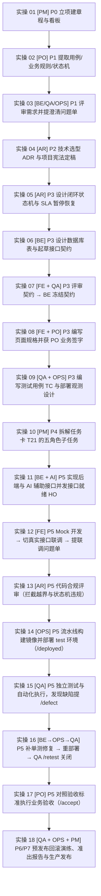

# 06 各岗位角色提示词实操演练全流程手册（从立项到功能上线的手把手操作实例）

> 工单平台、特定行业、技术栈、模块编号与任务数量均为演练示例，不自动成为新项目需求或架构决策；复制模板后按实际 SRS 取舍。

> **多人协作前置规则（复制提示词时一并加载）**：先按 AGENTS.md 声明 user_id、actor_id、role_id、task_id、lane_id；同角色多人各用独立分支/worktree，先领取不相交的文件与资源。自己的文档和代码在自检提交后分别冻结；任何冻结修改（含兼容变化、格式化）先有明确接口/功能干涉依据及真人批准，批准可指定其他用户/角色接手，无需原角色回来。冻结单据的回复另建记录。所有新文档放 z-readme/ 并使用时间戳与人员标识；固定示例名是内容类型，不是免除命名要求。运行锁以共享协调中心为准，Markdown 摘要不作为锁。具体命令见 `z-readme/202611122304_冻结并行开发与Git合并操作手册.md`。

> **文档目的**：前五份规范（`00~05`）定义了团队规则、文档标准、文件夹边界与提示词总库；本文档则通过一个**端到端真实业务功能——“工单退回补充与重新提交闭环（任务卡 `T21`）”**，按时间顺序完整演示 **PM、PO、AR、BE、FE、QA、OPS、AI 八大角色**在各自的 AI 开发工具会话中：
> 1. **会话怎么开场**（发送什么提示词、加载哪张角色卡）；
> 2. **具体任务提示词怎么发**（直接可复制的完整提示词原文）；
> 3. **AI 代理会读取哪些文件、产出什么文件与内容片段**；
> 4. **发现跨角色问题时怎么提单、怎么交接给下一棒、会话怎么收尾并提交 Git**。
>
> 任何岗位工程师（或一人兼多角的开发者）只需照着本手册中自己角色的演练步骤依样画葫芦，即可完成从需求到上线交付的全部研发工作。

---

## 1. 实操演练全局接力路线图（18 个实操会话接力棒）



### 1.1 每个角色会话的固定三步曲（所有 AI 工具通用）

无论你使用 Cursor、Codex、Qoder、Antigravity、Windsurf、Cline、Claude Code 还是 OpenCode，每次执行下面任意一棒时，都固定执行这三步：

| 步序       | 你的操作                                                                                    | 目的                                                         |
| ---------- | ------------------------------------------------------------------------------------------- | ------------------------------------------------------------ |
| **第一步** | 开启一个**全新对话/会话**，发送【开场提示词】加载本岗位角色卡                               | 锁定唯一角色身份与 `OWNERS.md` 可写目录，读取待办单据        |
| **第二步** | 发送本棒对应的【任务实操提示词】（见下文第 2–9 章实例）                                     | 在限定上下文与限定目录内完成设计、编码、测试、部署或评审任务 |
| **第三步** | 发送【收尾提示词】，并在终端执行 `validate_project.py --align --files <本泳道已领取的文件>` | 自检未越界、生成交接单/问题单、更新泳道与看板、按规范提交    |

---

## 2. 阶段 P0–P1 实操演练：从原始 SRS 到需求基线（PM / PO / BE / QA / OPS）

> **前置状态**：真人已将《智慧工单管理系统原始需求规格说明书》放入 `z-docs/SRS_工单管理系统.md`。

---

### 实操 01：【PM 项目经理】立项初始化团队章程、看板与阶段计划（P0）

#### ① PM 会话开场输入
```text
我是本项目的项目经理（PM）。
请先阅读：AGENTS.md、.agents/roles/PM.md、_STATE.md、_TASKLISTS.md、z-readme/collab/202611122304_团队成员与职责.md、z-readme/collab/202611122304_协作看板模板.md、z-docs/SRS_工单管理系统.md 的第 1–2 章。
请确认你已知晓 PM 的唯一可写路径，不要修改需求与代码。
```

#### ② PM 任务实操提示词（对应 `PM-01` + `PM-02`）
```text
【角色】你是本项目 PM。
【任务】执行 P0 阶段初始化（T000-PM）：
1. 创建泳道文件 z-readme/lanes/YYYYMMDDHHMM_T000-PM-pm01-s01.md（role_id=PM，status=IN_PROGRESS，owned_paths 为 PM 可写路径）；
2. 根据 z-docs/SRS_工单管理系统.md 第 1–2 章，完善 z-readme/collab/202611122304_团队成员与职责.md：填写项目名称"智慧工单管理系统（SG-WOP）"、项目目标、七大核心角色+AI 扩展角色就位表、五类争议裁决归属表；
3. 初始化 z-readme/collab/202611122304_协作看板模板.md：确保交接单、问题与缺陷单、评审单、变更单、阻塞项五张表表头齐全；在交接单表登记 HO-001（PM 通知全体角色开始 P0 需求通读）；
4. 创建 z-readme/collab/handoff/YYYYMMDDHHMM_HO-001-启动P0需求通读.md，通知 PO、AR、BE、FE、QA、OPS 各自完成 P0 任务；
5. 更新 z-readme/202611122304_开发计划模板.md 第 0 节"P0–P7 阶段里程碑计划"，并将 _STATE.md 的当前阶段更新为"P0 项目启动（进行中）"。
```

#### ③ PM 会话预期产出核对与 Git 提交
- **生成/更新文件**：`z-readme/lanes/YYYYMMDDHHMM_T000-PM-pm01-s01.md`、`z-readme/collab/202611122304_团队成员与职责.md`、`z-readme/collab/202611122304_协作看板模板.md`、`z-readme/collab/handoff/YYYYMMDDHHMM_HO-001-启动P0需求通读.md`、`z-readme/202611122304_开发计划模板.md`、`_STATE.md`。
- **终端执行校验与提交**：
  ```powershell
  py -3.11 z-scripts/validate_project.py --align --files <本泳道已领取的文件>
  git add -- _STATE.md z-readme/202611122304_开发计划模板.md z-readme/collab/202611122304_团队成员与职责.md z-readme/collab/202611122304_协作看板模板.md z-readme/collab/handoff/YYYYMMDDHHMM_HO-001-启动P0需求通读.md z-readme/lanes/YYYYMMDDHHMM_T000-PM-pm01-s01.md
  git commit -m "[PM][T000][pm01] docs: 建立团队章程与启动交接"
  ```

---

### 实操 02：【PO 产品经理】建立需求索引并编写“退回补充”用例、业务规则与状态机（P1）

#### ① PO 新开会话开场输入
```text
我是本项目的产品经理/业务设计师（PO）。
请先阅读：AGENTS.md、.agents/roles/PO.md、.agents/workflows/inbox.md、z-readme/collab/202611122304_协作看板模板.md。
请列出指派给 PO 的待办交接单，并确认 PO 的默认职责目录（仍须个人领取）。
```

#### ② PO 任务实操提示词（对应 `PO-02`、`PO-05`、`PO-06`、`PO-07`）
```text
【角色】你是本项目 PO。
【任务】针对 z-docs/SRS_工单管理系统.md 中"提交—评审—退回补充—重新提交—通过"核心闭环，完成需求分析包：
1. 在 z-readme/202611122304_需求索引模板.md 中登记工单退回补充相关原始需求条款编号（FR-RET-001 ~ FR-RET-008）与性能/安全非功能需求（NFR-PERF-001、NFR-SEC-001）；
2. 在 z-readme/analysis/YYYYMMDDHHMM_02-用例规格.md 中编写用例【UC-RET-001 评审人退回工单要求补充】与【UC-RET-002 提交人补充材料并重新提交】：
   - 必须包含：基本信息表（关联 FR-RET-*）、主成功场景（1..N 步）、扩展异常场景（退回原因未填、未标记问题字段、退回次数已达上限 3 次、并发已被其他评审人处理、非原提交人尝试补充）；
3. 在 z-readme/analysis/YYYYMMDDHHMM_03-业务规则库.md 中编写可测试的业务规则 BR-RET-001 ~ BR-RET-006：
   - BR-RET-001（退回必填校验）：退回时退回原因不少于 10 个字符，且至少勾选 1 个问题字段，否则拒绝并返回错误码 B0311；
   - BR-RET-002（最大退回次数）：同一工单累计退回补充次数默认上限为 3 次（可按工单类型配置），第 4 次点击退回时系统禁止退回并提示"已达最大退回次数，请直接作出驳回或通过决定"（错误码 B0302）；
   - BR-RET-003（SLA 计时暂停与恢复）：工单状态进入 WAIT_SUPPLEMENT（待补充）时，评审 SLA 计时器立即暂停，启动补充限时计时器（默认 48 工作小时）；提交人重新提交进入 IN_REVIEW 时，补充计时器停止，评审 SLA 计时器从暂停点继续累计；
   - BR-RET-004（重新提交路由策略）：退回时评审人可选择"重提后直达本评审节点（DIRECT_BACK）"或"重提后从头逐级重审（RESTART_ALL）"；
   - BR-RET-005（版本快照与字段级 Diff）：每次退回与每次重新提交均保存表单数据完整快照，系统自动计算修改前后的字段级差异供评审人核对；
4. 在 z-readme/analysis/YYYYMMDDHHMM_04-状态机规格.md 中输出工单主状态机：
   - 状态清单（DRAFT / SUBMITTED / IN_REVIEW / WAIT_SUPPLEMENT / APPROVED / REJECTED / WITHDRAWN / CLOSED）；
   - Mermaid stateDiagram-v2 状态图；
   - 状态转换表（重点写出 ST-WO-T04: IN_REVIEW --[RETURN_SUPPLEMENT]--> WAIT_SUPPLEMENT，以及 ST-WO-T05: WAIT_SUPPLEMENT --[RESUBMIT]--> IN_REVIEW 的守卫条件、动作与副作用）；
   - 状态 × 事件全矩阵（严禁留空单元格，非法转换填"拒绝: B0301"）。
5. 完成后按 .agents/workflows/handoff.md 创建交接单 z-readme/collab/handoff/YYYYMMDDHHMM_HO-002-需求分析包提请多方评审.md，接收方填 AR、BE、FE、QA、OPS，并更新 BOARD.md。
```

#### ③ PO 会话产出示例片段（AI 代理在 `z-readme/analysis/YYYYMMDDHHMM_03-业务规则库.md` 中的实际落盘效果）
| 规则编号     | 规则名称         | 类别 | 触发时机         | 精确规则表达式（IF / THEN / ELSE）                                                                           | 默认参数             | 关联需求    | 可测试断言说明                                              |
| ------------ | ---------------- | ---- | ---------------- | ------------------------------------------------------------------------------------------------------------ | -------------------- | ----------- | ----------------------------------------------------------- |
| `BR-RET-001` | 退回必填项校验   | 校验 | 点击确认退回时   | IF `len(trim(reason)) >= 10` AND `count(issueFields) >= 1` THEN 允许执行 `ST-WO-T04` ELSE 拒绝并返回 `B0311` | `minReasonLen=10`    | `FR-RET-01` | 传入 9 字原因或空字段数组，断言 HTTP 200 且 `code=="B0311"` |
| `BR-RET-002` | 退回次数上限控制 | 流转 | 点击确认退回时   | IF `order.returnCount < typeConfig.maxReturnCount` THEN `returnCount += 1` ELSE 拒绝并返回 `B0302`           | `maxReturnCount=3`   | `FR-RET-03` | 对 `returnCount==3` 的工单调退回接口，断言返回 `B0302`      |
| `BR-RET-003` | SLA 暂停与恢复   | 时效 | 状态进出待补充时 | 进入 `WAIT_SUPPLEMENT` 时 `reviewSla.pause()`；执行 `ST-WO-T05` 重提时 `reviewSla.resume()`                  | `supplementHours=48` | `FR-RET-05` | 暂停期间推进可调时钟 24h，恢复后断言已用评审时长未增加      |

---

### 实操 03：【BE + QA + OPS】并行评审需求分析包并提出问题单/评审单（P1）

三个角色各自开启独立会话，读取 `HO-002` 后从本专业视角挑刺（**绝不直接修改 PO 的文档**）：

#### ① BE 会话输入的提示词（对应 `BE-02`）
```text
我是本项目后端开发工程师（BE）。请先阅读 .agents/roles/BE.md 与 z-readme/collab/handoff/YYYYMMDDHHMM_HO-002-需求分析包提请多方评审.md。
请评审 z-readme/analysis/YYYYMMDDHHMM_03-业务规则库.md 与 04-状态机规格.md 的后端可实现性与并发边界：
1. 若发现"多级会签节点中，A 评审人点击通过、B 评审人同时点击退回补充"的并发与状态裁决规则未定义，请按 .agents/workflows/ask.md 创建问题单 z-readme/collab/issues/YYYYMMDDHHMM_IS-001-会签节点退回补充裁决规则澄清.md 指派给 PO；
2. 出具评审单 z-readme/collab/reviews/YYYYMMDDHHMM_RV-001-BE对需求分析包评审.md，并登记到 BOARD.md。
```

#### ② QA 会话输入的提示词（对应 `QA-02`）
```text
我是本项目测试工程师（QA）。请先阅读 .agents/roles/QA.md 与 HO-002。
请对 z-readme/analysis/02~04 进行可测试性评审，输出 z-readme/collab/reviews/YYYYMMDDHHMM_RV-002-QA可测试性评审.md：
重点检查：① BR-RET-003 的"48 工作小时"如何跳过周末与节假日、测试环境如何通过注入时钟在 10 秒内验证超时催办；
② 每个非法状态转换是否有唯一错误码可供接口自动化断言；③ NFR 中退回与重提接口的并发响应时间 P95 指标是否明确。
```

#### ③ OPS 会话输入的提示词（对应 `OPS-02`）
```text
我是本项目运维工程师（OPS）。请先阅读 .agents/roles/OPS.md 与 HO-002。
请评审非功能需求与运行约束的可运维性，输出 z-readme/collab/reviews/YYYYMMDDHHMM_RV-003-OPS可运维性评审.md：
重点检查：退回补充产生历史版本快照与附件增量后的存储容量估算、超时扫描定时任务在多实例部署下的防重复触发要求、审计日志留存期限。
```

> **闭环动作**：随后切回 **PO 会话**，输入 `请按 .agents/workflows/answer.md 处理 IS-001 与 RV-001~003`，PO 在 `03-业务规则库.md` 补充 `BR-RET-007（会签一票退回即整体退回）` 与工作日历规则，评审人复核关闭全部评审单，P1 需求基线关卡通过。

---

## 3. 阶段 P2 实操演练：架构设计、编码规范与权限锁定（AR 主导）

### 实操 04：【AR 系统架构师】定稿技术选型 ADR、编码规范与 `OWNERS.md`（P2）

#### ① AR 会话实操提示词（对应 `AR-05` ~ `AR-08`）
```text
我是本项目系统架构师（AR）。请先阅读 .agents/roles/AR.md、z-readme/analysis/01~04。
请完成以下任务：
1. 编写 z-readme/analysis/YYYYMMDDHHMM_05-领域模型.md：定义工单聚合根 WorkOrder（ENT-WO-001）、评审记录 ReviewRecord（ENT-WO-002）、退回补充单 ReturnSupplementRecord（ENT-WO-003，含问题字段批注列表与重提路由策略）、版本快照 WorkOrderSnapshot（ENT-WO-004）；
2. 在 z-readme/adr/YYYYMMDDHHMM_ADR-001-状态机与流程引擎选型.md 中记录决策：采用"显式领域状态机守卫 + 轻量流程引擎"方案，确保状态流转 100% 经过统一 WorkOrderStateMachine 服务；
3. 编写 z-readme/architecture/YYYYMMDDHHMM_CONVENTIONS.md：
   - 规定后端统一响应结构 Result<T>{code, message, data, traceId}；
   - 规定错误码：B0301（非法状态转换）、B0302（退回次数超限）、B0303（乐观锁版本冲突）、B0311（退回原因或问题字段缺失）；
   - 规定前端所有交互元素必须绑定 data-testid="<page>-<element>-<action>"（如 data-testid="review-return-btn"）；
   - 规定服务端必须提供可被测试环境覆盖的 ClockProvider 接口，以支持 QA 对 SLA 计时进行时间偏移测试；
4. 核对并定稿 z-readme/collab/202611122304_文件归属与评审矩阵.md，发出交接单 HO-003-架构基线与编码规范发布.md 给 BE、FE、QA、OPS。
```

---

## 4. 阶段 P3 实操演练：详细设计、契约冻结与测试用例设计（AR / BE / FE / PO / QA / OPS）

### 实操 05：【AR 系统架构师】编写核心闭环与状态机详细设计（`AR-09`）

```text
【角色】你是本项目 AR。
【任务】编写 z-readme/design/YYYYMMDDHHMM_04-流程引擎与闭环设计.md 中"退回补充与重新提交闭环"章节：
1. 画出完整时序图：评审人发起退回 → 状态机校验 ST-WO-T04 与 BR-RET-001/002 → 写入退回记录与问题字段清单 → 保存退回前快照 → 暂停评审 SLA 计时器并启动补充计时器 → 发送待补充通知；以及提交人修改问题字段 → 生成字段级 Diff → 状态机执行 ST-WO-T05 → 恢复评审 SLA → 按 DIRECT_BACK 或 RESTART_ALL 路由到目标评审节点；
2. 给出后端 WorkOrderStateMachine 核心接口签名与乐观锁防并发伪代码。
```

---

### 实操 06：【BE 后端开发】设计退回记录表并起草接口契约草案（`BE-04` + `BE-05`）

```text
【角色】你是本项目 BE。请先阅读 .agents/roles/BE.md、z-readme/analysis/03~05、z-readme/architecture/YYYYMMDDHHMM_CONVENTIONS.md、z-readme/design/YYYYMMDDHHMM_04-流程引擎与闭环设计.md。
【任务】
1. 在 z-readme/design/db/YYYYMMDDHHMM_workorder.md 中设计两张表：
   - TBL-WO-MAIN（t_work_order）：含 status、return_count、max_return_count、sla_paused、sla_elapsed_seconds、version（乐观锁）等字段；
   - TBL-WO-RETURN（t_work_order_return）：记录每次退回补充明细（id, order_id, round_no, from_node, reviewer_id, return_reason, issue_fields_json, resubmit_strategy, before_snapshot_json, after_snapshot_json, diff_json, returned_at, resubmitted_at, status）；给出完整 DDL 與索引；
2. 在 z-readme/design/api/YYYYMMDDHHMM_workorder.md 中起草 3 个接口契约（状态标为"草案 v0.9"）：
   - API-WO-005：POST /api/v1/work-orders/{id}/return-supplement（评审退回补充）
   - API-WO-006：POST /api/v1/work-orders/{id}/resubmit（提交人补充后重新提交）
   - API-WO-007：GET  /api/v1/work-orders/{id}/return-history（查询退回历史、问题字段批注与字段级 Diff）
   每个接口必须包含：元信息表、请求/响应字段表、完整成功/失败 JSON 示例、校验的 BR 编号、调用的 ST-T 编号、错误码表（B0301/B0302/B0303/B0311）、以及详情返回的 actions[] 计算规则；
3. 创建交接单 z-readme/collab/handoff/YYYYMMDDHHMM_HO-004-工单退回补充接口契约提请评审.md，发给 FE、QA、AR。
```

---

### 实操 07：【FE + QA】评审接口契约 → 【BE】修订并正式冻结契约（`FE-06` + `BE-05`）

#### ① FE 会话发送契约评审提示词
```text
我是本项目前端开发工程师（FE）。请阅读 .agents/roles/FE.md 与 HO-004、z-readme/design/api/YYYYMMDDHHMM_workorder.md。
请从前端实现视角评审 API-WO-005 ~ 007，输出 z-readme/collab/reviews/YYYYMMDDHHMM_RV-004-FE对退回补充接口契约评审.md：
检查发现：提交人在补充页面需要同时看到"每个问题字段的中文标签、原填报值、评审人对该字段的单条批注说明"，请要求 BE 在 API-WO-007 的 issueFields 数组中明确返回 {fieldKey, fieldLabel, oldValue, comment} 结构，并在详情接口返回 remainingReturnCount（剩余可退回次数）供评审弹窗展示。
```

#### ② BE 会话回复评审并冻结契约
```text
我是本项目 BE。请按 .agents/workflows/answer.md 处理 RV-004：
在 z-readme/design/api/YYYYMMDDHHMM_workorder.md 中补全 issueFields 四字段结构与 remainingReturnCount 字段，将文档头状态更新为"已冻结 v1.0（2026-11-10）"，
发出交接单 z-readme/collab/handoff/YYYYMMDDHHMM_HO-005-工单退回补充接口契约已冻结v1.0.md 给 FE、QA、PM。
```

---

### 实操 08：【FE 前端开发】编写页面规格并由【PO】完成业务签字（`FE-05` + `PO-10`）

#### ① FE 会话提示词
```text
【角色】你是本项目 FE。
【任务】基于冻结的 z-readme/design/api/YYYYMMDDHHMM_workorder.md（v1.0）与 z-readme/analysis/YYYYMMDDHHMM_02-用例规格.md，编写 z-readme/design/ui/YYYYMMDDHHMM_workorder-return.md：
定义 3 个页面/弹窗规格：
- PG-WO-004 评审退回补充弹窗（含剩余退回次数提示、问题字段多选框+单字段批注输入、退回总原因文本框、重提路由策略单选框；声明 data-testid="return-modal"、"return-reason-input"、"return-issue-field-select"、"return-submit-btn"）；
- PG-WO-005 提交人待补充工单编辑页（顶部高亮展示退回原因横幅与补充剩余倒计时，被标记为问题的字段红色高亮并显示评审批注，未修改问题字段时禁止点击重新提交按钮 data-testid="resubmit-btn"）；
- PG-WO-006 退回历史与字段变更 Diff 抽屉（左右对比展示修改前后的字段值，data-testid="return-diff-drawer"）；
每个页面写明加载/空/错误/无权限四态与调用的 API-WO-005~007。完成后发 HO-006 请 PO 业务签字。
```

#### ② PO 会话提示词（业务签字）
```text
我是本项目 PO。请阅读 HO-006 与 z-readme/design/ui/YYYYMMDDHHMM_workorder-return.md，对照 UC-RET-001/002 与 BR-RET-001~006 核查页面元素与交互无遗漏后，
在 z-readme/design/ui/YYYYMMDDHHMM_workorder-return.md 头部写入"业务签字：PO 已确认通过（日期）"，并在 z-readme/acceptance/YYYYMMDDHHMM_用户故事与验收标准.md 中写入故事 US-RET-001 及 6 条 Given/When/Then 验收标准（AC-RET-001-01 ~ 06）。
```

---

### 实操 09：【QA 测试】编写测试用例与数据需求 + 【OPS 运维】编写部署与观测设计（`QA-04/05` + `OPS-04/05`）

#### ① QA 会话提示词
```text
【角色】你是本项目 QA。
【任务】读取冻结的 API-WO-005~007、PG-WO-004~006、BR-RET-001~007、US-RET-001，在 z-readme/design/YYYYMMDDHHMM_07-测试策略与用例.md 中编写测试用例 TC-RET-001 ~ TC-RET-012：
必须覆盖：
- TC-RET-001：正常退回 → 补充问题字段 → 重新提交（DIRECT_BACK 直达原评审人）→ 评审通过（主路径 E2E）；
- TC-RET-002：正常退回 → 重新提交（RESTART_ALL 从头重审）；
- TC-RET-003：退回原因不足 10 字或未选问题字段（边界值，期望 B0311）；
- TC-RET-004：连续退回 3 次成功，第 4 次退回被拒（边界值，期望 B0302）；
- TC-RET-005：工单处于 APPROVED / DRAFT 等非 IN_REVIEW 状态调用退回接口（非法状态转换，期望 B0301）；
- TC-RET-006：非当前节点评审人或跨部门用户调用退回接口、非原提交人调用重新提交接口（越权测试，期望 A0403）；
- TC-RET-007：两名评审人并发点击通过与退回（乐观锁冲突，期望后提交者返回 B0303）；
- TC-RET-008：进入待补充后 SLA 暂停、重新提交后 SLA 恢复计时验证；
- TC-RET-009：重新提交后 Diff 抽屉准确展示字段修改前后值。
同步在 z-readme/test/YYYYMMDDHHMM_测试数据与环境需求.md 中写明所需的测试账号（submitter_01、reviewer_01、other_dept_user）与可调时钟需求，发 HO-007 给 OPS。
```

#### ② OPS 会话提示词
```text
【角色】你是本项目 OPS。
【任务】根据 HO-007 与架构设计，在 z-readme/design/YYYYMMDDHHMM_08-部署与运维设计.md 中补充：
1. 测试环境（test）开启时间偏移测试开关 `APP_CLOCK_OFFSET_ENABLED=true`（生产环境 prod 强制为 false）的环境变量说明；
2. 补充超时提醒定时任务的单实例锁配置；
3. 业务监控指标：`workorder_return_total`（退回计数）、`workorder_supplement_timeout_total`（补充超时计数）及告警规则。
```

---

## 5. 阶段 P4 实操演练：开发计划与角色子任务拆解（PM 主导）

### 实操 10：【PM 项目经理】拆解任务卡 `T21` 并排入迭代 `I3`（`PM-06` + `PM-07`）

```text
【角色】你是本项目 PM。
【任务】在 z-readme/202611122304_开发计划模板.md 中编写任务卡【T21 工单退回补充与重新提交闭环】，拆分为 5 个角色子任务并更新 z-readme/202611122304_进度看板模板.md 与 BOARD.md：
- T21-BE（BE）：实现 Flyway 脚本 V1_0_21__work_order_return.sql、退回与重提状态机转换 ST-WO-T04/T05、API-WO-005~007、SLA 暂停/恢复、字段级 Diff 计算及后端单测/接口测试；完成后发"接口就绪 HO"给 FE 与 QA；
- T21-AI（AI/BE）：实现 AIF-004"AI 辅助生成退回原因与问题字段定位建议"接口及假模型桩；
- T21-FE（FE）：按契约 Mock 实现 PG-WO-004~006（含全部 data-testid 与组件测试），收到 T21-BE 接口就绪 HO 后切换真实接口完成联调；
- T21-OPS（OPS）：在 test 环境配置可调时钟参数，在 T21-BE/FE 合并 develop 后触发流水线构建镜像并部署 test 环境，发 `/deployed` 交接单给 QA；
- T21-QA（QA）：编写 tests/api/test_workorder_return.py 与 web/e2e/workorder-return.spec.ts，在收到 OPS 部署通知后执行 TC-RET-001~012，缺陷清零后发"测试通过可验收 HO"给 PO。
```

---

## 6. 阶段 P5 实操演练：多角色并行编码、联调、代码评审、部署、测试与验收

### 实操 11：【BE 后端开发】测试先行实现 `T21-BE` 并发出“接口就绪”交接单（`BE-08` ~ `BE-10`）

#### ① BE 会话第一步：只读预分析（`BE-08`）
```text
我是本项目 BE，将执行子任务 T21-BE。
请先只读阅读：AGENTS.md、.agents/roles/BE.md、z-readme/202611122304_开发计划模板.md 中 T21、z-readme/design/db/YYYYMMDDHHMM_workorder.md、z-readme/design/api/YYYYMMDDHHMM_workorder.md（已冻结 v1.0）、z-readme/design/YYYYMMDDHHMM_04-流程引擎与闭环设计.md。
请先不要写代码，输出不超过 20 行的实施计划：迁移脚本路径、新增/修改的 Java 类路径、实现的 API 编号、对应的单元测试类与覆盖的 BR/ST 编号，并创建泳道文件 z-readme/lanes/YYYYMMDDHHMM_<TASK>-<ROLE>-<USER>-<SESSION>.md。
```

#### ② BE 会话第二步：编码实现与自测交接（`BE-09` + `BE-10`）
```text
请按实施计划完成 T21-BE 编码与自测（严格只写 server/ 目录）：
1. 编写迁移脚本 server/src/main/resources/db/migration/V1_0_21__work_order_return.sql；
2. 在 WorkOrderStateMachine 中实现 ST-WO-T04（IN_REVIEW → WAIT_SUPPLEMENT）与 ST-WO-T05（WAIT_SUPPLEMENT → IN_REVIEW），方法注释必须标注 // 依据: BR-RET-001, BR-RET-002, BR-RET-003, ST-WO-T04；
3. 实现 API-WO-005、API-WO-006、API-WO-007 的 Service 与 Controller（URL、请求响应字段、错误码 B0301/B0302/B0303/B0311 与冻结契约逐字一致，加权限注解与审计日志）；
4. 编写单元测试与接口集成测试 WorkOrderReturnIntegrationTest，覆盖正常退回重提、原因过短(B0311)、超过3次退回(B0302)、非法状态(B0301)、乐观锁冲突(B0303)、SLA 暂停与恢复；
5. 运行 `mvn test -Dtest=*WorkOrderReturn*` 并贴出真实通过结果；
6. 按 .agents/workflows/handoff.md 创建交接单 z-readme/collab/handoff/YYYYMMDDHHMM_HO-010-T21后端接口就绪.md 发给 FE 与 QA（附上测试账号、cURL 示例请求与响应报文）。
```

---

### 实操 12：【FE 前端开发】Mock 并行开发 → 切换真实接口联调 → 提联调问题单（`FE-09` ~ `FE-11`）

#### ① FE 会话第一步：基于冻结契约与 Mock 实现页面（`FE-09` + `FE-10`）
```text
我是本项目 FE，将执行子任务 T21-FE（严格只写 web/ 下除 web/e2e/ 之外的目录）。
请先阅读 .agents/roles/FE.md、z-readme/design/api/YYYYMMDDHHMM_workorder.md（v1.0）、z-readme/design/ui/YYYYMMDDHHMM_workorder-return.md（已获 PO 签字），完成：
1. 创建泳道 z-readme/lanes/YYYYMMDDHHMM_<TASK>-<ROLE>-<USER>-<SESSION>.md；
2. 在 web/src/types/workorder.ts 与 web/src/api/workorder.ts 中定义 API-WO-005~007 的精确 TypeScript 类型与请求函数；
3. 在 web/src/mock/workorder.ts 中编写带 API 编号注释的 Mock（覆盖正常、空历史、B0302 次数超限、B0303 并发冲突）；
4. 实现组件 ReturnSupplementModal.vue（PG-WO-004）、OrderSupplementEdit.vue（PG-WO-005）、ReturnDiffDrawer.vue（PG-WO-006），严格按规格绑定全部 data-testid 属性与 v-perm 权限指令，处理加载/空/错误/无权限四态；
5. 编写组件单元测试并运行 lint、typecheck、unit test 贴出结果。
```

#### ② FE 会话第二步：收到 `HO-010` 后切真实接口联调（`FE-11`）
```text
我已收到 BE 的接口就绪交接单 HO-010。请关闭本模块 Mock 开关，连接真实后端联调 API-WO-005~007：
- 若联调中发现 API-WO-007 返回的 diffList 中日期格式与契约不一致，请严禁在前端写脏正则兼容，立即按 .agents/workflows/ask.md 创建问题单 z-readme/collab/issues/YYYYMMDDHHMM_IS-005-退回Diff接口日期格式与契约不符.md 指派给 BE；
- 待 BE 修复验证通过后，创建交接单 z-readme/collab/handoff/YYYYMMDDHHMM_HO-011-T21前后端联调完成提请代码评审与部署.md 发给 AR 与 OPS。
```

---

### 实操 13：【AR 系统架构师】执行代码合规评审（`AR-14` + `/review`）

```text
我是本项目 AR。请加载 .agents/roles/REVIEWER-ARCH.md 与 .agents/workflows/review.md，对 feature/T21-be 与 feature/T21-fe 分支执行代码评审：
1. 核对 git diff --name-only 是否 100% 落在 BE 与 FE 各自的 OWNERS.md 路径内（确认 FE 未触碰 web/e2e/ 或 server/）；
2. 核对后端状态修改是否唯一通过 WorkOrderStateMachine，有无直接 mapper.updateStatus 的违规代码；
3. 核对前端 PG-WO-004~006 的 data-testid 是否与 z-readme/design/ui/YYYYMMDDHHMM_workorder-return.md 完全一致；
4. 输出评审单 z-readme/collab/reviews/YYYYMMDDHHMM_RV-008-T21代码评审.md。确认无"必须修改"项后结论置为"通过"，通知 PM 合并入 develop 分支。
```

---

### 实操 14：【OPS 运维工程师】构建镜像、部署 `test` 环境并移交 QA（`OPS-09` + `/deployed`）

```text
我是本项目 OPS。PM 已将 T21-BE 与 T21-FE 合并入 develop 分支（提交号 a8f3c21）。
请先阅读 .agents/roles/OPS.md 与 .agents/workflows/deployed.md，执行：
1. 更新 deploy/compose.test.yml 与 deploy/.env.example（加入 APP_CLOCK_OFFSET_ENABLED=true）；
2. 构建多阶段镜像并拉起 test 环境，检查 Flyway V1_0_21 迁移成功、/actuator/health 返回 UP；
3. 生成部署记录 z-readme/ops/YYYYMMDDHHMM_部署记录-test-v0.3.0-a8f3c21.md（记录镜像标签、Git 提交号 a8f3c21、包含任务卡 T21）；
4. 创建交接单 z-readme/collab/handoff/YYYYMMDDHHMM_HO-012-版本v0.3.0-a8f3c21已部署test环境.md 发给 QA。
```

---

### 实操 15：【QA 测试工程师】执行独立测试与自动化脚本，发现缺陷并提单（`QA-08` + `/defect`）

```text
我是本项目 QA。已收到 OPS 的部署交接单 HO-012（版本 v0.3.0-a8f3c21，环境 test）。
请先阅读 .agents/roles/QA.md、.agents/workflows/gate.md、.agents/workflows/defect.md、z-readme/design/YYYYMMDDHHMM_07-测试策略与用例.md 中 TC-RET-001~012，执行：
1. 准入核对：确认版本构建号与提交号 a8f3c21 可追溯，运行冒烟套件通过；
2. 在 tests/api/test_workorder_return.py 中编写并运行接口自动化测试（覆盖 TC-RET-003 ~ 008）；
3. 在 web/e2e/workorder-return.spec.ts 中使用 data-testid 编写并运行 Playwright E2E 测试（覆盖 TC-RET-001、002、009）；
4. 将执行结果记录到 z-readme/test/YYYYMMDDHHMM_迭代I3-执行记录.md；
5. 【发现缺陷】：在执行 TC-RET-008 时发现"当工单第 2 次被退回并重新提交后，sla_elapsed_seconds 被意外清零而非累加第 1 轮已耗用时长"。
   请严格遵守 QA 铁律（绝不修改 server/ 代码），按 /defect 创建缺陷单 z-readme/collab/issues/YYYYMMDDHHMM_IS-006-二次退回重提后SLA已耗用时长被清零.md：
   - 类型=缺陷，严重级别=严重，指派角色=BE，关联用例=TC-RET-008，发现版本=v0.3.0-a8f3c21；
   - 写明完整复现步骤、期望结果（引用 BR-RET-003）、实际数据库查询值与日志 traceId，并登记到 BOARD.md。
```

---

### 实操 16：【BE 修复 → OPS 重部署 → QA 复测关闭】缺陷闭环三步曲（`BE-11` → `OPS-09` → `QA-09`）

#### ① BE 会话修复缺陷（严禁自行关闭缺陷单）
```text
我是本项目 BE。请读取指派给我的严重缺陷单 z-readme/collab/issues/YYYYMMDDHHMM_IS-006-二次退回重提后SLA已耗用时长被清零.md：
1. 先在 WorkOrderReturnIntegrationTest 中新增测试方法 shouldAccumulateSlaElapsedSecondsAcrossMultipleReturnRounds() 复现该缺陷（断言失败）；
2. 定位并修复 WorkOrderSlaService.resumeSla() 中重置累计秒数的 Bug，重跑单测与集成测试全部变绿；
3. 在 IS-006.md 的"根因与修复记录"栏填写根因（文件与行号）、修改文件、新增单测方法名与通过结果，将状态改为"待部署"（严禁改为已关闭），通知 OPS。
```

#### ② OPS 会话重新部署 `test` 环境
```text
我是本项目 OPS。BE 的缺陷修复（IS-006，提交号 9d4e110）已合入 develop。
请构建并部署新版本 v0.3.1-9d4e110 到 test 环境，执行 /deployed 生成部署记录，将 BOARD.md 中 IS-006 状态更新为"待复测"并发 HO-013 通知 QA。
```

#### ③ QA 会话执行 `/retest` 复测并放行给 PO
```text
我是本项目 QA。已收到 OPS 的 HO-013（新版本 v0.3.1-9d4e110）。
请按 .agents/workflows/retest.md 对 IS-006 执行复测：
1. 重跑 tests/api/test_workorder_return.py 与 web/e2e/workorder-return.spec.ts 全量 12 条用例（TC-RET-001~012）；
2. 确认 TC-RET-008 及全部回归用例 100% 通过后，在 IS-006.md 填写复测记录并将状态正式改为"已关闭"；
3. 创建交接单 z-readme/collab/handoff/YYYYMMDDHHMM_HO-014-T21测试通过可进行业务验收.md 发给 PO（附上 12 条用例全部通过的执行记录路径）。
```

---

### 实操 17：【PO 产品经理】对照验收标准执行正式业务验收（`PO-12` + `/accept`）

```text
我是本项目 PO。已收到 QA 的"测试通过可验收"交接单 HO-014。
请加载 .agents/roles/ACCEPTOR-BIZ.md 与 .agents/workflows/accept.md，对用户故事 US-RET-001 进行业务验收：
1. 逐条核对 z-readme/acceptance/YYYYMMDDHHMM_用户故事与验收标准.md 中的 AC-RET-001-01 ~ 06 与 QA 测试证据/界面演示结果；
2. 在 z-readme/acceptance/YYYYMMDDHHMM_验收记录.md 追加验收通过记录（标注前置 QA 交接单 HO-014）；
3. 发出交接单 HO-015-US-RET-001业务验收通过.md 通知 PM，由 PM 更新 PROGRESS.md 并将稳定功能登记至 _CHECKLISTS.md。
```

---

## 7. 阶段 P6–P7 实操演练：系统测试、预发布回滚演练与上线交付（QA / OPS / AR / PM）

### 实操 18：【OPS 预发布演练】+【QA 准出门禁】+【PM 发布评审与真人拍板】

#### ① OPS 会话执行预发布部署与回滚演练（`OPS-10` + `/ready`）
```text
我是本项目 OPS。当前进入 P6 阶段，候选发布分支为 release/v1.0.0。
请按 z-readme/05_分阶段分角色提示词总手册.md 中的【OPS-10】与 .agents/workflows/ready.md 执行：
1. 在 staging 环境完成从 v0.9.0 升级到 v1.0.0 的演练，记录迁移与启动耗时；
2. 执行一次完整版本回滚演练（v1.0.0 → v0.9.0）与数据库全量备份恢复演练，验证历史数据兼容且耗时满足 RTO ≤ 15 分钟、RPO = 0；
3. 加载 .agents/roles/CHECKER-OPS.md 核对镜像非 root、无明文密钥、健康检查与监控告警规则；
4. 输出 z-readme/ops/YYYYMMDDHHMM_预发布与演练报告-v1.0.0.md（结论：部署就绪），发 HO 给 PM 与 AR。
```

#### ② QA 会话执行准出门禁核对并出具准出报告（`QA-11` + `QA-12` + `/gate`）
```text
我是本项目 QA。请按【QA-11】【QA-12】与 .agents/workflows/gate.md 对 staging 环境 v1.0.0 执行：
1. 汇总全量功能、接口自动化、E2E、兼容性、k6 性能压测与 OWASP 安全测试结果；
2. 加载 .agents/roles/CHECKER-QA.md 执行 `/gate 准出 v1.0.0`，生成 z-readme/test/YYYYMMDDHHMM_门禁-准出-v1.0.0.md（核对用例执行率 100%、FR 覆盖率 100%、致命/严重缺陷 = 0）；
3. 生成 z-readme/test/YYYYMMDDHHMM_系统测试与准出报告-v1.0.0.md 与终版 z-readme/delivery/YYYYMMDDHHMM_测试报告.md（结论：准予发布），发 HO 给 PM。
```

#### ③ PM 会话汇总四方结论并向真人发起发布批准请求（`PM-12`）
```text
我是本项目 PM。请读取 QA 准出报告、AR-16 安全性能评审单、OPS 预发布与回滚演练报告、PO-14 系统验收报告，
按【PM-12】生成 z-readme/collab/meetings/YYYYMMDDHHMM_发布评审会-v1.0.0.md，核对四方结论全部为"通过"后，
暂停并向真人输出唯一决策请求："v1.0.0 已通过 QA 准出、AR 安全性能评审、OPS 回滚演练与 PO 系统验收，是否批准在生产窗口发布 v1.0.0？"
（未经真人明确回复批准，严禁通知 OPS 执行生产环境发布。）
```

---

## 8. 各岗位日常实操“一句话速查卡”

| 你的岗位 | 每次开工第一句发什么                                                                 | 干活时去哪找提示词                                                     | 遇到别人文档/代码有问题怎么办                   | 干完活收尾发什么                                                   |
| -------- | ------------------------------------------------------------------------------------ | ---------------------------------------------------------------------- | ----------------------------------------------- | ------------------------------------------------------------------ |
| **PM**   | `我是本项目 PM，请读 .agents/roles/PM.md 并按 .agents/workflows/inbox.md 汇报待办`   | `z-readme/05_分阶段分角色提示词总手册.md` 查 `PM-01 ~ PM-13`           | 发 `/ask <角色>` 督办或在 `BOARD.md` 标阻塞     | `按 .agents/workflows/wrapup.md 收尾` + 运行 `validate_project.py` |
| **PO**   | `我是本项目 PO，请读 .agents/roles/PO.md 并按 .agents/workflows/inbox.md 汇报待办`   | 同上查 `PO-01 ~ PO-15`（验收用 `/accept`）                             | 验收不过提 `IS`（验收缺陷），改基线提 `/cr`     | `按 .agents/workflows/handoff.md 交接下游并执行 wrapup.md`         |
| **AR**   | `我是本项目 AR，请读 .agents/roles/AR.md 并按 .agents/workflows/inbox.md 汇报待办`   | 同上查 `AR-01 ~ AR-17`（代码与设计评审用 `/review`）                   | 出具 `RV-xxx` 评审单标“必须修改”，绝不代改代码  | `按 .agents/workflows/wrapup.md 收尾`                              |
| **BE**   | `我是本项目 BE，请读 .agents/roles/BE.md 并按 .agents/workflows/inbox.md 汇报待办`   | 同上查 `BE-01 ~ BE-14`                                                 | 需求不清 `/ask PO`，契约需破坏性修改提 `/cr`    | 发“接口就绪 `HO`”给 FE/QA；修完缺陷状态改 `待部署`（禁自关）       |
| **FE**   | `我是本项目 FE，请读 .agents/roles/FE.md 并按 .agents/workflows/inbox.md 汇报待办`   | 同上查 `FE-01 ~ FE-15`                                                 | 后端返回与契约不符提 `/ask BE`，禁前端打脏补丁  | 发“联调完成待测试 `HO`”给 OPS/QA；修完缺陷改 `待部署`              |
| **QA**   | `我是本项目 QA，请读 .agents/roles/QA.md 并按 .agents/workflows/inbox.md 汇报待办`   | 同上查 `QA-01 ~ QA-13`（门禁 `/gate`、提单 `/defect`、复测 `/retest`） | 一律发 `/defect` 提缺陷单，严禁改被测业务代码   | 缺陷清零后发“测试通过可验收 `HO`”给 PO                             |
| **OPS**  | `我是本项目 OPS，请读 .agents/roles/OPS.md 并按 .agents/workflows/inbox.md 汇报待办` | 同上查 `OPS-01 ~ OPS-12`（部署记录 `/deployed`、就绪核对 `/ready`）    | 服务不符合部署规范提 `/ask BE/FE`，禁改业务码   | 每次部署生成记录并发 `版本已部署 HO` 给 QA                         |
| **AI**   | `我是本项目 AI，请读 .agents/roles/AI.md 并按 .agents/workflows/inbox.md 汇报待办`   | 同上查 `AI-01 ~ AI-03`                                                 | 接口契约问题 `/ask BE`，模型资源问题 `/ask OPS` | 向 BE 发“AI 接口与假桩就绪 `HO`”，向 QA 提供离线评估集             |
