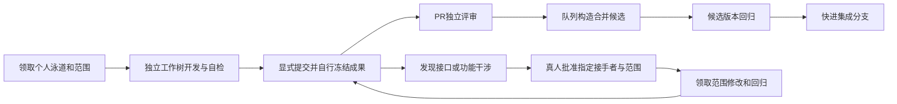

# 冻结、并行开发与 Git 合并操作手册

适用版本：本次优化后的团队模板。命令在复制后的**独立项目 Git 根目录**运行，要求 Python 3.10+，推荐 3.11；Windows 可把 `python3.11` 换成 `py -3.11`。本模板当前位于资料仓库的子目录，协调器会拒绝把父仓库误当成模板项目。

## 一、先理解三条规则

- 每个用户负责冻结自己交付的文档、代码与配置；冻结不等于 STABLE，也不因写锁释放而解除。
- 多名 BE、FE、QA 等可同时工作，各用独立 worktree/分支，领取不相交的路径和资源。
- 确有接口或功能干涉且真人明确批准后，可以由其他用户、其他角色接手修改；原作者不必回来，回归与独立评审仍然保留。



## 二、新项目引导与两名同角色开发者

先复制模板、完成初始 Git 提交，并建立 main/develop。首次初始化是没有协作者参与的引导操作，先核对待提交文件并脱敏；开始协作后不再直接编辑受保护分支。

集成人员从已知基线创建工作树（示例中的任务、人员及路径需替换）：

```bash
git worktree add -b feature/T021-be-dev01-s01 ../project-dev01 develop
git worktree add -b feature/T022-be-dev02-s01 ../project-dev02 develop
```

第一次且仅一次初始化共享协调中心。在任一工作树执行：

```bash
python3.11 z-scripts/team_guard.py init --project project-example
```

dev01 在自己的工作树执行：

```bash
python3.11 z-scripts/team_guard.py claim --lane T021-BE-dev01-s01 --user dev01 --actor dev01-s01 --role BE --task T021 --paths server/orders/ z-readme/roles/BE/dev01/
```

dev02 在另一个工作树执行：

```bash
python3.11 z-scripts/team_guard.py claim --lane T022-BE-dev02-s01 --user dev02 --actor dev02-s01 --role BE --task T022 --paths server/payments/ z-readme/roles/BE/dev02/
```

两个 BE 能同时工作。若 dev02 申请 `server/`、`server/orders/` 或其下某文件，则拒绝。共同依赖的公共模块由单独泳道负责；需要修改同一文件时排队，不用“不同函数/行号”充当文件锁边界。共享输出与迁移号用 `--resource db-migration` 等占用；独立构建目录不必锁成全仓串行。

`policy.json` 按最具体路径匹配；FE 不能领取包含 QA 子目录的整个 `web/`，应领取 `web/src/` 等明确范围。允许跨角色接手的批准仅对指定范围、任务及会话有效。

```bash
python3.11 z-scripts/team_guard.py status
python3.11 z-scripts/team_guard.py heartbeat --lane T021-BE-dev01-s01 --actor dev01-s01
```

同一中心中的一次 claim 失败不会留下部分占用。事务忙时稍后重试，禁止删锁。工具没有定时强制释放；时间到期的人工批准则立即失效。

## 三、提交、冻结与交接

在明确拥有相应路径的前提下，自检后执行：

```bash
git status --short
git diff --cached --name-only
git add -- server/orders/service.py
python3.11 z-scripts/team_guard.py check --lane T021-BE-dev01-s01 --actor dev01-s01 --staged --message '[BE][T021][dev01] feat: 实现订单服务'
git diff --cached
git commit -m '[BE][T021][dev01] feat: 实现订单服务'
python3.11 z-scripts/team_guard.py freeze --lane T021-BE-dev01-s01 --actor dev01-s01 --freeze-id FRZ-T021-code --paths server/orders/ --evidence '任务T021自检记录与评审请求'
python3.11 z-scripts/team_guard.py release --lane T021-BE-dev01-s01 --actor dev01-s01
```

文档、源码可以分别分配冻结号，便于最小范围解冻。冻结只能登记已提交且干净的文件；目录冻结也保护后续新文件加入、删除、重命名与模式变化。`freeze` 会保存整个目录的已跟踪文件清单；空范围、符号链接和子模块被拒绝。源码历史中原作者保留，重新冻结时记录新的责任人和版本。

`check --base <基线SHA>` 检查该基线与当前 HEAD、暂存区和未提交文件的路径并集；重命名按旧路径删除与新路径新增检查。该命令不运行业务测试、不证明批准真实性，也不自动提交。

冻结后创建 HO，记录冻结号、源码提交 SHA 与验证证据。交接单本身另行提交/冻结；不能把交接单的提交 SHA 填成尚不存在的自引用值。接收者以新回执引用原交接号，避免多人修改已冻结单据。

阶段结束时由持有文档泳道的协调员导出：

```bash
python3.11 z-scripts/team_guard.py snapshot --lane T090-AR-admin-s01 --actor admin-s01 --output z-readme/202611122304_冻结协调快照.json
```

该命令要求输出路径已被该泳道领取，且不能覆盖旧快照。纯文档导出泳道不进入导出快照的活跃锁列表；其他活跃泳道仍保留。人工审核快照后显式提交入 Git。协调目录中的状态为运行权威，版本化快照是审计/恢复依据，不能用旧快照替换在线中心。

## 四、人工解冻与其他角色接手

申请正文用 `collab/` 中的变更模板。以下为结构化批准记录示意，**只有真人已经批准后才可按真实信息填写**。占位符、示例身份和示例链接不是有效授权。

```json
{
  "approval_id": "AP-T030-human01-01",
  "freeze_id": "FRZ-T021-code",
  "revision": 1,
  "baseline_commit": "填写冻结记录的完整提交SHA",
  "user_id": "dev03",
  "actor_id": "dev03-s02",
  "role_id": "QA",
  "task_id": "T030",
  "paths": ["server/orders/service.py"],
  "approved_by": "human01",
  "approved_at": "填写带时区的真实批准时间",
  "expires_at": "填写带时区的失效时间",
  "human_evidence": "受保护PR的人工批准链接或本次会话批准记录编号",
  "reason_kind": "functional_interference",
  "reason": "明确的问题与涉及的接口或功能",
  "impact": "受影响功能及调用者",
  "regression": "对应回归命令与人工验收项",
  "rollback": "保留原提交及经批准的恢复方案"
}
```

`reason_kind` 仅允许 `interface_interference` 或 `functional_interference`。L1/L2 都需要真人解冻；兼容性只影响评审和回归规模。

批准记录统一保存到 `z-readme/` 下带时间戳的 JSON，作为结构化审批工件。它必须由受控的人类审批渠道核验；工具只能检查字段，任何开发者都能写 JSON，因此不能把 JSON 本身当作身份认证。

```bash
python3.11 z-scripts/team_guard.py thaw --approval z-readme/202611122304_人工批准AP-T030.json
python3.11 z-scripts/team_guard.py claim --lane T030-QA-dev03-s02 --user dev03 --actor dev03-s02 --role QA --task T030 --paths server/orders/service.py
```

批准绑定人员、会话、角色、任务、路径、冻结版本和期限。接手分支必须已经包含冻结提交；先同步已批准基线，不能从更旧的树直接覆盖新成果。即使默认角色权限不包含源码，明确获准的 QA 也可以接手这一个文件；随后由另一名 QA 做独立验证。其他路径仍不可写。

修改、提交与回归完成后，用原冻结号和原冻结范围重新冻结：

```bash
python3.11 z-scripts/team_guard.py freeze --lane T030-QA-dev03-s02 --actor dev03-s02 --freeze-id FRZ-T021-code --paths server/orders/ --evidence 'T030独立回归记录'
python3.11 z-scripts/team_guard.py release --lane T030-QA-dev03-s02 --actor dev03-s02
```

工具检查整个原范围的内容差异，只有本次领取且获批的文件允许变化。未变动的文件无需扩权。续批创建新 approval_id 并增加 `supersedes` 为旧批准号；未经再次人工批准不能擅自延长有效期。取消时先按人工决策保全或恢复改动，再重新冻结；工具不自动回滚。

原用户仍有运行锁时，thaw 不夺锁。原用户失联则由真人确认进程停止及改动已保全，形成含 `lane_id`、`lane_hash`、`approved_by`、`human_evidence`、`preserved_work`、`process_stopped_evidence` 的恢复批准记录，再执行 `recover --approval ...`。lane_hash 是对 status 返回的该 lane 对象用 `team_guard.digest` 得到的摘要；心跳变化也会使旧恢复记录失效。任何被指定人员可执行，不要求原角色回来。冻结保持不变，再走上面的解冻步骤。

## 五、有序提交与合理合并

每个 PR 提供：源 SHA、目标旧 SHA、任务/人员/泳道、冻结号和版本、接口依赖、人工批准、业务测试命令及结果、回退方案。审查代码也审查审批文件、策略与工具本身的改动。

推荐一个受控集成人员、一个 develop 合并队列：

1. 按依赖排序；公共契约与迁移先于消费者，同模块语义冲突先裁决。
2. 从目标旧 SHA 创建专用 `integration/...` 分支与 worktree。
3. 在队首源 SHA 上执行非快进合并，产生候选提交；普通无冲突合并只组合已冻结树，不修改成果语义。需要人工冲突修复时先检查冻结授权。
4. 记录候选 SHA，运行完整候选的必需测试。无代码冲突也要测契约、迁移顺序、配置、构建与业务交叉影响。
5. 所需评审和验收均针对该候选有效，且目标仍是旧 SHA 时，快进目标到候选。否则重建并重测。
6. 一次合并结束才处理下一项。线上失败以独立修复/经批准的 revert PR 处理，不强推公共历史。

示例命令只供**已经获得集成授权且工作树干净**的集成人员使用；把方括号参数替换成已审查的真实值：

```text
git worktree add -b integration/T021 ../project-integration <目标旧SHA>
git -C ../project-integration merge --no-ff <源SHA> -m "[AR][T021][integrator] chore: 构造集成候选"
git -C ../project-integration rev-parse HEAD
在该工作树运行项目必需检查并登记候选SHA。
在持有目标分支的工作树核对 HEAD 仍等于目标旧SHA。
git merge --ff-only <已验证候选SHA>
```

上述人工模式使用一个受控写入者；不能用一次非原子的“检查后推送”声称跨机器已无竞争。平台模式使用受保护 PR/merge queue，由服务器在检查通过后处理并发目标变化。main 的最终批准绑定实际候选版本，不能把 develop 的旧验收直接用于新合并树。

GitHub 示例见 `.ci/team-checks.example.yml`，只有复制到项目 `.github/workflows/` 并配置保护规则才会运行；`pull_request` 和 `merge_group` 都应触发必需检查。示例只测试模板治理工具，实际项目必须添加构建、业务单测、契约、集成和安全检查。不得把模板自检成功宣称为业务合并门禁通过。

CODEOWNERS 示例只负责请求评审；同一行多名 owner 不表示必须全部批准。需要多角色必审时由平台规则或独立状态检查核对评审矩阵。代码冻结、路径锁、人工审批真实性不能仅靠 CODEOWNERS 实现。

## 六、多人多机器、恢复与能力边界

- 同一仓库的 worktree：默认协调目录位于 Git common dir，自动共享；已用真实 worktree 测试。
- 独立 clone / 不同电脑：必须显式指定同一 `--coord-dir`，由维护者验证共享文件系统支持可靠原子操作。仅把记录提交到 Git 不提供运行互斥。
- 使用企业远程协调服务：本模板没有实现远程服务、数据库事务、SSO、签名审批或网络分区处理，不能声称这些能力已部署。
- 协调状态丢失：停写，从最新**已审核**快照恢复；`init --project ... --snapshot ...` 拒绝活跃泳道或未结束解冻的快照。恢复操作必须另有人工批准，工具不辨认授权者身份。
- `transaction.lock` 残留：备份中心，确认没有活跃协调进程，人工批准后清理；不能根据心跳老旧自动抢锁。
- freeze/check 用本地路径、Git 提交和协调状态做一致性检查；脚本不是 Git 服务端 hook，也没有自动安装任何仓库保护规则。正式启用前要核实权限、分支保护和 CI 实际运行。

## 七、只读与回归命令

```bash
python3.11 z-scripts/validate_project.py
python3.11 z-scripts/test_team_guard.py
```

格式化仅在已经领取文件且没有冻结限制时显式执行：

```bash
python3.11 z-scripts/validate_project.py --align --files readme.md
```

文档校验只验证目录、代码块和明确的固定文档引用，以及策略基本结构；不验证业务正确性、审批真假、所有自然语言单据完整性或真实部署状态。

## 八、官方依据

- [Git worktree](https://git-scm.com/docs/git-worktree)：各 worktree 独立 HEAD/index，共享大多数引用，区分本地提交与共享引用操作。
- [GitHub merge queue](https://docs.github.com/en/repositories/configuring-branches-and-merges-in-your-repository/configuring-pull-request-merges/managing-a-merge-queue)：队列候选检查及 merge_group 触发。
- [受保护分支](https://docs.github.com/en/repositories/configuring-branches-and-merges-in-your-repository/managing-protected-branches/about-protected-branches)：PR、评审与必需检查。
- [checkout](https://github.com/actions/checkout) 与 [setup-python](https://github.com/actions/setup-python)：CI 示例参考当前官方 v7 用法；实际启用时按组织策略锁定已审核版本并验证 runner 兼容性。本次只核对示例，未在远端运行。

官方材料核对日期：2026-11-12。本模板基于这些机制制定协作约束；路径冻结与人工解冻并非 Git 内建能力。
