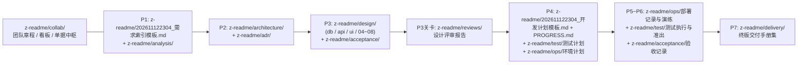

# `z-readme/` —— 项目全生命周期工程与协作文档中心

本目录是项目在 **P0（项目启动）→ P7（交付收尾）** 全生命周期中所有工程设计文档、计划看板、测试与运维记录、跨角色协作单据及最终交付手册的统一承载区。

> **重要区别**：
> - `z-docs/` 仅存放客户/用户提供的**原始输入需求文档（永久只读）**；
> - `z-readme/` 存放团队模板内置的**通用制度规范与分角色提示词手册**；
> - `z-readme/`（本目录）存放**当前项目实际产出的全部需求分析、架构设计、详细设计、测试、运维、计划与协作工件**，各子目录按岗位角色严格分权读写（详见 `z-readme/collab/202611122304_文件归属与评审矩阵.md`）。

各子目录的用途统一在本导航维护，不再放置重复的目录说明文件；项目需要产出时按表中路径创建目录，并先领取对应文件范围。

---

## 1. 本目录顶层文件说明

| 文件路径                                | 拥有角色  | 产生阶段 | 功能与用途说明                                                                   |
| --------------------------------------- | --------- | -------- | -------------------------------------------------------------------------------- |
| `z-readme/YYYYMMDDHHMM_SRS.md`          | `PO`      | P0 / P1  | 项目需求规格说明书基线副本（从 `z-docs/` 原始需求同步或按 `P-SRS-*` 基线化生成） |
| `z-readme/202611122304_需求索引模板.md` | `PO`      | P1       | 原始需求条款唯一索引表（分配全局不可变的 `FR-xxx`、`NFR-xxx` 与核心字典编码）    |
| `z-readme/202611122304_开发计划模板.md` | `PM`      | P0 / P4  | 项目阶段里程碑（P0）与迭代开发任务卡总表、角色子任务拆解及需求覆盖矩阵（P4）     |
| `z-readme/202611122304_进度看板模板.md` | `PM`      | P4–P7    | 迭代级与角色子任务级实时进度看板、阶段回归记录与设计文档回写台账                 |
| `z-readme/202611122304_工程文档导航.md` | `AR`/`PM` | 模板内置 | 本文件，说明 `z-readme/` 下全部子文件夹的功能、角色归属与流转关系                |

---

## 2. 一级与二级子文件夹功能总览

| 子文件夹路径             | 拥有角色（唯一可写）       | 必需评审 / 确认角色           | 启用阶段     | 核心功能与存放内容                                                                                                                                |
| ------------------------ | -------------------------- | ----------------------------- | ------------ | ------------------------------------------------------------------------------------------------------------------------------------------------- |
| `z-readme/analysis/`     | `PO`（00~04）、`AR`（05）  | `AR`、`BE`、`FE`、`QA`、`OPS` | P0–P1        | **需求分析与领域建模区**：需求通读笔记、需求澄清与假设（`Q/AS`）、用例规格（`UC`）、业务规则库（`BR`）、状态机规格（`ST`）、领域模型（`ENT`）     |
| `z-readme/architecture/` | `AR`                       | `PO`、`BE`、`FE`、`QA`、`OPS` | P2 / P7      | **系统架构与编码规范区**：`01-技术选型.md`、`02-概要设计.md`、`CONVENTIONS.md`（前后端与测试编码规范）、`架构说明书-终版.md`                      |
| `z-readme/adr/`          | `AR`                       | `BE`、`FE`、`QA`、`OPS`       | P2–P6        | **架构决策记录区（ADR）**：存放 `ADR-001-*.md`，记录每项关键技术选型与架构变更的候选对比、结论与代价                                              |
| `z-readme/design/`       | 按下属子目录与文件分权     | `AR` 统筹把关                 | P3           | **详细设计中心**：涵盖数据库、接口契约、前端页面、流程闭环、AI 服务、安全、测试策略与用例、部署与运维设计                                         |
| `├─ design/db/`          | `BE`                       | `AR`、`OPS`                   | P3           | **数据库详细设计**：`00-数据库总体设计.md`、分模块表结构 `<模块>.md`（`TBL-xxx`）与 `99-DDL汇总.sql`                                              |
| `├─ design/api/`         | `BE`                       | `FE`、`AR`、`QA`              | P3 / P7      | **前后端接口契约**：`00-接口规范.md`、分模块冻结契约 `<模块>.md`（`API-xxx`）与 `接口文档-终版.md`                                                |
| `├─ design/ui/`          | `FE`                       | `PO`（业务签字）、`AR`、`QA`  | P3           | **前端信息架构与页面规格**：`00-信息架构.md`、分模块页面规格 `<模块>.md`（`PG-xxx`、四态与 `data-testid`）                                        |
| `└─ design/ai/`          | `AI`（未设时 `AR`）        | `PO`、`AR`、`BE`、`FE`、`QA`  | P3           | **AI 功能专项详设**：各智能辅助功能 `AIF-xxx` 的提示词模板、输入输出 JSON Schema、脱敏与降级规则                                                  |
| `z-readme/acceptance/`   | `PO`                       | `QA`（前置测试通过）          | P3 / P5 / P6 | **业务验收区**：`用户故事与验收标准.md`（`US/AC`）、迭代 `验收记录.md`、P6 `系统验收报告.md`                                                      |
| `z-readme/test/`         | `QA`                       | `PO`、`AR`、`PM`              | P3–P6        | **测试管理与质量门禁区**：`测试计划.md`、`测试数据与环境需求.md`、迭代测试执行记录与小结、准入/准出门禁单、性能与安全测试报告、系统测试与准出报告 |
| `z-readme/ops/`          | `OPS`                      | `AR`、`PM`、`QA`              | P4–P6        | **运维计划与部署演练记录区**：`环境与流水线计划.md`、`环境清单.md`、各次版本 `部署记录-*.md`、`预发布与演练报告-*.md`、`生产发布方案-*.md`        |
| `z-readme/reviews/`      | `AR`                       | `PM`、全体核心角色            | P3           | **阶段设计评审汇总区**：存放 P3 详细设计出口关卡的全局一致性检查与 `设计评审报告.md`                                                              |
| `z-readme/delivery/`     | `PO` / `QA` / `OPS` 分担   | `PM`、`AR`、真人签收          | P7           | **最终交付手册区**：`用户手册.md`、`配置手册.md`（PO）、`测试报告.md`（QA）、`部署手册.md`、`运维手册.md`（OPS）                                  |
| `z-readme/collab/`       | `PM` 统筹，全体按单据分权  | 按单据流转规则确认            | P0–P7        | **跨角色沟通与协作中枢**：团队章程 `TEAM.md`、路径权限 `OWNERS.md`、协作看板 `BOARD.md`、风险册 `RISKS.md` 及下属六大协作子目录                   |
| `├─ collab/notes/`       | 各角色写自己的笔记         | `PO` 汇总                     | P0           | **需求通读笔记**：存放 `<ROLE>-需求通读笔记.md`（BE/FE/QA/OPS 初读原始 SRS 的关注点与待澄清问题）                                                 |
| `├─ collab/handoff/`     | 发起角色创建，接收角色确认 | 接收角色                      | P0–P7        | **正式交接单（`HO-xxx`）**：文档提审、契约冻结、接口就绪、版本已部署、测试通过可验收等跨角色正式交接                                              |
| `├─ collab/issues/`      | 发起角色创建，指派角色处理 | `QA`（缺陷唯一关闭人）        | P1–P6        | **问题单与测试缺陷单（`IS-xxx`）**：需求疑问、技术争议、联调问题、QA 独立测试缺陷、环境故障与阻塞单                                               |
| `├─ collab/reviews/`     | 评审角色创建，作者回复     | 评审角色复核关闭              | P1–P6        | **评审单（`RV-xxx`）**：需求评审、架构评审、契约评审、代码 PR 评审、安全与性能评审意见及闭环记录                                                  |
| `├─ collab/changes/`     | 发起角色创建，五方评估     | `PM` + 真人批准               | P1–P6        | **受控基线变更单（`CR-xxx`）**：对已冻结需求、架构、表结构、接口契约、页面规格或计划的变更申请与五方评估                                          |
| `└─ collab/meetings/`    | `PM`                       | 参会角色确认                  | P0–P7        | **项目会议纪要**：启动会、需求澄清会、架构评审会、每日站会、缺陷评审会、迭代计划/评审/回顾会、发布评审会                                          |

---

## 3. 子文件夹之间的阶段演进与流转关系

## 4. 使用与维护铁律

1. **先查权属再落笔**：任何角色在 `z-readme/` 下新建或修改文档前，必须确认目标子文件夹在 `z-readme/collab/202611122304_文件归属与评审矩阵.md` 中归属本角色；发现其它子文件夹文档有问题时，统一在 `z-readme/collab/issues/` 下创建 `IS-xxx` 问题单，**严禁跨目录直接代改**。
2. **标准规范参照**：本目录各文档的强制章节骨架、必填表头与唯一编号前缀（`FR/UC/BR/ST/ENT/ADR/TBL/API/PG/AIF/US/AC/TC`）统一遵循 `z-readme/01_大项目全技术规范与架构文档内容规范.md`。
3. **表格对齐与校验**：每次在 `z-readme/` 下新增或修改文档后，收尾时运行 `py -3.11 z-scripts/validate_project.py --align --files <本泳道已领取的文件>` 自动完成表格列宽对齐与代码块闭合校验。
