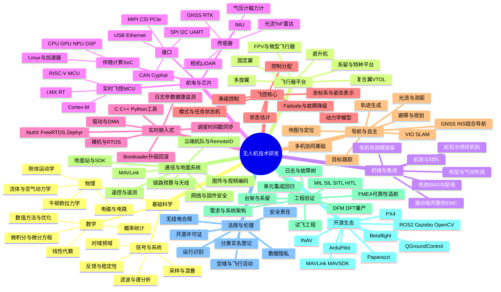
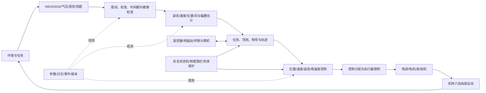
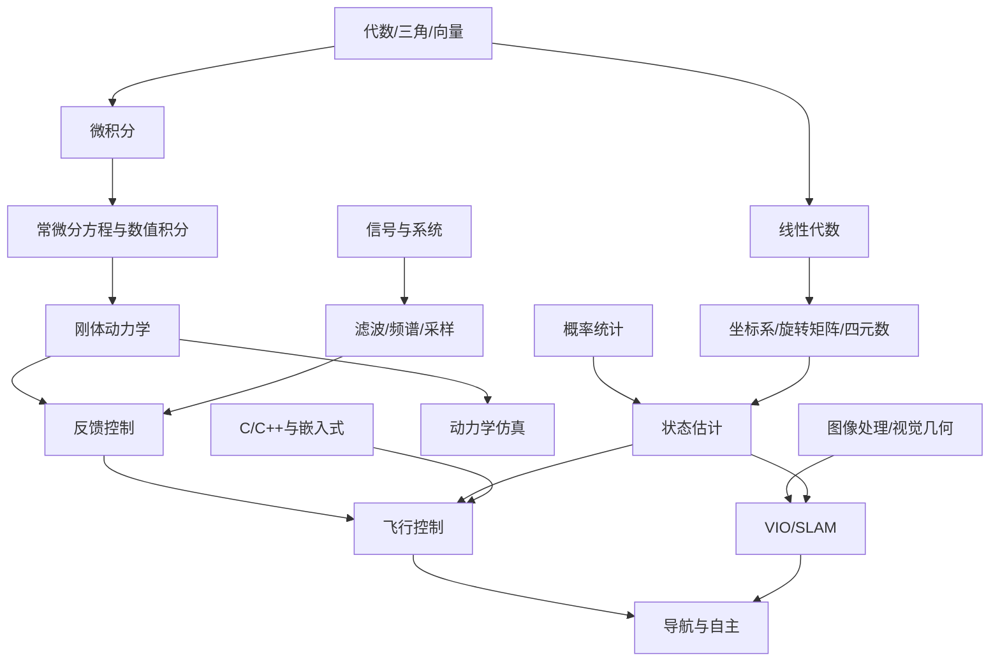

# 无人机技术研发知识图谱总览

> 目标：把“学什么、为什么学、先学什么、最终落到哪个研发对象”放到同一张图中。<br>
> 阅读提示：知识图谱不是课程目录。一个节点是否掌握，要通过计算、仿真、台架、日志或试飞证据验证。

## 一、顶层知识图谱



## 二、从物理世界到任务结果的数据闭环



这条链中任一处的单位、方向、时间基准或有效性错误，都会被后续模块当作“真实世界”处理。例如：IMU 安装方向错会表现为控制方向错；相机时间戳漂移会表现为 VIO 发散；电机饱和会让积分器继续累积；GNSS 多径会让位置环追逐不存在的位移。

## 三、必备基础的依赖关系



### 3.1 最低数学门槛

| 模块       | 必须掌握                         | 典型无人机应用          | 入门完成证据               |
| :--------- | :------------------------------- | :---------------------- | :------------------------- |
| 向量与矩阵 | 点乘、叉乘、矩阵乘法、逆、特征值 | 力矩、坐标变换、稳定性  | 手算并用代码验证三轴旋转   |
| 微积分     | 导数、积分、链式法则、线性化     | 速度/加速度、模型雅可比 | 从状态方程完成一步数值积分 |
| 微分方程   | 一二阶系统、状态空间             | 电机、姿态和位置动态    | 比较欧拉法与 RK 方法误差   |
| 概率统计   | 均值、方差、协方差、高斯分布     | 传感器噪声、融合权重    | 从静态 IMU 数据估计噪声    |
| 数值优化   | 最小二乘、约束、梯度直觉         | 标定、轨迹优化、视觉    | 完成带异常值的最小二乘实验 |

## 四、研发对象分层

### 4.1 机载实时飞控

硬实时或准硬实时系统，负责传感器采集、状态估计、控制、混控、模式、故障保护和最基本的通信。其首要指标不是峰值算力，而是确定性、低延迟、可诊断和失效后仍安全。

### 4.2 伴随计算机

通常运行 Linux，处理相机、深度、AI、SLAM、复杂规划、任务脚本或高带宽通信。伴随计算机可以提出期望轨迹，但应由实时飞控执行最后的稳定与安全约束。Linux 卡顿或 AI 崩溃时，飞行器仍应悬停、返航或受控降落。

### 4.3 地面站与遥控端

负责配置、任务规划、遥测显示、媒体管理、升级和运维。地面站不是安全底线：失联后机载系统必须有独立决策能力。

### 4.4 云端与机队系统

负责账号、设备、任务、航线、数据、远程运维、审计与监管接口。云端命令必须鉴权、授权、审计、限速，并能处理网络分区和重复消息。

## 五、机型知识分支

| 机型          | 核心控制量             | 关键优势                 | 特有难点                   | 适合的入门顺序       |
| :------------ | :--------------------- | :----------------------- | :------------------------- | :------------------- |
| 多旋翼        | 各旋翼推力/转速        | 垂直起降、悬停、机械简单 | 能耗高、失去推力后滑翔差   | 最适合学习闭环与自主 |
| 固定翼        | 油门、升降/副翼/方向舵 | 高效率、长航时           | 起降、失速、配平、空速依赖 | 掌握基础飞控后进入   |
| 直升机        | 总距、周期变距、尾桨   | 悬停与较高效率           | 机械复杂、强耦合、振动     | 不建议作为第一平台   |
| 复合翼 VTOL   | 旋翼与舵面协同         | 兼顾垂起与巡航           | 转换段、冗余、控制分配     | 进阶系统工程项目     |
| 穿越/竞速 FPV | 高频角速度控制         | 机动、低时延             | 抗振、滤波、操控风险       | 有安全场地后学习     |
| 微型室内机    | 小型电机与姿态控制     | 低能量、便于实验         | 载荷与算力极受限、地效明显 | 安全入门硬件平台之一 |

## 六、芯片和硬件知识图谱

### 6.1 不要用“型号记忆”代替架构判断

```text
任务需求
  ├─ 控制周期/最坏延迟 ──> MCU 性能、FPU/DSP、RAM、DMA、RTOS
  ├─ 传感器数量与速率 ──> SPI/I²C/UART/CAN、时间戳、缓存
  ├─ 视觉与 AI 吞吐 ────> SoC、ISP、GPU/NPU、内存带宽、MIPI/PCIe
  ├─ 安全与可靠性 ──────> 看门狗、ECC、双电源、冗余 IMU、Secure Boot
  ├─ 功耗与散热 ────────> 工艺、电源树、DVFS、热路径、降频策略
  └─ 软件生态与生命周期 ─> BSP、主线支持、文档、供货、许可证、社区
```

### 6.2 芯片角色

| 角色             | 常见类别                     | 主要任务                        | 选型重点                        |
| :--------------- | :--------------------------- | :------------------------------ | :------------------------------ |
| 实时飞控 MCU     | STM32F4/F7/H7、i.MX RT 等    | 高频采样、估计、控制、Failsafe  | 确定性、RAM、总线、定时器、生态 |
| 安全/IO MCU      | 小型 Cortex-M、车规 MCU      | PWM/DSHOT、RC、看门狗、电源管理 | 独立性、启动快、故障隔离        |
| 伴随计算 SoC     | ARM Cortex-A、x86、异构 SoC  | 视觉、AI、SLAM、规划、视频      | 内存带宽、ISP/NPU、功耗、BSP    |
| 无线/基带芯片    | Wi-Fi/专用链路/蜂窝/LPWAN    | 控制、遥测、图传、云连接        | 法规、时延、抗干扰、天线        |
| 传感器专用芯片   | IMU、气压、磁力、GNSS、ToF   | 物理量测量                      | 噪声、温漂、带宽、同步、抗振    |
| 电源与执行器芯片 | PMIC、BMS AFE、栅极驱动、MCU | 供电、保护、电机换相            | 瞬态、效率、热、故障状态        |

## 七、软件知识图谱

| 层        | 典型对象                             | 必须理解的核心问题                       |
| :-------- | :----------------------------------- | :--------------------------------------- |
| Boot/板级 | Bootloader、BSP、时钟、电源、内存    | 如何启动、如何恢复、如何安全升级         |
| 驱动      | IMU/GNSS/Baro/RC/ESC/存储            | 数据何时产生、单位是什么、是否完整有效   |
| 中间件    | uORB、消息总线、参数、日志、时间同步 | 生产者消费者、队列、丢包、优先级和版本   |
| 估计控制  | EKF、姿态/位置控制、分配器           | 状态可观性、延迟、饱和、稳定裕度         |
| 导航任务  | 航点、返航、地理围栏、任务状态机     | 谁拥有控制权、模式如何切换、异常如何退出 |
| 伴随计算  | ROS 2、MAVSDK、OpenCV、AI runtime    | 非实时结果如何安全地进入实时闭环         |
| 地面与云  | QGC、App、设备云、OTA                | 鉴权、兼容、审计、断网和回滚             |

## 八、岗位能力地图

| 岗位方向   | 必修节点                     | 强相关节点             | 首个代表性作品                   |
| :--------- | :--------------------------- | :--------------------- | :------------------------------- |
| 飞控算法   | 刚体动力学、控制、估计、日志 | 系统辨识、优化、执行器 | 仿真串级控制器及故障注入报告     |
| 嵌入式飞控 | C/C++、RTOS、驱动、时间同步  | PCB、电源、启动升级    | IMU 驱动 + 时间戳 + 数据质量测试 |
| 航电硬件   | 电路、电源、EMC、传感器、PCB | 飞控软件、热、可靠性   | 飞控最小系统与电源/噪声测试报告  |
| 自主导航   | 概率、估计、视觉、规划       | ROS 2、GPU/NPU、标定   | 仿真 VIO/避障闭环及失效处理      |
| 通信图传   | RF、网络、编码、链路预算     | 天线、实时协议、安全   | 可复现的时延/丢包/距离测试       |
| 结构动力   | 力学、材料、旋翼、电机、电池 | 振动、热、控制         | 推力台数据与结构模态/振动分析    |
| 系统测试   | 架构、状态机、日志、FMEA     | 所有专业接口           | 需求追踪矩阵 + SITL/HIL 回归套件 |
| 产品系统   | 任务场景、权衡、法规、量产   | 软件硬件全链           | 系统架构、预算表和验收标准       |

## 九、最容易漏掉但最关键的横向知识

1. **时间**：传感器时间戳、时钟漂移、曝光中点、通信往返时延和日志时间基准。
2. **坐标系**：ENU/NED、机体系、相机系、云台系、传感器安装方向和外参版本。
3. **单位**：度/弧度、g/m·s⁻²、Pa/hPa、m/mm、真高/海拔、磁北/真北。
4. **有效性**：每个数据都应带状态、方差、年龄、来源和超时规则。
5. **饱和**：电机、舵机、带宽、CPU、存储、无线链路和热设计都会饱和。
6. **版本**：固件、参数、机架、桨、电机、标定和地面站必须能形成可复现实验快照。
7. **失效模式**：安全不能只写“异常返航”，必须定义定位不可信、航向不可信、电量不足、执行器故障和失联时的不同策略。

## 十、知识图谱的完成判据

完成入门阶段时，应能独立回答以下问题：

- 为什么四旋翼需要高速闭环才能稳定，固定翼却可在一定条件下滑翔？
- IMU 的带宽、采样率、数字低通和控制器频率如何相互影响？
- 为什么 MCU 性能足够仍可能因 DMA、缓存或优先级导致飞控抖动？
- 为什么 EKF 的“数值没发散”不等于状态可信？
- GNSS、气压计、磁力计、光流和 VIO 各自可观测什么，在哪些环境下失效？
- 电机达到最大输出后，积分器和控制分配器应如何处理？
- 为什么伴随计算机不能直接替代实时飞控的安全底线？
- 如何从需求建立 MIL→SIL/SITL→HIL→台架→系留→开放场试飞的证据链？
- 开源许可证、法规、运行识别和无线电要求会怎样影响产品架构？
